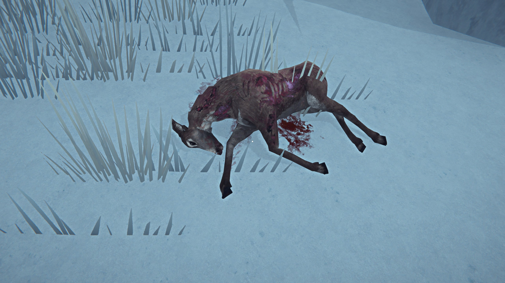

# Ravaged Deer Remains

**Categories:** Interactable Objects, Story items · **Source:** [Fandom](https://thelongdark.fandom.com/wiki/Ravaged_Deer_Remains)

**Ravaged Deer Remains**

**General**

**Item Type:** Item

**Wintermute:** Yes A **Ravaged Deer Remains** is an "object" found within [Cougar](./Cougar.md) Territory.

## Overview

These carcassses serve as a warning that the player is close to a Cougar's territory. They cannot be harvested for any usable meat/hide/gut, but [Crows](./Crow.md) will fly around a Ravaged Deer Carcass.

There will only be one or two Crows flying around at a time to reflect how little meat is left on the carcass, and they occasionally drop 1-2 [Crow Feathers](./Crow%20Feather.md).
