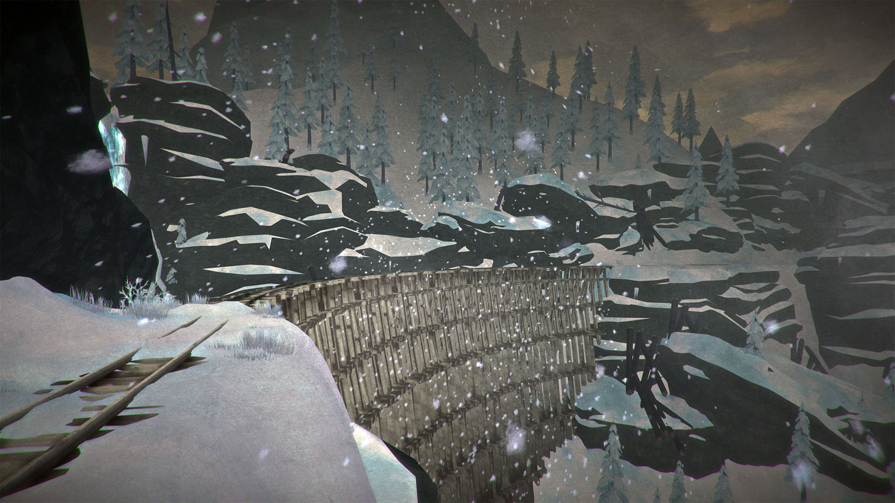
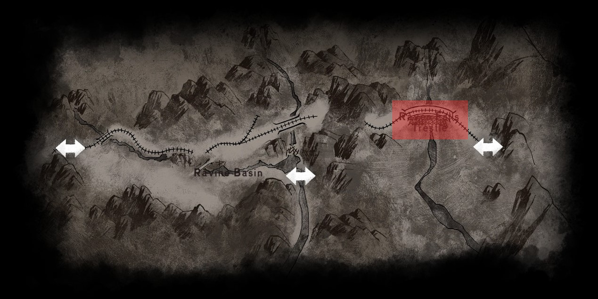

# Raven Falls Trestle

**Raven Falls Trestle**

| Property | Details |
| --- | --- |
|  |  / *Trestle at Ravine's End* |
| **Location** |  |
|  |  / *Raven\_Falls\_Trestle\_Location.png* |
| Region | [The Ravine](./The%20Ravine.md)\|- |
| Description | A partially damaged wooden train trestle. |
| **General** |  |
| Type | Industrial\|- |
