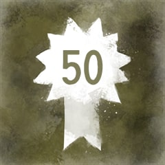

# Ready for when the SHTF\!

**Categories:** Achievements · **Source:** [Fandom](https://thelongdark.fandom.com/wiki/Ready_for_when_the_SHTF!)

**Ready for when the SHTF!**

| Property | Details |
| --- | --- |
|  |  / _Ready\_for\_when\_the\_SHTF!\_icon.png_ |
| Description | You survived 50 days in a single Survival mode game. |

**Ready for when the SHTF!** is an [achievement](./The%20Long%20Dark%20%E2%80%94%20Achievements.md) in _[The Long Dark](./The%20Long%20Dark.md)_.

## Guide

This achievement is obtained after surviving for fifty whole days in a single [Survival Mode](./Survival%20Mode.md) game mode. It is most easily done on Pilgrim.
