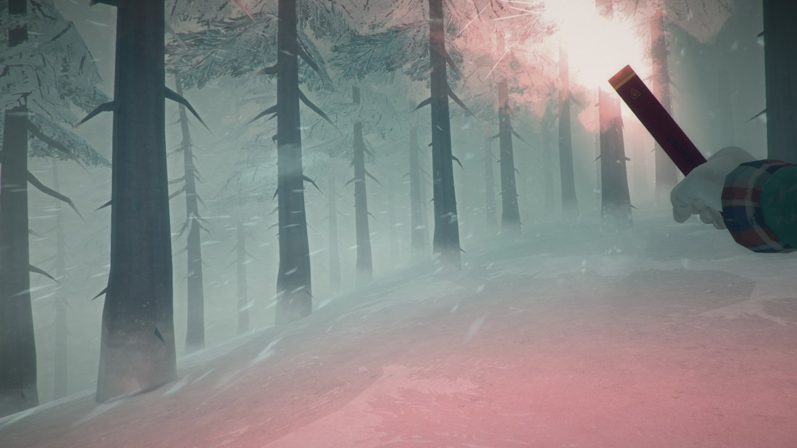

# Realism

**Source:** [Fandom](https://thelongdark.fandom.com/wiki/Realism)

**Contents**

- [Basic human needs](#basic-human-needs)
- [Environment](#environment)
- [Geomagnetic disaster](#geomagnetic-disaster)
- [Time](#time)
- [Specificity](#specificity)
- [Player skills](#player-skills)

> “**We're more interested in making the game compelling, than we are in making it realistic. When the two are compatible, we embrace both.**”
>
> — Hinterland, 2015

In _[The Long Dark](./The%20Long%20Dark.md)_, besides the core survival [mechanics](./Needs.md) there are also anomalies created by [geomagnetic disaster](./First%20Flare.md) which immerse the player to alternate reality. The game stays true to this fiction and therefore is realistic in the merit of it. Some other aspects of the game can also be considered realistic because the game communicates realism to the player through computer interface and so most of the game mechanics has to be specific - like the [Condition Bar](./Condition.md) that represents player's health from 0 to 100%.

**Minor SPOILER ALERT**

This game is constantly tuned to create interesting gameplay and not to conform to real-world expectations. Thus a new player could, after reading this article, be less surprised of the way things work in game both in possibly a positive or a negative way - depending on the type of player.

## Basic human needs

The core gameplay in _[The Long Dark](./The%20Long%20Dark.md)_ can be said to be based on the lowest level of Maslow's hierarchy of needs - food, water, warmth and rest. Other needs, such as [safety](./Safehouse.md) and love needs (only [story](./Wintermute.md) mode), are not directly measured in the game's interface (with exception of somewhat related to love - trust in the story mode) but instead meant for the player to experience individually. The deprivation of the measured needs leads to the player loosing overall Condition and ultimately death. Both the basic 4 needs as well as condition directly can be affected by many [Afflictions](./Afflictions.md).

Things worth noting:

- There is currently no mechanic that would let the player partly satisfy his [Warmth](./Warmth.md) need by moving or shivering (movement does however affect calorie burn and [Fatigue](./Fatigue.md))
- The player can die of starvation in about 4 game days if all other needs are satisfied (which could mean that the game simply does not include the mechanic which lets human body break down its proteins and fat)
- Drinking water to satisfy the thirst need from toilet bowls does not carry any risk of [Dysentery](./Dysentery.md) or [Food Poisoning](./Food%20Poisoning.md).

## Environment

The game's environment graphics were created by choice to be of artistic style instead of photorealistic. The Long Dark environment features such realistic features as rising and setting sun and moon, wind that affects the player and fires, snow that can make clothes wet, fog that limits visibility for both the player and wildlife.

Notable departures from the real world:

- Some players noticed that, more often than it would occur naturally, the wind changes direction to oppose the player's movement or blow out fires that are protected from the wind. Whether or not this is actually true remains a speculation.
- Not all water surfaces freezes even in very low temperatures resulting in constant weak ice in some areas. Note also that the player can fall through weak ice where at the same exact place heavier than player [bears](./Bear.md) and other animals do not fall through.

### Geomagnetic disaster

The Long Dark is set in a universe after huge [geomagnetic disaster](./Aurora.md) with some of after effects still felt in the present game time. There also apparently have been major earthquakes which rendered roads and railroads collapsed and useless. This said universe is different from the real world in the following ways:

- Wolves will attack the player even if not provoked (except on Pilgrim difficulty)
- Most electronics function during an aurora event - lights flicker, computers display emails. Otherwise, without an aurora, they are useless.
- During an aurora some animals will have a glowing body (a mini aurora around them)

## Time

_Normal flare. It lasts for 5 real-time minutes_ The time in game runs 12 times faster than real time. The game developers were therefore at liberty to decide if some actions should run in real-time, game-time or somewhere in between (because it does not break immersion either way).

- Time of day changes according to game-time (and is one of the biggest selling points of the game)
- [Cooking](./Cooking.md) times adhere to game-time.
- [Fire](./Fire.md) duration adhere to game-time (note also that having the same wood, fires last longer outdoors instead of indoors)
- [Flare](./Flare.md)'s burn time relates to the real time (5min of real time for a normal flare and 2.5min for a [marine flare](./Marine%20Flare.md)) obviously because 1min burn time of a typical real world flare converted to the game time would constitute only 5 seconds of the real time.
- [Storm Lantern](./Storm%20Lantern.md)'s burn time relates to game-time - fully refueled it burns for about 4 game hours. Note however that fuel efficiency of a storm lantern is at least 10x less efficient than real world equivalent even when measured in game-time.
- [Warmth](./Warmth.md) depletion for the player appears to be more related to game-time (however it varies by difficulty level so it can also be somewhere in between on the lowest difficulty)
- [Fatigue](./Fatigue.md) is tightly tied with game-time as from it the possibility to sleep is derived (note also that there is no problem of falling asleep even right after 8-hour sleep night, as long as the player has some fatigue left).
- The [decay](./Decay.md) of food and clothes is mostly even faster than game-time but it varies by the level of difficulty chosen (in Pilgrim mode things decay somewhat realistically when measured in game-time). Note that frozen meat even in very low temperatures and low difficulty levels [decays](./Decay.md) in a matter of days.

Time can be further accelerated by engaging in activities such as chopping wood, fishing, repairing, crafting, forging, sleeping or just passing time. Eating is almost instant - it takes only very little time whether measured by game-time or real-time. In Custom Mode - time can be set to run slower, but there is no way to make the time run at real-time.

## Specificity

Most events in the player's survival experience are explicit, immediate and constant:

- Drinking drugs or medicinal teas will have immediate affect and will only apply to the area specified by the player (not to the whole body).
- After the player's [warmth](./Warmth.md) bar empties - he begins to loose condition at a specific constant rate regardless of temperature that surrounds him.
- All of afflictions end abruptly. For example, when [Warming Up](./Warming%20Up.md) effect expires the player immediately looses some of his feel like temperature (note that the player cannot get warming up effect from drinking hot water, only hot teas)
- Temperatures of all inside locations are constant (it does not change in any way with surrounding weather changing) and will only have its temperature temporary increased while a fire is going inside of it. Once the last embers are gone - the temperature will drop to predefined constant (it will not maintain heat accumulated from the fire in the air or walls). Note also that embers take only a few game-time minutes to completely burn out.

Notable exception is carrying capacity lost due to [fatigue](./Fatigue.md). The two are somewhat gradually related.

## Player skills

The player can acquire skills that speed up or make some actions more efficient. In addition some skill levels appear to somewhat change in-game reality instead of affecting only the player himself:

- The animal bleed out times are reduced depending on the skill level of [Archery](./Archery.md) (one might argue however that the wounds inflicted by a skilled archer are greater). Note also that bleeding from more than one wound doesn't stack, in other words it would be the same if animals bled only from the latest wound.
- The player can harvest 100% frozen carcass by hand (without any tool) when reached [Carcass Harvesting](./Carcass%20Harvesting.md) level 5.
- The player can safely eat meat without the risk of [intestinal parasites](./Intestinal%20Parasites.md) or [food poisoning](./Food%20Poisoning.md) when [level 5 cooking](./Cooking.md) is achieved (even if the food was prepared before the player got the skill, which therefore some players jokingly call an eating skill). Also a player with higher cooking skill gets more calories from any cooked item.
- The fires last longer depending on [Fire Starting](./Fire%20Starting.md) skill while other factors are equal. Also note that with any skill level it is possible to light a fire with [magnifying lens](./Magnifying%20Lens.md) in a shadow (of a building, cliff etc.).
- The player catches more fish within the same time depending on [Ice Fishing](./Ice%20Fishing.md) skill (despite the equipment being the same).
- The damage from rifle shots is increased with [Rifle Firearm](./Rifle%20Firearm.md) skill, same with [Revolver Firearm](./Revolver%20Firearm.md) skill.
- Even with highest [sharpening](./Sharpening.md) skill, [whetstone](./Whetstone.md) can be used to sharpen tools for only about 20 times before rendered useless.
