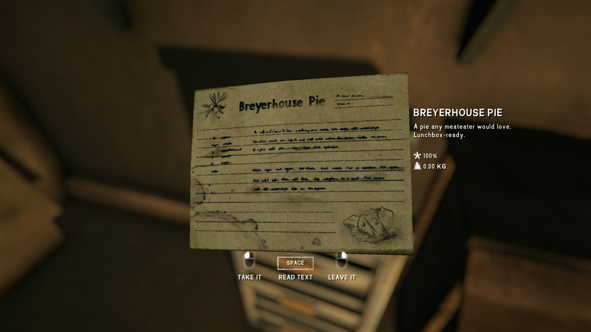
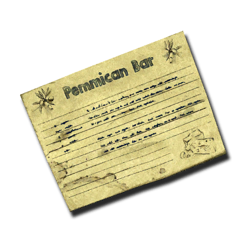
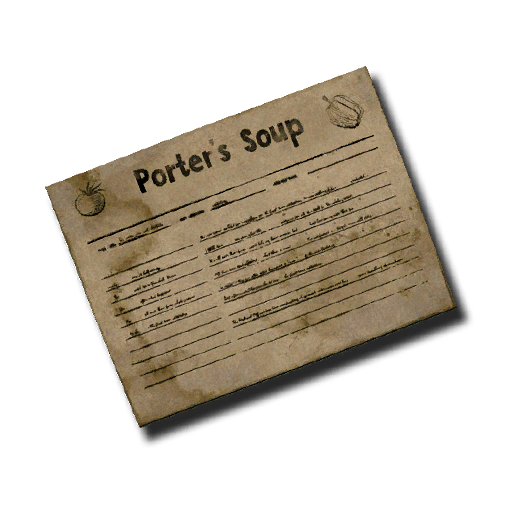
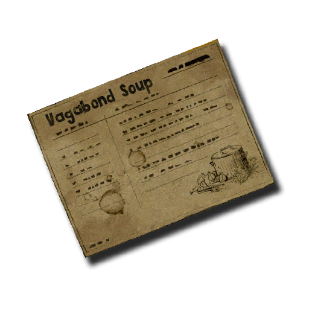
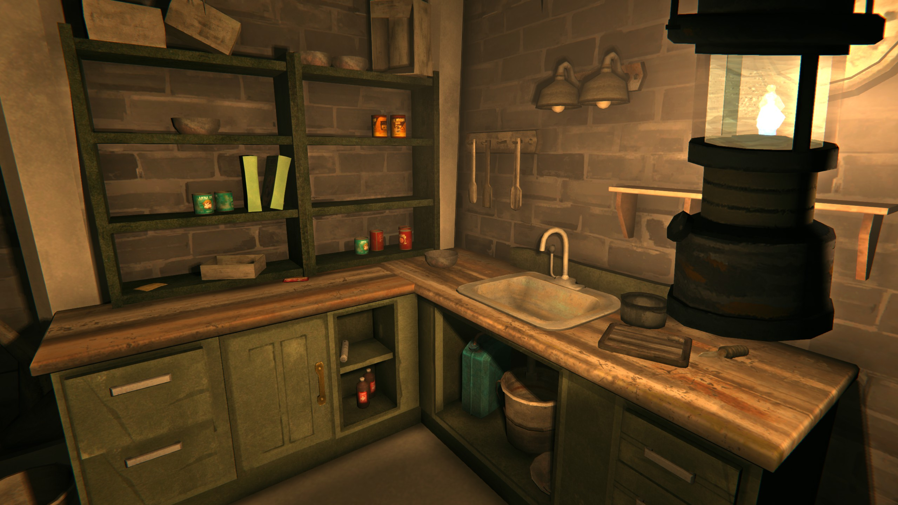

# Recipe Cards

**Categories:** Collectibles, DLC Content, Pages with update history · **Source:** [Fandom](https://thelongdark.fandom.com/wiki/Recipe_Cards)

_Ptarmigan\_icon.png_

**DLC-Exclusive content.** / This content requires the [Tales from the Far Territory](./Tales%20from%20the%20Far%20Territory.md) addon to be installed before it can be seen or used in regular gameplay.

\|} {\| style="margin:auto"

“

**Recipe Cards with details on unique and potent Great Bear Island dishes.** / Collectibles Description

”

**Recipe Cards** are a [Collectible](./Collectibles.md) found in [Survival Mode](./Survival%20Mode.md) that unlock a unique Cooking Recipe. They were introduced in the Part 3 Frontier Cooking update for players that bought the [Tales from the Far Territory](./Tales%20from%20the%20Far%20Territory.md) addon.

There are currently 13 Recipe Cards that are found in certain places across the Island. Collected cards are recorded in the [Survival Menu](./Survival%20Menu.md) under the Collectibles section of the [Journal](./Journal.md) menu, and show up as aWhite Star recipe in the Cooking Recipes menu.

Cards usually spawn at the same location/building, but the exact locations within their areas changes between saves. 4 cards can only be acquired by trading with the [Trader](./Trader.md), who must be enabled on a save file in order to gain the cards.

&lt;table-progress-tracking table-id="1" unique-column-index="2"&gt;

Image

Recipe Name

Cooking Level

Region

Location

_Recipe\_Card\_(Breyerhouse\_Pie)\_icon.png_

[Breyerhouse Pie](./Breyerhouse%20Pie.md)

5

[Broken Railroad](./Broken%20Railroad.md)

[Hunting Lodge](./Hunting%20Lodge.md) / - In the basement, atop a [Vegetable Rack](./Vegetable%20Rack.md) / - Between the mattresses in the upstairs room opposite the bathroom / - On the nightstand table next to the [Stove](./Stove.md)

_Recipe\_Card\_(Camber\_Flight\_Porridge)\_icon.png_

[Camber Flight Porridge](./Camber%20Flight%20Porridge.md)

4

[Forsaken Airfield](./Forsaken%20Airfield.md)

[Main Hanger](./Main%20Hangar.md) kitchen / - On the table left side of the room / - Under the Microwave cabinet shelf on the right side of the room

_Recipe\_Card\_(Coastal\_Fishcakes)\_icon.png_

[Coastal Fishcakes](./Coastal%20Fishcakes.md)

5

[Desolation Point](./Desolation%20Point.md)

[Lonely Lighthouse](./Lonely%20Lighthouse.md) / - Pinned to a board on the wall above the [Buffer Memories](./Buffer%20Memories.md) computer / - Underneath the yellow lockers on the 3rd floor / - On the final step of the 4th floor before exiting outside

_Recipe\_Card\_(Dockworker's\_Pie)\_icon.png_

[Dockworker's Pie](./Dockworker%27s%20Pie.md)

5

[Bleak Inlet](./Bleak%20Inlet.md)

Last Resort Cannery [Workshop](./Workshop.md) / - On the counter by the sink / - Inside the lockers in the break room

_Recipe\_Card\_Soup\_Potato.png_

[Last Resort Soup](./Last%20Resort%20Soup.md)

1

[Trader](./Trader.md)

This recipe is acquired through a trade.

_Recipe\_Card\_(Lily's\_Pancakes)\_icon.png_

[Lily's Pancakes](./Lily%27s%20Pancakes.md)

4

[Mountain Town](./Mountain%20Town.md)

In [Milton House (Grey Mother's)](./Milton%20House%20%28Grey%20Mother%27s%29.md) / - Atop the left table in the kitchen. / - On the cabinet behind the fireplace, partially hidden by the picture frame. / - On the shelf in the upstairs storage room.

_Recipe\_Card\_Pemmican\_Bar.png_

[Pemmican Bar](./Pemmican%20Bar.md)

5

[Trader](./Trader.md)

This recipe is acquired through a trade.

_Recipe\_Card\_Soup\_Ptarmigan.png_

[Porter's Soup](./Porter%27s%20Soup.md)

4

[Trader](./Trader.md)

This recipe is acquired through a trade.

_Recipe\_Card\_(Prepper's\_Pie)\_icon.png_

[Prepper's Pie](./Prepper%27s%20Pie.md)

5

Random Prepper Cache

Inside a [Prepper Cache](./Prepper%20Cache.md) / - In the "Stockpile" Prepper Cache / - In a carboard box in an Abandoned Prepper Cache with a Corpse (Interloper/Misery only)

_Recipe\_Card\_(Ranger\_Stew)\_icon.png_

[Ranger Stew](./Ranger%20Stew.md)

4

[Ash Canyon](./Ash%20Canyon.md)

[Foreman's Retreat](./Foreman%27s%20Retreat.md) / - On the floor under the table left of the door

_Recipe\_Card\_(Stalker's\_Pie)\_icon.png_

[Stalker's Pie](./Stalker%27s%20Pie.md)

5

[Hushed River Valley](./Hushed%20River%20Valley.md)

On one of three possible frozen corpses in Hushed River Valley (see image below)

_Recipe\_Card\_(Thomson\_Family\_Stew)\_icon.png_

[Thomson Family Stew](./Thomson%20Family%20Stew.md)

4

[Pleasant Valley](./Pleasant%20Valley.md)

Thomson's Crossing [Community Hall](./Community%20Hall.md) / - On the open counter in the kitchen / - On the middle shelf next to the back door / - On the desk in the office

_Recipe\_Card\_Rabbit\_Soup.png_

[Vagabond Soup](./Vagabond%20Soup.md)

1

[Trader](./Trader.md)

This recipe is acquired through a trade.

&lt;/table-progress-tracking&gt;

## Gallery

_The location of the Stalker's Pie Card_

_Prepper's Pie Card in the Kitchen Prepper cache (left side counter)_

_Ditto_

_Prepper's Pie recipe card (on Interloper and Misery)_

_Orca Bar Recipe Card (Formerly used for Pemmican Bar)_

## Game History

- UPDATE **21 June 2023 ([Update](./The%20Long%20Dark%20%E2%80%94%20Changelog.md#2.17)):**
  - Added to game.
