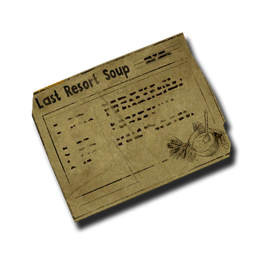
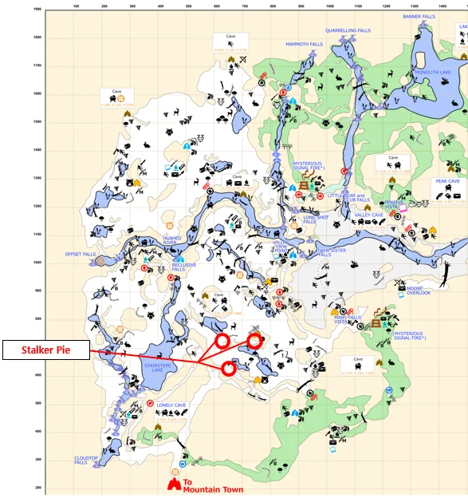
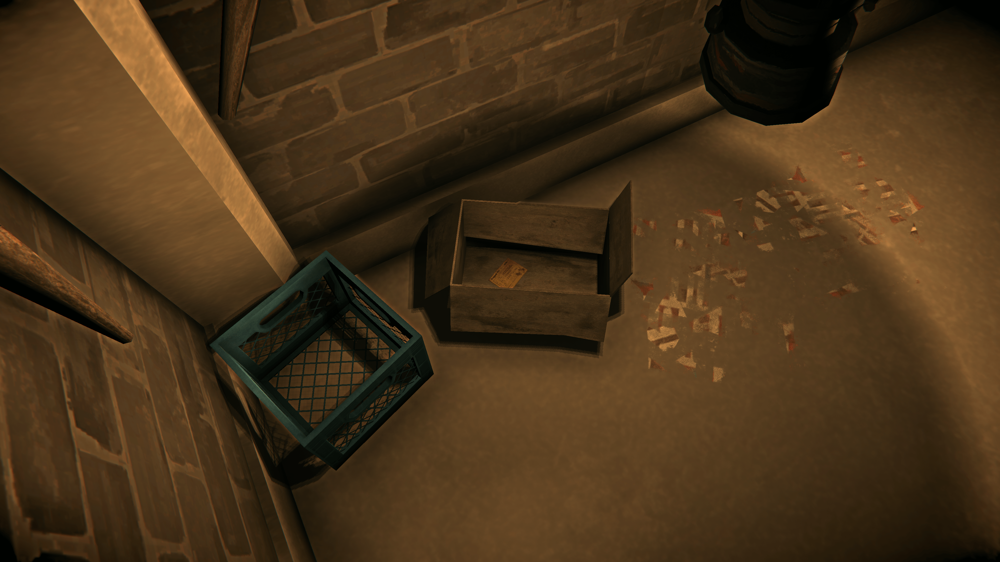
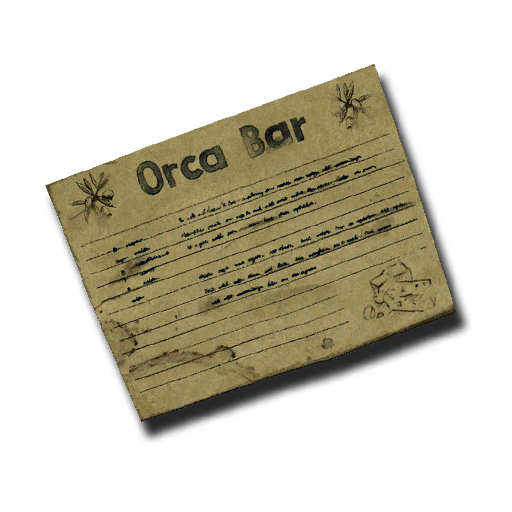

# Recipe Cards

<table style="width:100%;">
<colgroup>
<col style="width: 16%" />
<col style="width: 16%" />
<col style="width: 16%" />
<col style="width: 16%" />
<col style="width: 16%" />
<col style="width: 16%" />
</colgroup>
<tbody>
<tr>
<td width="40px"><figure>
[Missing image: Ptarmigan_icon.png]
<figcaption>Ptarmigan_icon.png</figcaption>
</figure></td>
<td>
<strong>DLC-Exclusive content.</strong> 

This content requires the <a href="./Tales%20from%20the%20Far%20Territory.md" class="wikilink" title="Tales from the Far Territory">Tales from the Far Territory</a> addon to be installed before it can be seen or used in regular gameplay.

</td>
<td>
|} [Missing image: Recipe_Card.jpg]{| style="margin:auto"
</td>
<td style="vertical-align: top; font-size: 3em; color: #5d5980; padding-right: 10px">
“
</td>
<td>
Recipe Cards with details on unique and potent Great Bear Island dishes.

&#10;

Collectibles Description

</td>
<td style="vertical-align: bottom; font-size: 3em; color: #5d5980; padding-left: 10px">
”
</td>
</tr>
</tbody>
</table>

**Recipe Cards** are a <a href="./Collectibles.md" class="wikilink" title="Collectible">Collectible</a> found in <a href="./Survival%20Mode.md" class="wikilink" title="Survival Mode">Survival Mode</a> that unlock a unique Cooking Recipe. They were introduced in the Part 3 Frontier Cooking update for players that bought the <a href="./Tales%20from%20the%20Far%20Territory.md" class="wikilink" title="Tales from the Far Territory">Tales from the Far Territory</a> addon.

There are currently 13 Recipe Cards that are found in certain places across the Island. Collected cards are recorded in the <a href="./Survival%20Menu.md" class="wikilink" title="Survival Menu">Survival Menu</a> under the Collectibles section of the <a href="./Journal.md" class="wikilink" title="Journal">Journal</a> menu, and show up as aWhite Star recipe in the Cooking Recipes menu.

Cards usually spawn at the same location/building, but the exact locations within their areas changes between saves. 4 cards can only be acquired by trading with the <a href="./Trader.md" class="wikilink" title="Trader">Trader</a>, who must be enabled on a save file in order to gain the cards.

\<table-progress-tracking table-id="1" unique-column-index="2"\>

<table>
<colgroup>
<col style="width: 20%" />
<col style="width: 20%" />
<col style="width: 20%" />
<col style="width: 20%" />
<col style="width: 20%" />
</colgroup>
<thead>
<tr>
<th>
Image
</th>
<th>
Recipe Name
</th>
<th style="text-align: center;">
Cooking Level
</th>
<th>
Region
</th>
<th>
Location
</th>
</tr>
</thead>
<tbody>
<tr>
<td><figure>

<figcaption>Recipe_Card_(Breyerhouse_Pie)_icon.png</figcaption>
</figure></td>
<td>
<a href="./Breyerhouse%20Pie.md" class="wikilink" title="Breyerhouse Pie">Breyerhouse Pie</a>
</td>
<td style="text-align: center;">
5
</td>
<td>
<a href="./Broken%20Railroad.md" class="wikilink" title="Broken Railroad">Broken Railroad</a>
</td>
<td>
<a href="./Hunting%20Lodge.md" class="wikilink" title="Hunting Lodge">Hunting Lodge</a>

<ul>
<li>In the basement, atop a <a href="./Vegetable%20Rack.md" class="wikilink" title="Vegetable Rack">Vegetable Rack</a></li>
<li>Between the mattresses in the upstairs room opposite the bathroom</li>
<li>On the nightstand table next to the <a href="./Stove.md" class="wikilink" title="Stove">Stove</a></li>
</ul></td>
</tr>
<tr>
<td><figure>

<figcaption>Recipe_Card_(Camber_Flight_Porridge)_icon.png</figcaption>
</figure></td>
<td>
<a href="./Camber%20Flight%20Porridge.md" class="wikilink" title="Camber Flight Porridge">Camber Flight Porridge</a>
</td>
<td style="text-align: center;">
4
</td>
<td>
<a href="./Forsaken%20Airfield.md" class="wikilink" title="Forsaken Airfield">Forsaken Airfield</a>
</td>
<td>
<a href="./Main%20Hangar.md" class="wikilink" title="Main Hanger">Main Hanger</a> kitchen

<ul>
<li>On the table left side of the room</li>
<li>Under the Microwave cabinet shelf on the right side of the room</li>
</ul></td>
</tr>
<tr>
<td><figure>

<figcaption>Recipe_Card_(Coastal_Fishcakes)_icon.png</figcaption>
</figure></td>
<td>
<a href="./Coastal%20Fishcakes.md" class="wikilink" title="Coastal Fishcakes">Coastal Fishcakes</a>
</td>
<td style="text-align: center;">
5
</td>
<td>
<a href="./Desolation%20Point.md" class="wikilink" title="Desolation Point">Desolation Point</a>
</td>
<td>
<a href="./Lonely%20Lighthouse.md" class="wikilink" title="Lonely Lighthouse">Lonely Lighthouse</a>

<ul>
<li>Pinned to a board on the wall above the <a href="./Buffer%20Memories.md" class="wikilink" title="Buffer Memories">Buffer Memories</a> computer</li>
<li>Underneath the yellow lockers on the 3rd floor</li>
<li>On the final step of the 4th floor before exiting outside</li>
</ul></td>
</tr>
<tr>
<td><figure>

<figcaption>Recipe_Card_(Dockworker's_Pie)_icon.png</figcaption>
</figure></td>
<td>
<a href="./Dockworker%27s%20Pie.md" class="wikilink" title="Dockworker&#39;s Pie">Dockworker's Pie</a>
</td>
<td style="text-align: center;">
5
</td>
<td>
<a href="./Bleak%20Inlet.md" class="wikilink" title="Bleak Inlet">Bleak Inlet</a>
</td>
<td>
Last Resort Cannery <a href="./Workshop.md" class="wikilink" title="Workshop">Workshop</a>

<ul>
<li>On the counter by the sink</li>
<li>Inside the lockers in the break room</li>
</ul></td>
</tr>
<tr>
<td><figure>

<figcaption>Recipe_Card_Soup_Potato.png</figcaption>
</figure></td>
<td>
<a href="./Last%20Resort%20Soup.md" class="wikilink" title="Last Resort Soup">Last Resort Soup</a>
</td>
<td style="text-align: center;">
1
</td>
<td>
<a href="./Trader.md" class="wikilink" title="Trader">Trader</a>
</td>
<td>
This recipe is acquired through a trade.
</td>
</tr>
<tr>
<td><figure>

<figcaption>Recipe_Card_(Lily's_Pancakes)_icon.png</figcaption>
</figure></td>
<td>
<a href="./Lily%27s%20Pancakes.md" class="wikilink" title="Lily&#39;s Pancakes">Lily's Pancakes</a>
</td>
<td style="text-align: center;">
4
</td>
<td>
<a href="./Mountain%20Town.md" class="wikilink" title="Mountain Town">Mountain Town</a>
</td>
<td>
In <a href="./Milton%20House%20%28Grey%20Mother%27s%29.md" class="wikilink" title="Milton House (Grey Mother&#39;s)">Milton House (Grey Mother's)</a>

<ul>
<li>Atop the left table in the kitchen.</li>
<li>On the cabinet behind the fireplace, partially hidden by the picture frame.</li>
<li>On the shelf in the upstairs storage room.</li>
</ul></td>
</tr>
<tr>
<td><figure>

<figcaption>Recipe_Card_Pemmican_Bar.png</figcaption>
</figure></td>
<td>
<a href="./Pemmican%20Bar.md" class="wikilink" title="Pemmican Bar">Pemmican Bar</a>
</td>
<td style="text-align: center;">
5
</td>
<td>
<a href="./Trader.md" class="wikilink" title="Trader">Trader</a>
</td>
<td>
This recipe is acquired through a trade.
</td>
</tr>
<tr>
<td><figure>

<figcaption>Recipe_Card_Soup_Ptarmigan.png</figcaption>
</figure></td>
<td>
<a href="./Porter%27s%20Soup.md" class="wikilink" title="Porter&#39;s Soup">Porter's Soup</a>
</td>
<td style="text-align: center;">
4
</td>
<td>
<a href="./Trader.md" class="wikilink" title="Trader">Trader</a>
</td>
<td>
This recipe is acquired through a trade.
</td>
</tr>
<tr>
<td><figure>

<figcaption>Recipe_Card_(Prepper's_Pie)_icon.png</figcaption>
</figure></td>
<td>
<a href="./Prepper%27s%20Pie.md" class="wikilink" title="Prepper&#39;s Pie">Prepper's Pie</a>
</td>
<td style="text-align: center;">
5
</td>
<td>
Random Prepper Cache
</td>
<td>
Inside a <a href="./Prepper%20Cache.md" class="wikilink" title="Prepper Cache">Prepper Cache</a>

<ul>
<li>In the "Stockpile" Prepper Cache</li>
<li>In a carboard box in an Abandoned Prepper Cache with a Corpse (Interloper/Misery only)</li>
</ul></td>
</tr>
<tr>
<td><figure>

<figcaption>Recipe_Card_(Ranger_Stew)_icon.png</figcaption>
</figure></td>
<td>
<a href="./Ranger%20Stew.md" class="wikilink" title="Ranger Stew">Ranger Stew</a>
</td>
<td style="text-align: center;">
4
</td>
<td>
<a href="./Ash%20Canyon.md" class="wikilink" title="Ash Canyon">Ash Canyon</a>
</td>
<td>
<a href="./Foreman%27s%20Retreat.md" class="wikilink" title="Foreman&#39;s Retreat">Foreman's Retreat</a>

<ul>
<li>On the floor under the table left of the door</li>
</ul></td>
</tr>
<tr>
<td><figure>

<figcaption>Recipe_Card_(Stalker's_Pie)_icon.png</figcaption>
</figure></td>
<td>
<a href="./Stalker%27s%20Pie.md" class="wikilink" title="Stalker&#39;s Pie">Stalker's Pie</a>
</td>
<td style="text-align: center;">
5
</td>
<td>
<a href="./Hushed%20River%20Valley.md" class="wikilink" title="Hushed River Valley">Hushed River Valley</a>
</td>
<td>
On one of three possible frozen corpses in Hushed River Valley (see image below)
</td>
</tr>
<tr>
<td><figure>

<figcaption>Recipe_Card_(Thomson_Family_Stew)_icon.png</figcaption>
</figure></td>
<td>
<a href="./Thomson%20Family%20Stew.md" class="wikilink" title="Thomson Family Stew">Thomson Family Stew</a>
</td>
<td style="text-align: center;">
4
</td>
<td>
<a href="./Pleasant%20Valley.md" class="wikilink" title="Pleasant Valley">Pleasant Valley</a>
</td>
<td>
Thomson's Crossing <a href="./Community%20Hall.md" class="wikilink" title="Community Hall">Community Hall</a>

<ul>
<li>On the open counter in the kitchen</li>
<li>On the middle shelf next to the back door</li>
<li>On the desk in the office</li>
</ul></td>
</tr>
<tr>
<td><figure>

<figcaption>Recipe_Card_Rabbit_Soup.png</figcaption>
</figure></td>
<td>
<a href="./Vagabond%20Soup.md" class="wikilink" title="Vagabond Soup">Vagabond Soup</a>
</td>
<td style="text-align: center;">
1
</td>
<td>
<a href="./Trader.md" class="wikilink" title="Trader">Trader</a>
</td>
<td>
This recipe is acquired through a trade.
</td>
</tr>
</tbody>
</table>

\</table-progress-tracking\>

## Gallery

<table class="gallery">
<colgroup>
<col style="width: 25%" />
<col style="width: 25%" />
<col style="width: 25%" />
<col style="width: 25%" />
</colgroup>
<tbody>
<tr>
<td><figure>

<figcaption>The location of the Stalker's Pie Card</figcaption>
</figure></td>
<td><figure>
[Missing image: Prepper_Cache_Kitchen.jpg]
<figcaption>Prepper's Pie Card in the Kitchen Prepper cache (left side counter)</figcaption>
</figure></td>
<td><figure>
[Missing image: Stalker's_Pie_Card.jpg]
<figcaption>Ditto</figcaption>
</figure></td>
<td><figure>

<figcaption>Prepper's Pie recipe card (on Interloper and Misery)</figcaption>
</figure></td>
</tr>
<tr>
<td><figure>

<figcaption>Orca Bar Recipe Card (Formerly used for Pemmican Bar)</figcaption>
</figure></td>
<td></td>
<td></td>
<td></td>
</tr>
</tbody>
</table>

## Game History

- UPDATE **21 June 2023 (<a href="./The%20Long%20Dark%20%E2%80%94%20Changelog.md#2.17" class="wikilink" title="Update">Update</a>):**
  - Added to game.

**Lua execution error in Module:Navbox function navboxLua execution error in Module:Navbox function navbox**

<a href="ru:%D0%9E%D1%81%D0%BE%D0%B1%D1%8B%D0%B5_%D1%80%D0%B5%D1%86%D0%B5%D0%BF%D1%82%D1%8B" class="wikilink" title="ru:Особые рецепты">ru:Особые рецепты</a>

