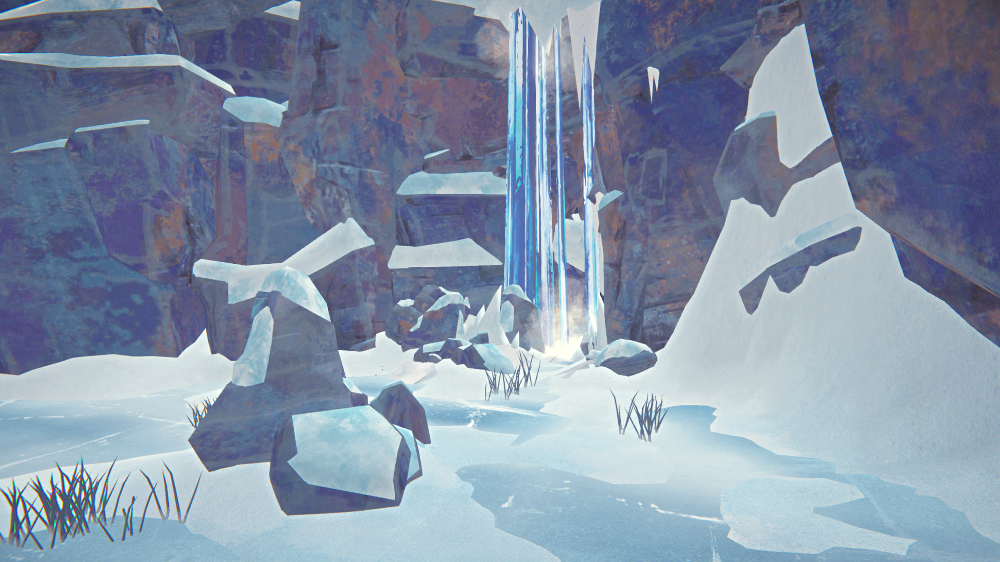

# Reclusive Falls

**Reclusive Falls**

| Property | Details |
| --- | --- |
|  |  / *Hushed\_river\_valley\_reclusive\_falls\_20201031.png* |
| **Location** |  |
|  |  / *Reclusive\_Falls\_Location.png* |
| Region | [Hushed River Valley](./Hushed%20River%20Valley.md)\|- |
| Description | A waterfall with an entrance to the [ice cave](./Ice%20Cave.md) behind it. |
| **General** |  |
| Type | Outdoors\|- |
