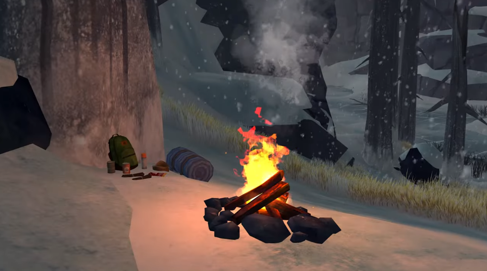

# Recovery Backpack

**Categories:** Interactable Objects · **Source:** [Fandom](https://thelongdark.fandom.com/wiki/Recovery_Backpack)

**Recovery Backpack**

_Recovery\_Backpack.png_

**Story item:** No

**Container**

**Capacity:** 5.00 kg(11 lbs)

_For an ordinary backpack, see [Backpack](./Backpack.md)._

A **Recovery Backpack** is a stationary interactable object in [_The Long Dark_](./The%20Long%20Dark.md). It only spawns when the player decides to [Cheat Death](./Cheat%20Death.md) in [Survival Mode](./Survival%20Mode.md).

## Overview

If the player dies and decides to continue their save file then most of their items will remain on their person, but many of their items will disappear from their inventory. A Recovery Backpack will appear in set spawn location in the [Region](./Region.md) they died in to hold these lost items as a punishment for Cheating Death. Checking the local Region map will reveal the location of the Backpack, represented by a Campfire icon.

When the player finds their Recovery Backpack, a small Campfire will always be found nearby, and a small smokestack will appear rising from the Campfire as if it burned out the moment the player arrived (as if another survivor looted your belongings shortly before arriving). A majority of the player's previous items will be found in the Recovery Backpack itself, but some of your lost items may be scattered around the Recovery Backpack when it is found, and will decay as normal in the game world until Ruined (if applicable, such as clothing or food) if the player takes too long to arrive. It is possible that some of the player's less critical items (food, clothing, etc) will be lost forever or in low/ruined condition when the Recovery Backpack is rediscovered. The Campfire always found nearby can be lit like a normal Campfire.

It is currently unknown if Experience difficulty affects the rate or priority of how items/tools are lost or which items appear outside of the backpack.

### Failing to recover a Recovery Backpack

If the player dies a second time and Cheats Death before recovering the first Recovery Backpack, a second new Recovery Backpack will appear in the game world and override the first Recovery Backpack:

- This will cause the first Backpack to disappear from the previous region along with any items inside. (save for anything that was scattered on the ground around it).
- Items will be permanently lost if the player again dies and Cheats Death before the previous Recovery Backpack is reclaimed.
- Choosing to respawn via the "close but risky respawn" option to quickly obtain your items from the Recovery Backpack can be a gamble, and will most likely result in the player dying if they are unfamiliar with the local Region they last died in. The player will also often spawn at night with low condition clothing, possibly freezing to death in the dark. Keep this in mind.
- It is entirely possible to lose rare or unique one of a kind items if you did not reclaim your first Recovery Backpack (such as [Tactical Gloves](./Tactical%20Gloves.md), [Vaughn's Rifle](./Vaughn%27s%20Rifle.md), etc). Make it a priority to recover your items to avoid this.

## Recovery Backpack Locations
