# Region

**Categories:** Regions · **Source:** [Fandom](https://thelongdark.fandom.com/wiki/Region)

**Contents**

- [Overview](#overview)
- [Selection](#selection)
- [Survival Mode](#survival-mode)
- [Wintermute](#wintermute)
- [Region list](#region-list)
- [Lower Great Bear](#lower-great-bear)
- [The Far Territory](#the-far-territory)
- [Wintermute Exclusive](#wintermute-exclusive)
- [Cauldron Island](#cauldron-island)
- [Brief Description](#brief-description)
- [Mystery Lake](#mystery-lake)
- [Coastal Highway](#coastal-highway)
- [Pleasant Valley](#pleasant-valley)
- [Desolation Point](#desolation-point)
- [Timberwolf Mountain](#timberwolf-mountain)
- [Forlorn Muskeg](#forlorn-muskeg)
- [Broken Railroad](#broken-railroad)
- [Mountain Town](#mountain-town)
- [Hushed River Valley](#hushed-river-valley)
- [Bleak Inlet](#bleak-inlet)
- [Ash Canyon](#ash-canyon)
- [Blackrock](#blackrock)
- [Forsaken Airfield](#forsaken-airfield)
- [Zone of Contamination](#zone-of-contamination)
- [Sundered Pass](#sundered-pass)
- [Transition Zones](#transition-zones)
- [Outdoor Transition Zones](#outdoor-transition-zones)
- [Indoor Transition Zones](#indoor-transition-zones)
- [Directly connected regions](#directly-connected-regions)
- [Gallery](#gallery)
- [Region Maps](#region-maps)
- [Lower Great Bear Maps](#lower-great-bear-maps)
- [Far Territory Maps](#far-territory-maps)
- [Trivia](#trivia)

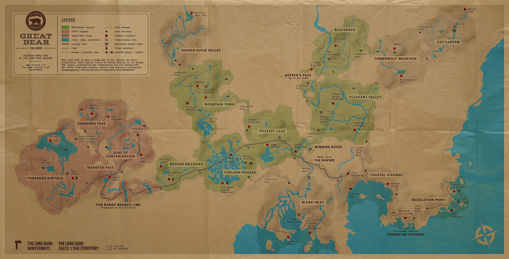_A fanmade map of all Regions on Great Bear Island._ A **Region** is a large, explorable outdoor area that encompasses many discoverable locations.

## Overview

All regions are located on [Great Bear Island](./Great%20Bear%20Island.md) and [Cauldron Island](./Cauldron%20Island.md) in northern [Canada](./The%20Collapse.md). Each of the regions connects to at least one other region, either directly or by a smaller Transition Zone.

## Selection

### Survival Mode

In most difficulty levels of [Survival Mode](./Survival%20Mode.md), the player may select any region as the starting point or may choose to start in a random region. Only Regions that have been visited in game will appear when initially selecting a starting location, otherwise, only beginner locations are accessible at first.

If the Interloper experience is selected, then the starting region will be randomly chosen from more challenging maps. In Interloper, the player will not spawn in Mountain Town, Mystery Lake, or Coastal Highway, and the number of possible spawn locations within each possible region is limited.

### Wintermute

In the [Wintermute](./Wintermute.md), the starting location is always the same and the player is restricted in what regions they can visit.

- [Episode 1](./Episode%201%20-%20Do%20Not%20Go%20Gentle.md) takes place entirely in [Mountain Town](./Mountain%20Town.md). Once the main quest is completed, the player acquires means to proceed away from this region into Mystery Lake, which triggers the beginning of Episode 2.
- [Episode 2](./Episode%202%20-%20Luminance%20Fugue.md) mostly takes place in [Mystery Lake](./Mystery%20Lake%20%28disambiguation%29.md), however the player has to also travel to [Forlorn Muskeg](./Forlorn%20Muskeg.md) and [Broken Railroad](./Broken%20Railroad.md) to progress the main quest. It is not possible to return to Mountain Town (Milton) once Episode 2 starts.
- [Episode 3](./Episode%203%20-%20Crossroads%20Elegy.md) takes place in [Pleasant Valley](./Pleasant%20Valley.md) and ends in the [Cinder Hills Coal Mine](./Cinder%20Hills%20Coal%20Mine.md) (the final cutscene takes place in [Coastal Highway](./Coastal%20Highway.md), though it is not playable).
- [Episode 4](./Episode%204%20-%20Fury%2C%20Then%20Silence.md) takes place in [Blackrock Region](./Blackrock.md), with the opening of the episode taking place in a small section of [Keeper's Pass North](./Keeper%27s%20Pass%20North.md).

## Region list

There are currently 16 regions in [_The Long Dark_](./The%20Long%20Dark.md), which are listed below.

### Lower Great Bear

These regions are available to all players who own _The Long Dark_.

| Region | Difficulty | Number of / locations | Modes | Release date |
| --- | --- | --- | --- | --- |
| [Mystery Lake](./Mystery%20Lake%20%28region%29.md) | Beginner | 28 | Survival, Story | 22 Sep 2014 |
| [Coastal Highway](./Coastal%20Highway.md) | Intermediate | 20 | Survival | 30 Oct 2014 |
| [Pleasant Valley](./Pleasant%20Valley.md) | Advanced | 33 | Survival, Story | 7 Feb 2015 |
| [Desolation Point](./Desolation%20Point.md) | Intermediate | 12 | Survival | 18 Sep 2015 |
| [Timberwolf Mountain](./Timberwolf%20Mountain.md) | Advanced | 25 | Survival | 16 Dec 2015 |
| [Forlorn Muskeg](./Forlorn%20Muskeg.md) | Advanced | 18 | Survival, Story | 19 Dec 2016 |
| [Broken Railroad](./Broken%20Railroad.md) | Intermediate | 10 | Survival, Story | 1 Aug 2017 |
| [Mountain Town](./Mountain%20Town.md) | Beginner | 27 | Survival, Story | 1 Aug 2017 |
| [Hushed River Valley](./Hushed%20River%20Valley.md) | Advanced | 25 | Survival | 14 June 2018 |
| [Bleak Inlet](./Bleak%20Inlet.md) | Advanced | 21 | Survival | 10 Dec 2019 |
| [Ash Canyon](./Ash%20Canyon.md) | Advanced | 20 | Survival | 7 Dec 2020 |
| [Blackrock](./Blackrock.md) | Intermediate | 25 | Survival, Story | 6 Oct 2021 |

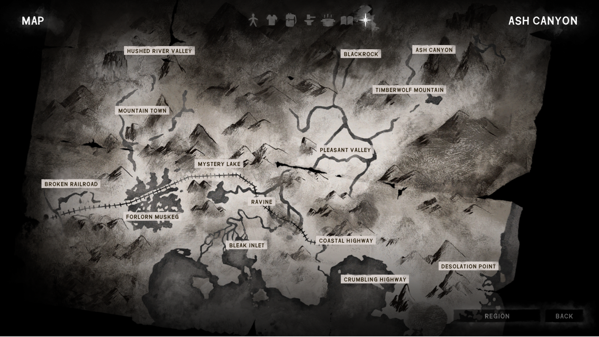

- [Broken Railroad](./Broken%20Railroad.md)
- [Forlorn Muskeg](./Forlorn%20Muskeg.md)
- [Mountain Town](./Mountain%20Town.md)
- [Mystery Lake)](./Mystery%20Lake%20%28region%29.md)
- [The Ravine](./The%20Ravine.md)
- [Winding River](./Winding%20River.md)
- [Pleasant Valley](./Pleasant%20Valley.md)
- [Timberwolf Mountain](./Timberwolf%20Mountain.md)
- [Coastal Highway](./Coastal%20Highway.md)
- [Crumbling Highway](./Crumbling%20Highway.md)
- [Desolation Point](./Desolation%20Point.md)
- [Hushed River Valley](./Hushed%20River%20Valley.md)
- [Bleak Inlet](./Bleak%20Inlet.md)
- [Blackrock](./Blackrock.md)
- [Ash Canyon](./Ash%20Canyon.md)

### The Far Territory

In addition to the regions above, players who purchased the [Tales from the Far Territory](./Tales%20from%20the%20Far%20Territory.md) DLC expansion pass will have access to a number of other regions. These regions are Survival Mode only. To access these regions from Lower Great Bear, players will have to travel to [Broken Railroad](./Broken%20Railroad.md) and head along the [Far Range Branch Line](./Far%20Range%20Branch%20Line.md).

| Region | Difficulty | Number of / locations | Modes | Release date |
| --- | --- | --- | --- | --- |
| [Transfer Pass](./Transfer%20Pass.md) | Intermediate | 11 | Survival | 5 Dec 2022 |
| [Forsaken Airfield](./Forsaken%20Airfield.md) | Advanced | 26 | Survival | 5 Dec 2022 |
| [Zone of Contamination](./Zone%20of%20Contamination.md) | Advanced | 25 | Survival | 5 Dec 2023 |
| [Sundered Pass](./Sundered%20Pass.md) | Advanced | 25 | Survival | 24 June 2024 |

- [Forsaken Airfield](./Forsaken%20Airfield.md)
- [Zone of Contamination](./Zone%20of%20Contamination.md)
- [Transfer Pass](./Transfer%20Pass.md)
- [Far Range Branch Line](./Far%20Range%20Branch%20Line.md)

### Wintermute Exclusive

In addition to the regions above, players who purchased the [Wintermute](./Wintermute.md) DLC will have access to a small set of regions that appear in [Episode 5: The Light At The End Of All Things](./Episode%205%20-%20The%20Light%20At%20The%20End%20Of%20All%20Things.md). Every other Episode features Regions found in both Wintermute and Survival Mode, but these regions are Wintermute only. Episode 5 Regions were designed differently that the other Episode regions, focusing more on storytelling than survival.

| Region | Difficulty | Number of / locations | Modes | Release date |
| --- | --- | --- | --- | --- |
| [Perseverance Mills](./Perseverance%20Mills.md) | Beginner |  | Wintermute | 31 March 2026 |
| [Perseverance Wilds](./Perseverance%20Wilds.md) | Beginner |  | Wintermute | 31 March 2026 |
| [Desperation Bay](./Desperation%20Bay.md) | Beginner |  | Wintermute | 31 March 2026 |
| [Blackrock Foothills](./Blackrock%20Foothills.md) | Beginner |  | Wintermute | 31 March 2026 |
| [Suzuki Environs](./Suzuki%20Environs.md) | Beginner |  | Wintermute | 31 March 2026 |
| [Suzuki Geothermal Region](./Suzuki%20Geothermal%20Region.md) | Beginner |  | Wintermute | 31 March 2026 |
| [Railway](./Railway.md) | Beginner |  | Wintermute | 31 March 2026 |

### Cauldron Island

In addition to the regions above, players who purchased the [Iron Road](./Iron%20Road.md) DLC expansion pass will have access to a number of other regions. These regions are Survival Mode only. To access these regions from Lower Great Bear, players will have to travel to [Desolation Point](./Desolation%20Point.md) and take the [Fulmar Autopilot Boat](./Fulmar%20Autopilot%20Boat.md) to [Cauldron Island](./Cauldron%20Island.md), a chain of 5 islands located even further to the north of Great Bear Island,

| Region | Difficulty | Number of / locations | Modes | Release date |
| --- | --- | --- | --- | --- |
| [Port Remnant](./Port%20Remnant.md) |  |  | Survival | 27 October 2026 |
| [Anna Island -- Track Section 1](./Anna%20Island%20--%20Track%20Section%201.md) |  |  | Survival | 27 October 2026 |
| [Anna Island -- Track Section 2](./Anna%20Island%20--%20Track%20Section%202.md) |  |  | Survival | 27 October 2026 |
| [Anna Island -- Track Section 3](./Anna%20Island%20--%20Track%20Section%203.md) |  |  | Survival | 27 October 2026 |
| [Anna Island -- Track Section 4](./Anna%20Island%20--%20Track%20Section%204.md) |  |  | Survival | 27 October 2026 |
| [Anna Island -- Track Section 5](./Anna%20Island%20--%20Track%20Section%205.md) |  |  | Survival | 27 October 2026 |
| [Anna Island -- Track Section 6](./Anna%20Island%20--%20Track%20Section%206.md) |  |  | Survival | 27 October 2026 |

### Brief Description

The regions in this list are sorted by release date.

#### Mystery Lake

Centered on [its namesake lake](./Mystery%20Lake%20%28location%29.md), **[Mystery Lake](./Mystery%20Lake%20%28region%29.md)** is ideal for players new to the game. It features a little bit of everything: cabins scattered throughout, wilderness, some industry, [fishing](./Ice%20Fishing.md) on the lake, plenty of foraging, and a relatively low predator density. Overall, the region is quite well balanced.

#### Coastal Highway

One of the three major coastal regions in-game, **[Coastal Highway](./Coastal%20Highway.md)** consists of a frozen bay with two offshore islands, rimmed by mountains that can be climbed by the use of windy logging roads. A large paved road runs right along the water's edge, passing through an [abandoned town](./Coastal%20Townsite.md) and a [fishing camp](./Fishing%20Camp.md). Survivors who venture into the mountains will find many small cabins scattered throughout. This region provides easy access to manufactured goods, especially clothes and [food](./Food%20And%20Drink.md) in the early game, but Survivors also report significant [wolf](./Wolf.md) activity in the region, especially around the abandoned townsite. The region's mild weather, however, may help those who get into [struggles](./Struggle.md) with wolves, as the lower chance of hypothermia means that Survivors are more often in better health when they do get into a struggle, increasing the odds of their survival.

#### Pleasant Valley

The main part of **[Pleasant Valley](./Pleasant%20Valley.md)** consists of relatively open farmland, where one can find a [farmhouse](./Pleasant%20Valley%20Farmstead.md) and [two](./Pleasant%20Valley%20Outbuildings.md) [barns](./Barn%20%28Molly%27s%29.md). Surrounding the farmland are relatively uninhabited high hills, which offer limited man-made shelter, though there is a small [settlement](./Thomson%27s%20Crossing.md) a short walk east from the farm, along with a [radio tower](./Signal%20Hill.md) and a [crashed plane](./Crash%20Site%20%28Pleasant%20Valley%29.md) for Survivors brave enough to handle the frequent blizzards and roaming [wolves](./Wolf.md), both of which offer excellent rewards for those who live long enough to get there.

#### Desolation Point

For those who like to live along the ocean, **[Desolation Point](./Desolation%20Point.md)** is the perfect region. Consisting of a narrow strip of coastline with a paved road, Survivors will find plenty of [beachcombing](./Beachcombing.md) if they brave the [weak ice](./Weak%20Ice.md). For those unlucky enough to fall in, not to worry: the region offers plenty of shelter, in the form of a [lighthouse](./Lonely%20Lighthouse.md), a [beached whaling ship](./The%20Riken.md), and a [whale processing plant](./Hibernia%20Processing.md). The region as a whole is quite small: while this means that Survivors are less likely to get horribly lost in a blizzard, it may make it harder to avoid the many predators in the region, one of which lives in a [quite unexpected location](./Cave%20%28Desolation%20Point%20location%29.md). Arguably, this region's most important feature is the [forge](./Forge.md) found on the old whaling ship, which allows tools to be forged from [scrap metal](./Scrap%20Metal.md), provided that Survivors have sufficient [coal](./Coal.md) -- which, given the [two](./No.%203%20Coal%20Mine.md) [mines](./Abandoned%20Mine%20No.%205.md), is generally a trivial task.

#### Timberwolf Mountain

Mountaineers will very much enjoy **[Timberwolf Mountain](./Timberwolf%20Mountain.md)**, despite its harsh weather. Its most prominent feature is the [peak](./Summit.md) of Timberwolf Mountain itself. Aside from enjoying the great view from the top, Survivors will likely want to check out the many containers found in the region. Some of them can be found scattered throughout the forest surrounding the mountain, but most of them remained in the [Tail Section](./Tail%20Section.md) of the airplane at the summit, along with a [Distress Pistol](./Distress%20Pistol.md) -- the only weapon that can reliably drive off a charging [bear](./Bear.md). Aside from the summit, the region also features a number of other, smaller peaks, many of which are accessible. While there isn't much man-made shelter aside from the [Mountaineer's Hut](./Mountaineer%27s%20Hut.md), there are many natural caves, where players can rest in-between the many long [rope climbs](./Rope%20Climbing.md) up to the summit.

#### Forlorn Muskeg

The **[Forlorn Muskeg](./Forlorn%20Muskeg.md)** consists of a [railway track](./Trans-Island%20Railway%20Line.md) passing through the centre of a large and relatively featureless boggy area. Going through the region isn't too difficult, as it involves simply following the tracks, but once Survivors leave the tracks, they can very easily find themselves lost, especially given the region's frequent fog. Navigation is made even more challenging by the presence of weak ice throughout the region, which can easily turn a promising route into a no-go. To top it off, man-made shelter is hard to find, and there are many wolves throughout. The region's saving grace is that it has a [forge](./Forge.md) at [an old farmstead](./Old%20Spence%20Family%20Homestead.md) to the south, allowing the creation of improvised tools.

#### Broken Railroad

**[Broken Railroad](./Broken%20Railroad.md)** is a very small region, but that doesn't mean it lacks features. If Survivors can dodge the many wolves along the narrow path to the [Maintenance Yard](./Maintenance%20Yard.md), they will find a massive shed, full of industrial supplies. Also in the shed is a [forge](./Forge.md), though some forethought is required, owing to the scarcity of [coal](./Coal.md) in the local area. Survivors who travel past the Maintenance Yard and up the mountain will come to a large [Hunting Lodge](./Hunting%20Lodge.md), which is usually well stocked and offers big-game hunting just outside the front door.

#### Mountain Town

For those who prefer more a more urbanized location over country life, **[Mountain Town](./Mountain%20Town.md)** may be the place to live. It is centered around the recently abandoned town of [Milton](./Milton.md), located high in the mountains of Great Bear, and new Survivors will quickly get an abundance of [food](./Food%20And%20Drink.md) and [clothing](./Clothing.md) from the many houses around town. Venturing out of town can be risky; many wolves can be found just outside of town, especially in the [wood lots](./Wood%20Lot.md) just to the north and south of town. Wolves can also be found in the fields of [Paradise Meadows Farm](./Paradise%20Meadows%20Farm.md) to the west, which requires a key to open for the first time. Despite the risks, venturing out of town can provide good hunting and foraging opportunities.

#### Hushed River Valley

Once Survivors have entered the **[Hushed River Valley](./Hushed%20River%20Valley.md)**, they have left civilization behind. There are _no_ man-made houses in the area, aside from a few [snow shelters](./Snow%20Shelter.md), which require constant maintenance to keep up. Navigation can be challenging, as the region features multiple distinct levels, which require [rope climbing](./Rope%20Climbing.md) to travel between; successfully navigating this region requires Survivors to think in 3-D when they want to go somewhere. Once Survivors get their bearings, however, they will be greeted with one of the most beautiful and resource-rich regions in-game (especially in Interloper), with dozens of waterfalls, deep river valleys, caves for shelter, plants to forage, and game to hunt. While parts of the region feature many predators, large other parts are nearly predator-free. Despite the lack of civilization, manufactured items are still available -- searching around [corpses](./Frozen%20Corpse.md) and stumbling upon [caches](./Hidden%20Cache.md) can yield a wide variety of useful supplies.

#### Bleak Inlet

Home to roaming [Timberwolf](./Timberwolf.md) packs, visiting **[Bleak Inlet](./Bleak%20Inlet.md)** is not for the unarmed. The coastal region, split into a high plateau and a coastal plain, features weather that's often cold and windy, and frequent Timberwolves will threaten the player wherever they travel. Despite the danger, Bleak Inlet is one of only two regions that offers ammunition crafting at the [Cannery Pier](./Cannery%20Pier.md), enabling Survivors to make more ammunition for their [rifle](./Hunting%20Rifle.md) and [revolver](./Revolver.md). Saltwater [ice fishing](./Ice%20Fishing.md) is also available, along with a [Distress Pistol](./Distress%20Pistol.md) in the [fallen lighthouse](./Fallen%20Lighthouse.md). For those trying to stay away from the Timberwolves, there is hope; a small [cabin](./Cabin.md) near Raven Falls Picnic Area offers relative safety and good [deer](./Deer.md) hunting nearby. Additionally, for those with lots of ammunition, some of the best [moose](./Moose.md) hunting in-game is located on the [Frozen Delta](./Frozen%20Delta.md) north of the Cannery.

#### Ash Canyon

**[Ash Canyon](./Ash%20Canyon.md)** consists of a deep canyon with a river running through, recently ravaged by a forest fire. Surrounding this central canyon are steep cliff walls, above which can be found a series of plateaus. These can be accessed by [rope climbing](./Rope%20Climbing.md) and mountain paths. Survivors need to be careful in this region: it is very cold, and the lower levels are frequented by wolves. The high plateaus have little wildlife of any kind, though the rope bridges connecting them can be treacherous to cross, as a fall from them will be deadly. Following the narrow mountain paths will eventually lead to a [Gold Mine](./Gold%20Mine.md) in which a [useful backpack upgrade](./Technical%20Backpack.md) may be found. Man-made shelter is rather limited, though there are a few cabins scattered around, and several natural caves.

#### Blackrock

Home to the infamous [Blackrock Prison](./Blackrock%20Prison.md), **[Blackrock](./Blackrock.md)** is a hilly region frequented by [timberwolves](./Timberwolf.md), making it difficult for the inmates to escape... and for Survivors to survive. Those who don't become Timberwolf prey will find a decent amount of man-made shelter, consisting of mainly of trailers and commercial buildings, along with a [vest](./Ballistic%20Vest.md) that can reduce the damage dealt by Timberwolves.

**Transfer Pass**

Currently the smallest Region in the game, [Transfer Pass](./Transfer%20Pass.md) is a small valley like area that serves as the player's initial starting point to the Inner [Far Territories](./Tales%20from%20the%20Far%20Territory.md) of Great Bear Island. The area contains very few resources or landmarks, save for a single [cave](./Feedwater%20Cave.md) near some [crashed flatcars](./Distempered%20Flatcars.md), an [abandoned passenger train station](./Vacant%20Depot.md), and a [quiet pond](./Loitering%20Marsh.md). A road found behind the station leads further into the mountains, with a large sign splitting the road in two, leading the player to either an [abandoned airfield](./Field%2031.md) or to a [hazardous open pit mine](./Zone%20of%20Contamination.md). Players will likely not stay here for long due to its small size, only passing through to uncover the more enticing secrets of the Far Territory.

#### Forsaken Airfield

**[Forsaken Airfield](./Forsaken%20Airfield.md)** is a relatively large and open region centered on a ruined airfield, named [Airfield 31](./Field%2031.md), that it's plagued by a [mysterious variant of heavy fog](./Glimmer%20Fog.md). Several non-functional aircraft can be found around the airport and in the [hangar](./Main%20Hangar.md). A short walk north of the airfield is [a large lake](./Shoulder%20Lake.md), which features a [fairly large island](./Drift%20Island.md) with a [cottage](./Island%20Cottage.md) on it. Two roads wind through the region: one from [Transfer Pass](./Transfer%20Pass.md) to the airfield, the other to [Mindful Cabin](./Mindful%20Cabin.md). The edges of the region are much more forested, and contain a few shallow caves. Survivors will want to be careful during the region's frequent fog and blizzards, or they risk getting lost. It currently connects to [Zone of Contamination](./Zone%20of%20Contamination.md) and [Sundered Pass](./Sundered%20Pass.md) via a transition cave and to [Transfer Pass](./Transfer%20Pass.md).

#### Zone of Contamination

An abandoned yet hazardous open-pit mine region, the [Zone of Contamination](./Zone%20of%20Contamination.md) connects with [Forsaken Airfield](./Forsaken%20Airfield.md), [Transfer Pass](./Transfer%20Pass.md), and [Sundered Pass](./Sundered%20Pass.md) through a transition cave. The Zone features a massive open pit [industrial mine](./Langston%20Mine.md) created by the Langston Mining Corporation and is highly toxic, with [Chemical Hazards](./Chemical%20Hazard.md) spread over much of the industrialized areas and with toxic mineshaft gases present inside the mine itself. This region houses the exclusive [Poisoned Wolf](./Poisoned%20Wolf.md), a starving and aggressive wolf variant. The Zone is the centerpiece of the [Buried Echoes](./Buried%20Echoes.md) Tale.

#### Sundered Pass

A region which connects with [Forsaken Airfield](./Forsaken%20Airfield.md) and the [Zone of Contamination](./Zone%20of%20Contamination.md) through a transition cave or with [Transfer Pass](./Transfer%20Pass.md). [Sundered Pass](./Sundered%20Pass.md) is a very mountainous and cold region prone to many avalanches, with Wolves stalking the lower forests and Timberwolf packs hunting in the higher altitude fields. The region continues to get colder the higher in altitude the player gets. The Pass is the beginning of the [Last Horizon](./Last%20Horizon.md) Tale.

## Transition Zones

Not all regions connect directly to other regions, but can instead be separated by smaller explorable "mini regions" dubbed Transition Zones. These regions are characterized by several qualities, such as the inability to spawn here when starting a game (or randomly spawning as is the case in Interloper or Custom games), they do not typically show up on the island-wide overworld map, but have their own regional map, and they are often sparse with resources. All Transition Zones will never contain very large animals such as [Bears](./Bear.md) or [Moose](./Moose.md), and can sometimes not even contain any medium sized prey or predator animals, such as [Deer](./Deer.md) or [Wolves](./Wolf.md).

### Outdoor Transition Zones

These regions may also contain a handful of marked or unmarked discoverable locations, and can be surveyed with [Charcoal](./Charcoal.md). The Outdoor Transition Zones include:

| Region | Number of Locations | Modes | Release Date |
| --- | --- | --- | --- |
| [The Ravine](./The%20Ravine.md) (Raven Falls) | 4 | Survival | Oct 30 2014 |
| [Winding River](./Winding%20River.md) | 2 | Survival | May 21 2015 |
| [Crumbling Highway](./Crumbling%20Highway.md) (Old Island Connector) | 5 | Survival | 18 Sep 2015 |
| [Keeper's Pass South](./Keeper%27s%20Pass%20South.md) | 4 | Survival | 7 Dec 2021 |
| [Keeper's Pass North](./Keeper%27s%20Pass%20North.md) | 4 | Survival, Story | 7 Dec 2021 |
| [Far Range Branch Line](./Far%20Range%20Branch%20Line.md) | 9 | Survival | 5 Dec 2022 |

### Indoor Transition Zones

In addition to outdoor areas, Great Bear Island contains many indoor Transition Zones as well. These areas cannot be surveyed with Charcoal and are incredibly small, contain no Wildlife, and can often be mazelike in their navigation:

- [Abandoned Mine No. 3](./No.%203%20Coal%20Mine.md) - connects [Old Island Connector](./Crumbling%20Highway.md) (Crumbling Highway) and [Desolation Point](./Desolation%20Point.md)
- [Cinder Hills Coal Mine](./Cinder%20Hills%20Coal%20Mine.md) - connects [Coastal Highway](./Coastal%20Highway.md) and [Pleasant Valley](./Pleasant%20Valley.md)
- [Carter Hydro Dam Environs](./Winding%20River.md) - connects [Mystery Lake](./Mystery%20Lake%20%28region%29.md) and [Pleasant Valley](./Pleasant%20Valley.md) (consists of [Carter Hydro Dam](./Carter%20Hydro%20Dam.md), the [Winding River](./Winding%20River.md), and a [Cave](./Cave%20%28Transition%20Zone%29.md))
- Various cave systems

(For further information, see [Cave (Transition zone)](./Cave%20%28Transition%20Zone%29.md))

### Directly connected regions

Some regions are connected directly, without any Transition Zones between them. These connections are:

- [Mystery Lake](./Mystery%20Lake%20%28region%29.md) - [Forlorn Muskeg](./Forlorn%20Muskeg.md)
- [Forlorn Muskeg](./Forlorn%20Muskeg.md) - [Broken Railroad](./Broken%20Railroad.md)
- [Mountain Town](./Mountain%20Town.md) - [Forlorn Muskeg](./Forlorn%20Muskeg.md)
- [Pleasant Valley](./Pleasant%20Valley.md) - [Timberwolf Mountain](./Timberwolf%20Mountain.md)
- [Timberwolf Mountain](./Timberwolf%20Mountain.md) - [Ash Canyon](./Ash%20Canyon.md)
- [Transfer Pass](./Transfer%20Pass.md) - [Forsaken Airfield](./Forsaken%20Airfield.md)
- [Transfer Pass](./Transfer%20Pass.md) - [Zone of Contamination](./Zone%20of%20Contamination.md)
- [Transfer Pass](./Transfer%20Pass.md) - [Sundered Pass](./Sundered%20Pass.md)

## Gallery

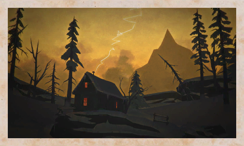

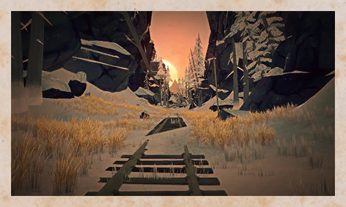

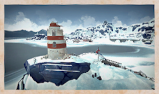

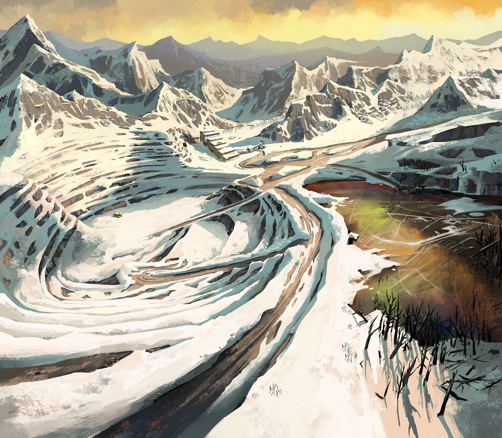

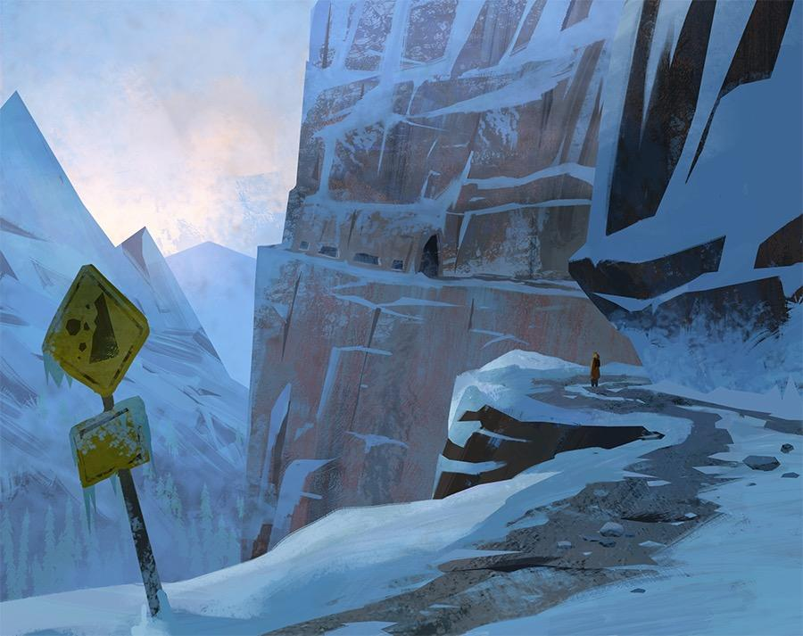

### Region Maps

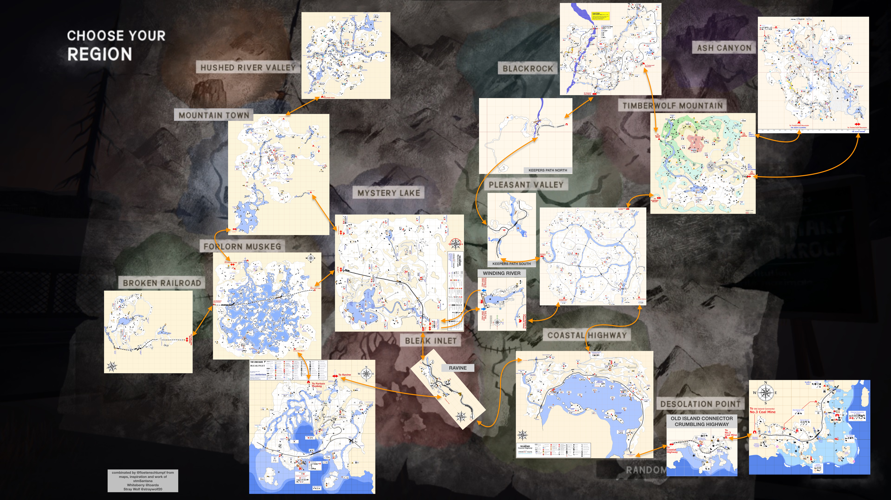

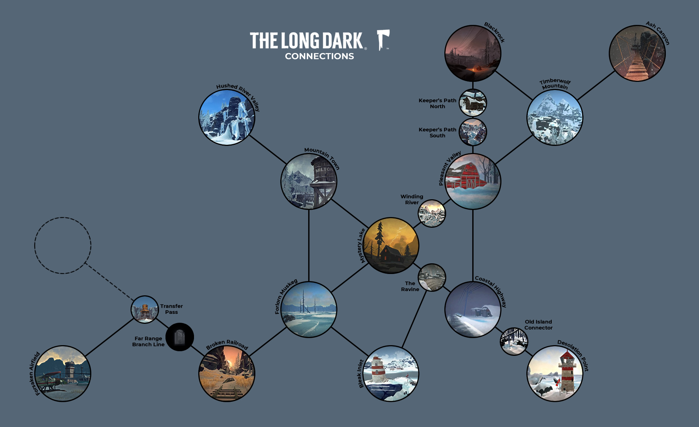

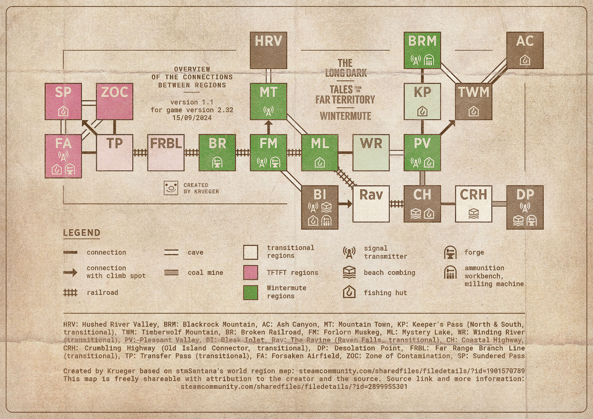

### Lower Great Bear Maps

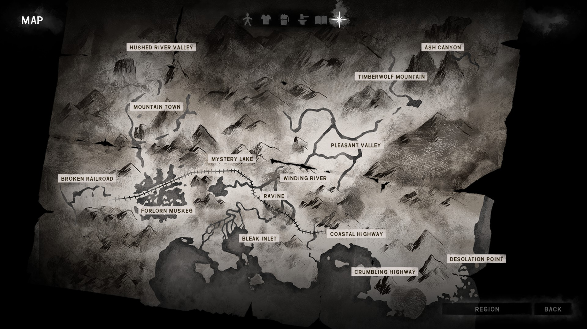

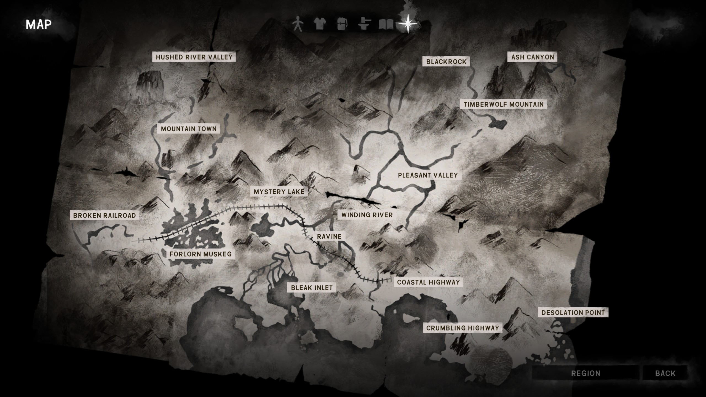

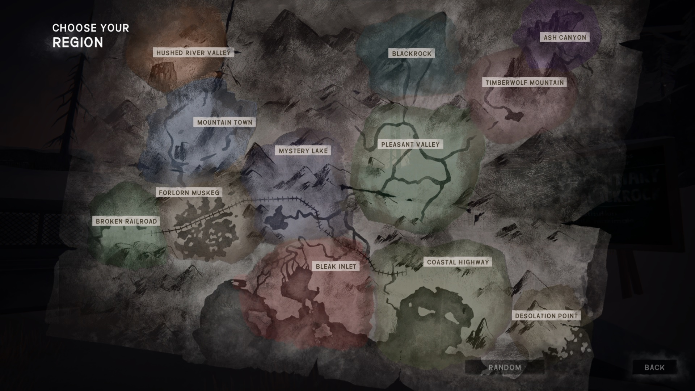

### Far Territory Maps

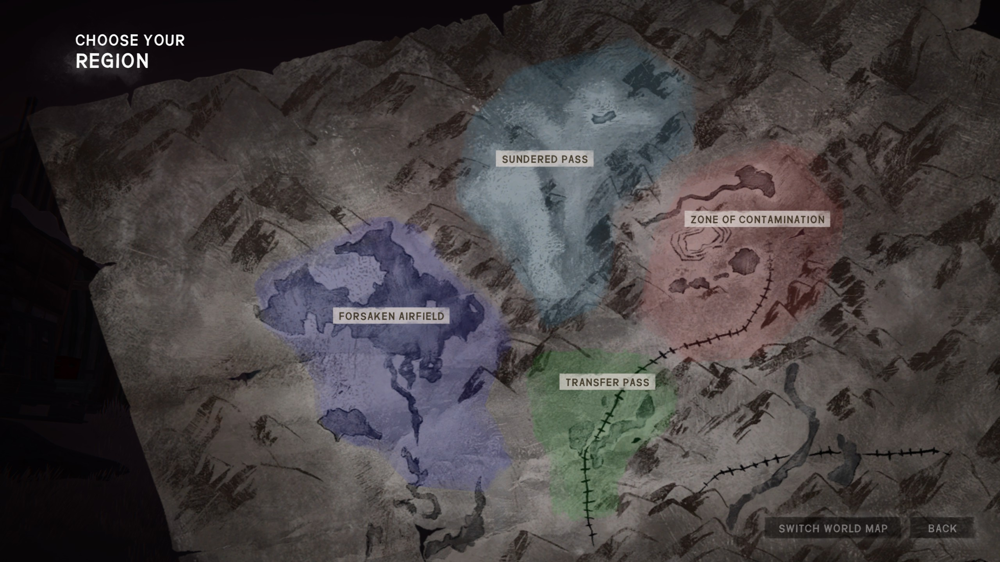

## Trivia

- All the regions of [Great Bear Island](./Great%20Bear%20Island.md) aside from [Mystery Lake](./Mystery%20Lake%20%28region%29.md) and [Coastal Highway](./Coastal%20Highway.md) were designed by Katie Sorrell.
  - The location "[Katie's Secluded Corner](./Katie%27s%20Secluded%20Corner.md)" in [Desolation Point](./Desolation%20Point.md) is named after her.
