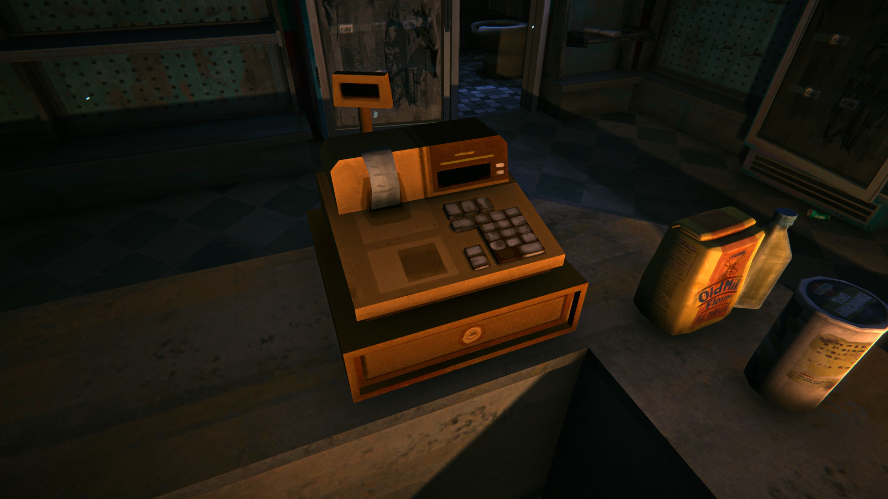

# Register

**Register**

| Property | Details |
| --- | --- |
|  |  / *Register.jpg* |
| Release | TBD |
| Update | [0.00](./The%20Long%20Dark%20%E2%80%94%20Changelog.md#0.00) |
| Story item | No |
| **Container** |  |
| Capacity | 5.00 kg(11 lbs) |

A **Register** is an interactable storage object found inside many stores across [Great Bear Island](./Great%20Bear%20Island.md). The till has 5.00 Kg of storage space and yields low value items when searched, occasionally yielding [Cash](./Cash.md). They can be found in [Milton Credit Union](./Milton%20Credit%20Union.md), [Rural Store](./Rural%20Store.md), [Quonset Garage](./Quonset%20Garage.md), and [Orca Gas Station](./Orca%20Gas%20Station.md). **Lua execution error in Module:Navbox function navbox**
