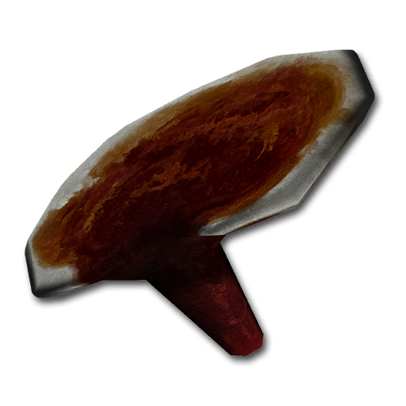
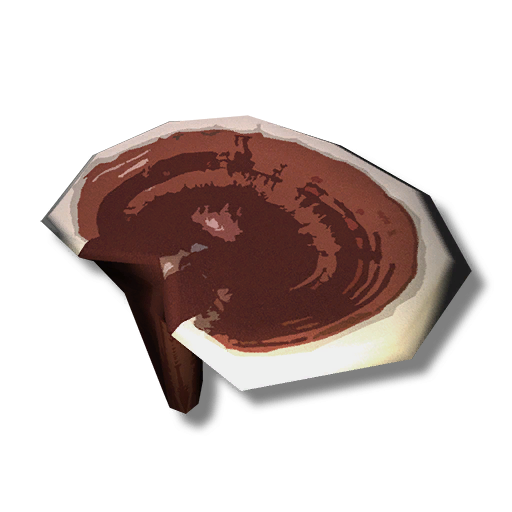

# Reishi Mushroom

**Contents**

- [Overview](#Overview)
- [Products](#Products)
- [Tips](#Tips)
- [Trivia](#Trivia)
- [Gallery](#Gallery)
- [Update history](#Update_history)

<table class="infobox">
<caption>Reishi Mushroom</caption>
<colgroup>
<col style="width: 50%" />
<col style="width: 50%" />
</colgroup>
<tbody>
<tr>
<td colspan="2"><figure>

<figcaption>Reishi_Mushroom_icon.png</figcaption>
</figure></td>
</tr>
<tr>
<td>
Release
</td>
<td>
<a href="./The%20Long%20Dark%20%E2%80%94%20Changelog.md#0.192" class="wikilink" title="7 February 2015">7 February 2015</a>
</td>
</tr>
<tr>
<td>
Wintermute
</td>
<td>
Yes
</td>
</tr>
<tr>
<td>
Renewable
</td>
<td>
No
</td>
</tr>
<tr>
<td colspan="2" class="section">
<strong>Properties</strong>
</td>
</tr>
<tr>
<td>
Item type
</td>
<td>
<a href="./Materials.md" class="wikilink" title="Materials">Materials</a>|-
</td>
</tr>
<tr>
<td>
Stackable
</td>
<td>
Yes
</td>
</tr>
<tr>
<td>
Examine
</td>
<td>
A large, edible shelf mushroom, found mainly on coniferous trees.
</td>
</tr>
<tr>
<td colspan="2" class="section">
<strong>Values</strong>
</td>
</tr>
<tr>
<td>
Weight
</td>
<td>
0.05 kg (0.11 lbs)
</td>
</tr>
<tr>
<td colspan="2" class="section">
<strong>Actions</strong>
</td>
</tr>
<tr>
<td>
Backpack
</td>
<td>
Examine
</td>
</tr>
<tr>
<td>
On ground
</td>
<td>
Take It, Leave It
</td>
</tr>
</tbody>
</table>

**Reishi Mushrooms** are a natural material that can be used to create both food and first aid treatments that are used to treat <a href="./Afflictions.md" class="wikilink" title="Afflictions">Afflictions</a> in *The Long Dark*.

## Overview

Reishi Mushrooms can be found in the wilderness growing on the trunks or stumps of dead trees, typically in clusters of 1-3 units. They can be crafted into <a href="./Prepared%20Reishi%20Mushrooms.md" class="wikilink" title="Prepared Reishi Mushrooms">Prepared Reishi Mushrooms</a> to be able to be cooked into <a href="./Reishi%20Tea.md" class="wikilink" title="Reishi Tea">Reishi Tea</a>. Raw Mushrooms can be used in the <a href="./Prepper%27s%20Pie.md" class="wikilink" title="Prepper&#39;s Pie">Prepper's Pie</a> and <a href="./Thomson%20Family%20Stew.md" class="wikilink" title="Thomson Family Stew">Thomson Family Stew</a> recipes.

Prepared Reishi Mushrooms have half the weight of their raw form, and no form of Reishi Mushroom decays.

## Products

## Tips

- Reishi Mushrooms are found sporadically in all regions on the stumps of dead trees.
- Reishi Mushrooms (and thus Reishi Tea) are finite in all regions and do not regrow.
- Teas are more weight efficient than Water for the Hydration they grant. (0.1kg of a tea grants 30% Hydration, equivalent to 0.198kg of water).
- Teas never <a href="./Decay.md" class="wikilink" title="Decay">Decay</a> once cooked.
- Teas may be heated to grant the <a href="./Warming%20Up.md" class="wikilink" title="Warming Up">Warming Up</a> benefit by placing them on a fire's cooking spot, or nearby a lit fire.
- Upon reaching Level 5 <a href="./Cooking.md" class="wikilink" title="Cooking skill">Cooking skill</a>, all artificial foods and cooked meats may be safely eaten regardless of condition (including "Ruined" food), making Food Poisoning and Intestinal Parasites only possible through the consumption of raw meat.
- <a href="./Infection.md" class="wikilink" title="Infections">Infections</a>, <a href="./Dysentery.md" class="wikilink" title="Dysentery">Dysentery</a> and <a href="./Intestinal%20Parasites.md" class="wikilink" title="Intestinal Parasites">Intestinal Parasites</a> are permanent and lethal if left untreated, though <a href="./Food%20Poisoning.md" class="wikilink" title="Food Poisoning">Food Poisoning</a> is not lethal in of itself and will dissipate naturally with time (12-24 hours), but will reduce maximum Condition to 15%, making it potentially dangerous.
- <a href="./Antibiotics.md" class="wikilink" title="Antibiotics">Antibiotics</a> are not a renewable resource and cannot be crafted; however Reishi Tea is functionally similar to Antibiotics, but is made from natural materials found abundantly in the wilds.

## Trivia

- Reishi Mushrooms are a real-world bracket fungus (Species: [*G. lingzhi*](https://en.wikipedia.org/wiki/Lingzhi_(mushroom))) common to the Pacific North-West (United States and Canada), as well as north-eastern China, Korea, Japan and Russia.
- "Reishi" (霊芝) is the Japanese name for the fungus; other names include Lingzhi, Yeongji (영지), Het Lin Chue (หลินจือ) and Linh Chi.
- Reishi have a long history of use in [Traditional Chinese Medicine](https://en.wikipedia.org/wiki/Traditional_Chinese_medicine), though there is insufficient evidence that their consumption has any tangible medical effect, unlike their in-game description and use. They are an anti-oxidant but exhibit no antibiotic properties, unlike the *Ganoderma* (*Penicillium)* mold used to create [Penicillin](https://en.wikipedia.org/wiki/Penicillin) (an antibiotic), which is unrelated to *G. lingzhi*.
- Real reishi are typically parasitic or saprotrophic (feed on dead matter) of maple trees, unlike in *The Long Dark* where they are exclusively saprotrophic to cedar or fir.
- Antibiotics are typically a prescription-grade drug derived from penicillin, which is the case in *The Long Dark* as they are labeled as "Pharmacillin".
- In The Long Dark, Antibiotics and Reishi Tea must be applied directly to treat a specific injury (similar to a Bandage), unlike real-world orally-taken drugs which become generally distributable through the body.

## Gallery

<table class="gallery">
<colgroup>
<col style="width: 25%" />
<col style="width: 25%" />
<col style="width: 25%" />
<col style="width: 25%" />
</colgroup>
<tbody>
<tr>
<td><figure>
[Missing image: Reishi_mushrooms_on_tree_stump.jpg]
<figcaption>A pair of reishi mushrooms growing on a tree stump in <a href="./Pleasant%20Valley.md" class="wikilink" title="Pleasant Valley">Pleasant Valley</a>.</figcaption>
</figure></td>
<td><figure>
[Missing image: Crafting-menu-v1.6x.jpg]
<figcaption>Crafting (after v1.6 update)</figcaption>
</figure></td>
<td><figure>

<figcaption>An older model for the mushroom</figcaption>
</figure></td>
<td><figure>
[Missing image: Reishi_mushroom.png]
<figcaption>Early pre alpha model</figcaption>
</figure></td>
</tr>
</tbody>
</table>

## Update history

- UPDATE **7 February 2015 (<a href="./The%20Long%20Dark%20%E2%80%94%20Early%20Access%20Changelog.md#0.192" class="wikilink" title="Update">Update</a>):**
  - Added to game

**Lua execution error in Module:Navbox function navbox** **Lua execution error in Module:Navbox function navbox** <a href="ru:%D0%93%D1%80%D0%B8%D0%B1_%D0%A0%D0%B5%D0%B9%D1%88%D0%B8" class="wikilink" title="ru:Гриб Рейши">ru:Гриб Рейши</a>

