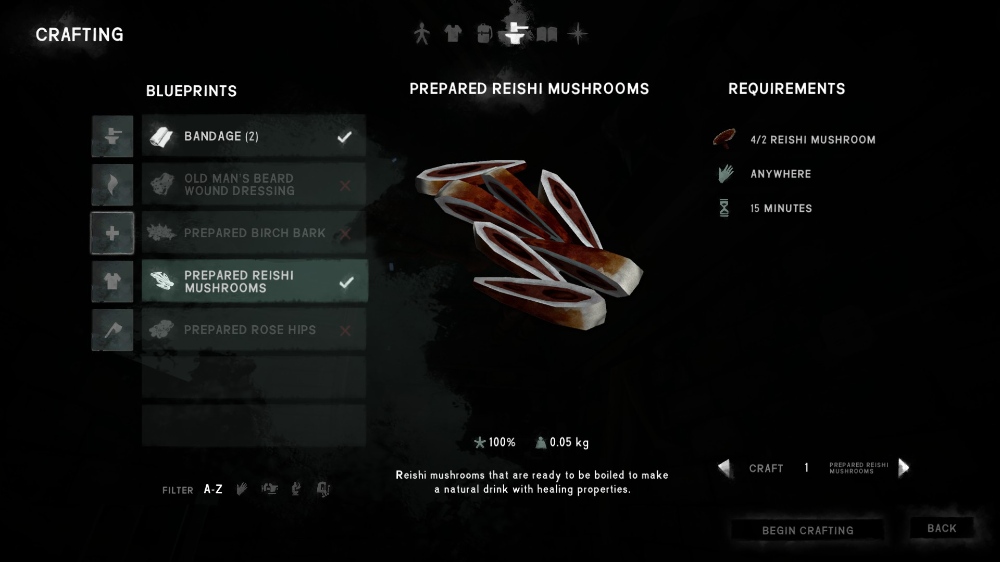
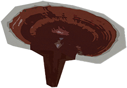

# Reishi Mushroom

**Categories:** Food And Drink, Materials, Pages with update history, Plants · **Source:** [Fandom](https://thelongdark.fandom.com/wiki/Reishi_Mushroom)

**Contents**

- [Overview](#overview)
- [Products](#products)
- [Tips](#tips)
- [Trivia](#trivia)
- [Gallery](#gallery)
- [Update history](#update-history)

**Reishi Mushroom**

[Reishi Mushroom icon](../assets/Reishi_Mushroom_icon.png)

**Release:** [7 February 2015](./The%20Long%20Dark%20%E2%80%94%20Early%20Access%20Changelog.md#0.192)

**Wintermute:** Yes

**Renewable:** No

**Properties**

**Item type:** [Materials](./Materials.md)

**Stackable:** Yes

**Examine:** A large, edible shelf mushroom, found mainly on coniferous trees.

**Values**

**Weight:** 0.05 kg (0.11 lbs)

**Actions**

**Backpack:** Examine

**On ground:** Take It, Leave It

**Reishi Mushrooms** are a natural material that can be used to create both food and first aid treatments that are used to treat [Afflictions](./Afflictions.md) in _The Long Dark_.

## Overview

Reishi Mushrooms can be found in the wilderness growing on the trunks or stumps of dead trees, typically in clusters of 1-3 units. They can be crafted into [Prepared Reishi Mushrooms](./Prepared%20Reishi%20Mushrooms.md) to be able to be cooked into [Reishi Tea](./Reishi%20Tea.md). Raw Mushrooms can be used in the [Prepper's Pie](./Prepper%27s%20Pie.md) and [Thomson Family Stew](./Thomson%20Family%20Stew.md) recipes.

Prepared Reishi Mushrooms have half the weight of their raw form, and no form of Reishi Mushroom decays.

## Products

| Item | Skills | Materials |
| --- | --- | --- |
| [Prepared Reishi Mushrooms](./Prepared%20Reishi%20Mushrooms.md) | None | - 2 × [Reishi Mushroom](./Reishi%20Mushroom.md) |
| [Prepper's Pie](./Prepper%27s%20Pie.md) | None | - 1 × [Acorn Grounds](./Acorn%20Grounds.md) - 4 × [Reishi Mushroom](./Reishi%20Mushroom.md) - 2 × [Burdock Root](./Burdock%20Root.md) - 0.10 L × [Water (Potable)](./Water%20%28Potable%29.md) - 0.05 L × [Cooking Oil](./Cooking%20Oil.md) - 0.01 kg × [Salt](./Salt.md) |
| [Thomson Family Stew](./Thomson%20Family%20Stew.md) | None | - 0.30 kg × [Canned Corn](./Canned%20Corn.md) - 0.40 kg × [Carrot](./Carrot.md) - 2 × [Potato](./Potato.md) - 2 × [Reishi Mushroom](./Reishi%20Mushroom.md) - 0.40 L × [Broth](./Broth.md) - 0.05 kg × [Old Mill Flour](./Old%20Mill%20Flour.md) |

## Tips

- Reishi Mushrooms are found sporadically in all regions on the stumps of dead trees.
- Reishi Mushrooms (and thus Reishi Tea) are finite in all regions and do not regrow.
- Teas are more weight efficient than Water for the Hydration they grant. (0.1kg of a tea grants 30% Hydration, equivalent to 0.198kg of water).
- Teas never [Decay](./Decay.md) once cooked.
- Teas may be heated to grant the [Warming Up](./Warming%20Up.md) benefit by placing them on a fire's cooking spot, or nearby a lit fire.
- Upon reaching Level 5 [Cooking skill](./Cooking.md), all artificial foods and cooked meats may be safely eaten regardless of condition (including "Ruined" food), making Food Poisoning and Intestinal Parasites only possible through the consumption of raw meat.
- [Infections](./Infection.md), [Dysentery](./Dysentery.md) and [Intestinal Parasites](./Intestinal%20Parasites.md) are permanent and lethal if left untreated, though [Food Poisoning](./Food%20Poisoning.md) is not lethal in of itself and will dissipate naturally with time (12-24 hours), but will reduce maximum Condition to 15%, making it potentially dangerous.
- [Antibiotics](./Antibiotics.md) are not a renewable resource and cannot be crafted; however Reishi Tea is functionally similar to Antibiotics, but is made from natural materials found abundantly in the wilds.

## Trivia

- Reishi Mushrooms are a real-world bracket fungus (Species: [_G. lingzhi_](https://en.wikipedia.org/wiki/Lingzhi_%28mushroom%29)) common to the Pacific North-West (United States and Canada), as well as north-eastern China, Korea, Japan and Russia.
- "Reishi" (霊芝) is the Japanese name for the fungus; other names include Lingzhi, Yeongji (영지), Het Lin Chue (หลินจือ) and Linh Chi.
- Reishi have a long history of use in [Traditional Chinese Medicine](https://en.wikipedia.org/wiki/Traditional_Chinese_medicine), though there is insufficient evidence that their consumption has any tangible medical effect, unlike their in-game description and use. They are an anti-oxidant but exhibit no antibiotic properties, unlike the _Ganoderma_ (_Penicillium)_ mold used to create [Penicillin](https://en.wikipedia.org/wiki/Penicillin) (an antibiotic), which is unrelated to _G. lingzhi_.
- Real reishi are typically parasitic or saprotrophic (feed on dead matter) of maple trees, unlike in _The Long Dark_ where they are exclusively saprotrophic to cedar or fir.
- Antibiotics are typically a prescription-grade drug derived from penicillin, which is the case in _The Long Dark_ as they are labeled as "Pharmacillin".
- In The Long Dark, Antibiotics and Reishi Tea must be applied directly to treat a specific injury (similar to a Bandage), unlike real-world orally-taken drugs which become generally distributable through the body.

## Gallery

_A pair of reishi mushrooms growing on a tree stump in [Pleasant Valley](./Pleasant%20Valley.md)._

## Update history

- UPDATE **7 February 2015 ([Update](./The%20Long%20Dark%20%E2%80%94%20Early%20Access%20Changelog.md#0.192)):**
  - Added to game
