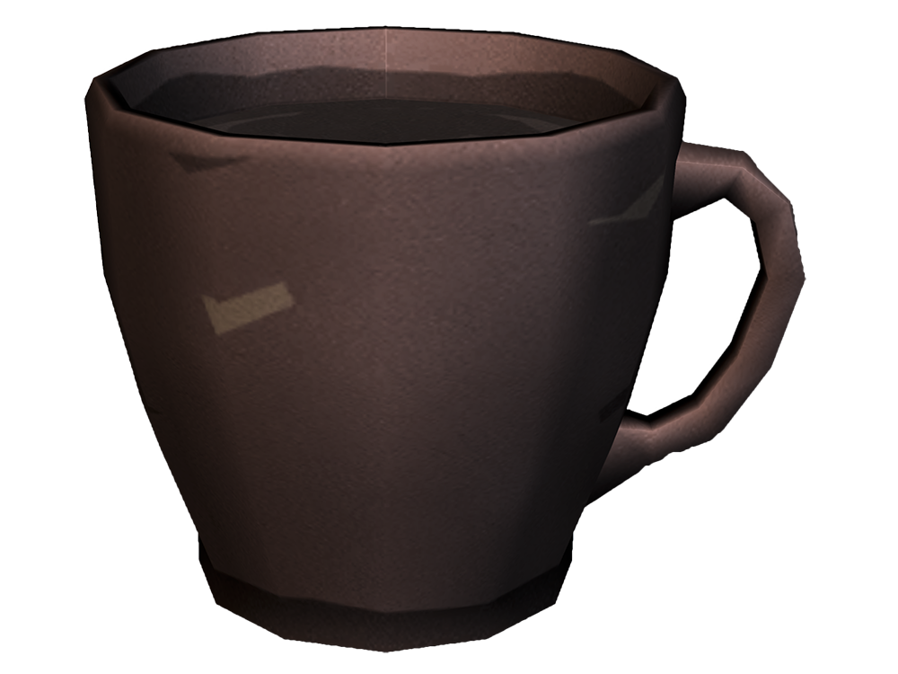
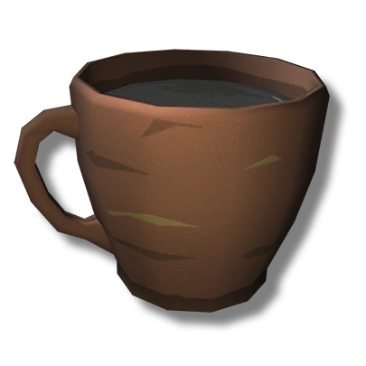

# Reishi Tea

**Categories:** First Aid, Food And Drink, Pages with update history · **Source:** [Fandom](https://thelongdark.fandom.com/wiki/Reishi_Tea)

**Contents**

- [Overview](#overview)
- [Recipe](#recipe)
- [Tips](#tips)
- [Trivia](#trivia)
- [Gallery](#gallery)
- [Update history](#update-history)

**Reishi Tea**

_Reishi\_Tea\_icon.png_

**Release:** [7 February 2015](./The%20Long%20Dark%20%E2%80%94%20Changelog.md#0.192)

**Renewable:** No

**Properties**

**Item type:** [First Aid](./First%20Aid.md)

**Values**

**Calories:** 100 kcal

**Hydration:** 30%

**[Vitamin C](./Scurvy.md):** Minor (5%)

**Weight:** 0.10 kg (0.22 lbs)

**Reishi Tea** is a natural medical and food item used to treat [Afflictions](./Afflictions.md) in _The Long Dark_.

## Overview

Reishi Tea functions similar to [Antibiotics](./Antibiotics.md) for treating Afflictions, and is cooked from one [Prepared Reishi Mushrooms](./Prepared%20Reishi%20Mushrooms.md) (two [Reishi Mushrooms](./Reishi%20Mushroom.md)) and 0.25 liters of [Potable Water](./Water%20%28Potable%29.md) at a lit [Fire](./Fire.md). Consuming prepared Reishi Tea (even without treating an Affliction) grants 100 Calories, restores 30% Hydration, and potentially grants the benefit [Warming Up](./Warming%20Up.md). Cooking Reishi Tea increases [Cooking Skill](./Skills.md).

Reishi Tea, like [Burdock Tea](./Burdock%20Tea.md), is used to treat the following Afflictions:

- [Food Poisoning](./Food%20Poisoning.md) (1 dose and 10 hours Sleep, or 12-24 hours if untreated)
- [Infection](./Infection.md) (1 dose and 8 hours Sleep)
- [Dysentery](./Dysentery.md) (1 dose and 10 hours Sleep)
- [Intestinal Parasites](./Intestinal%20Parasites.md) (1 dose and 10 days Sleep on Stalker (20 days on Interloper))

The effect of Reishi Tea is not generalized throughout the body, and each dose will treat only one injury. For example, Food Poisoning and Dysentery will display as separate Afflictions, with each requiring separate doses to treat.

Reishi Mushrooms can be found in the wilderness growing on the trunks or stumps of dead trees, typically in clusters of 1-3 units. They cannot be directly consumed and must first be crafted into [Prepared Reishi Mushrooms](./Prepared%20Reishi%20Mushrooms.md) and then cooked into [Reishi Tea](./Reishi%20Tea.md).

Prepared Reishi Mushrooms have half the weight of their raw form, and no form of Reishi Mushroom [Decay](./Decay.md).

## Recipe

**Reishi Tea**

12.5 minutes

[Water (Potable)](./Water%20%28Potable%29.md)

0.25 L

**Requirements**

**Item:** [Prepared Reishi Mushrooms](./Prepared%20Reishi%20Mushrooms.md)

**Quantity:** 1

## Tips

- Reishi Mushrooms are found sporadically in all regions on the trunks of dead pine tree stumps.
- Reishi Mushrooms (and thus Reishi Tea) are finite in all regions and do not regrow.
- Teas are more weight efficient than Water for the Hydration they grant. (0.1kg of a tea grants 30% Hydration, equivalent to 0.25kg of water).
- Teas never decay once cooked.
- Teas may be heated to grant the Warming Up Benefit by placing them on a fire's cooking spot, or near a lit fire.
- Upon reaching Level 5 [Cooking Skill](./Skills.md), all artificial foods and cooked meats may be safely eaten regardless of condition (including "Ruined" food), making Food Poisoning and Intestinal Parasites only possible through the consumption of raw or close to Ruined carnivore meat.
- Infections, Dysentery, and Intestinal Parasites are permanent and lethal if left untreated. Food Poisoning alone is not lethal and will dissipate naturally with time (12-24 hours), but will reduce maximum [Condition](./Condition.md) to 15%, making it potentially dangerous.
- Reishi Tea is functionally similar to Antibiotics, and is made from natural materials found abundantly in the wilds. In spite of this, Interloper and above require 20 daily doses to treat Parasites, and during a long game the player is liable to accidentally get Intestinal Parasites so it is generally wiser to save Reishi for treatment rather than using it on the Warmth bonus. Antibiotics are also renewable through [Beachcombing](./Beachcombing.md) and [Trading](./Trader.md), but Reishi are not.

## Trivia

- Reishi Mushrooms are a real-world bracket fungus (Species: [_G. lingzhi_](https://en.wikipedia.org/wiki/Lingzhi_%28mushroom%29)) common to the Pacific North-West (United States and Canada), as well as north-eastern China, Korea, Japan and Russia.
- "Reishi" (霊芝) is the Japanese name for the fungus; other names include Lingzhi, Yeongji (영지), Het Lin Chue (หลินจือ) and Linh Chi.
- Reishi have a long history of use in [Traditional Chinese Medicine](https://en.wikipedia.org/wiki/Traditional_Chinese_medicine), though there is insufficient evidence that their consumption has any tangible medical effect, unlike their in-game description and use. They are an antioxidant but exhibit no antibiotic properties, unlike the _Ganoderma_ (_Penicillium)_ mold used to create [Penicillin](https://en.wikipedia.org/wiki/Penicillin) (an antibiotic), which is unrelated to _G. lingzhi_.
- Real Reishi are typically parasitic or saprotrophic (feeding on dead matter) of maple trees, unlike in _The Long Dark_ where they are exclusively saprotrophic to cedar or fir.
- Antibiotics are typically a prescription-grade drug derived from Penicillin, which is the case in _The Long Dark_ as they are labeled as "Pharmacillin".
- In The Long Dark, Antibiotics and Reishi Tea must be applied directly to treat a specific injury (similar to a Bandage), unlike real-world orally-taken drugs which become generally distributed through the body.

## Gallery

_Old model._

_Old icon_

## Update history

- HOTFIX **20 January 2020 ([Update](./The%20Long%20Dark%20%E2%80%94%20Changelog.md#1.71)):**
  - \[Gameplay\] Tea will no longer remain hot forever.
- HOTFIX **18 December 2019 ([Update](./The%20Long%20Dark%20%E2%80%94%20Changelog.md#1.69)):**
  - \[Gameplay\] Rosehip Tea and Reishi Tea now replenishes the correct amount of thirst, when drank.
- UPDATE **6 May 2019 ([Update](./The%20Long%20Dark%20%E2%80%94%20Changelog.md#1.48)):**
  - \[Survival Mode\] Updated medicinal Tea so it now acts like a First Aid item if a treatable Affliction is present. Otherwise it will still work as a Food item.
- UPDATE **14 June 2018 ([Update](./The%20Long%20Dark%20%E2%80%94%20Changelog.md#1.33)):**
  - \[All\] Fixed Living Off the Land achievement progress being reset when drinking tea crafted from Reishi Mushrooms or Rosehips.
- HOTFIX **20 March 2018 ([Update](./The%20Long%20Dark%20%E2%80%94%20Changelog.md#1.27)):**
  - \[Wintermute\] Fixed issue where Water in inventory was incorrectly counted, preventing Coffee and Tea brewing.
- HOTFIX **23 April 2016 ([Update](./The%20Long%20Dark%20%E2%80%94%20Changelog.md#0.326)):**
  - Reishi Tea requirement reduced from 3 Reishi Mushrooms to 2
- UPDATE **16 December 2015 ([Update](./The%20Long%20Dark%20%E2%80%94%20Changelog.md#0.298)):**
  - Fixed issue where creating Reishi and Rosehip tea invalidated the Living Off The Land achievement.
- HOTFIX **26 September 2015 ([Update](./The%20Long%20Dark%20%E2%80%94%20Changelog.md#0.270)):**
  - Fixed issue that could sometimes cause Reishi Tea to not provide medicinal benefits.
- UPDATE **7 February 2015 ([Update](./The%20Long%20Dark%20%E2%80%94%20Changelog.md#0.192)):**
  - Added to game.
