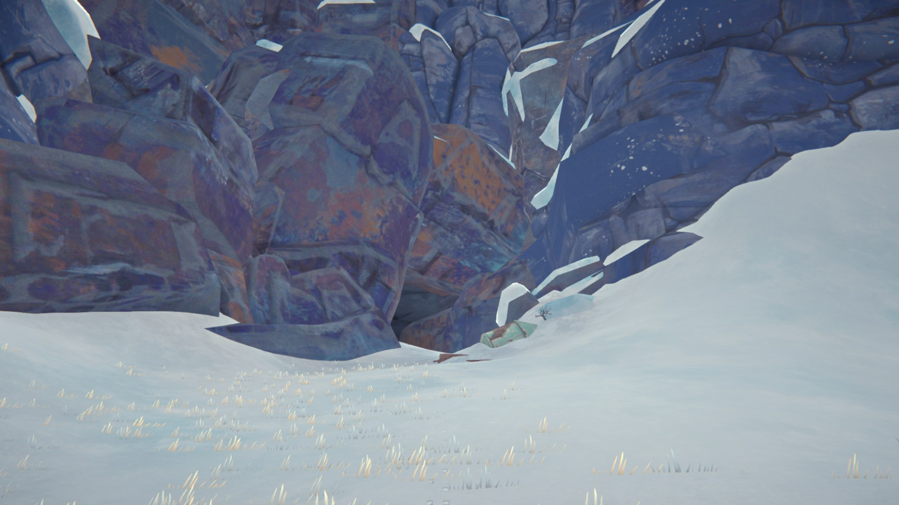
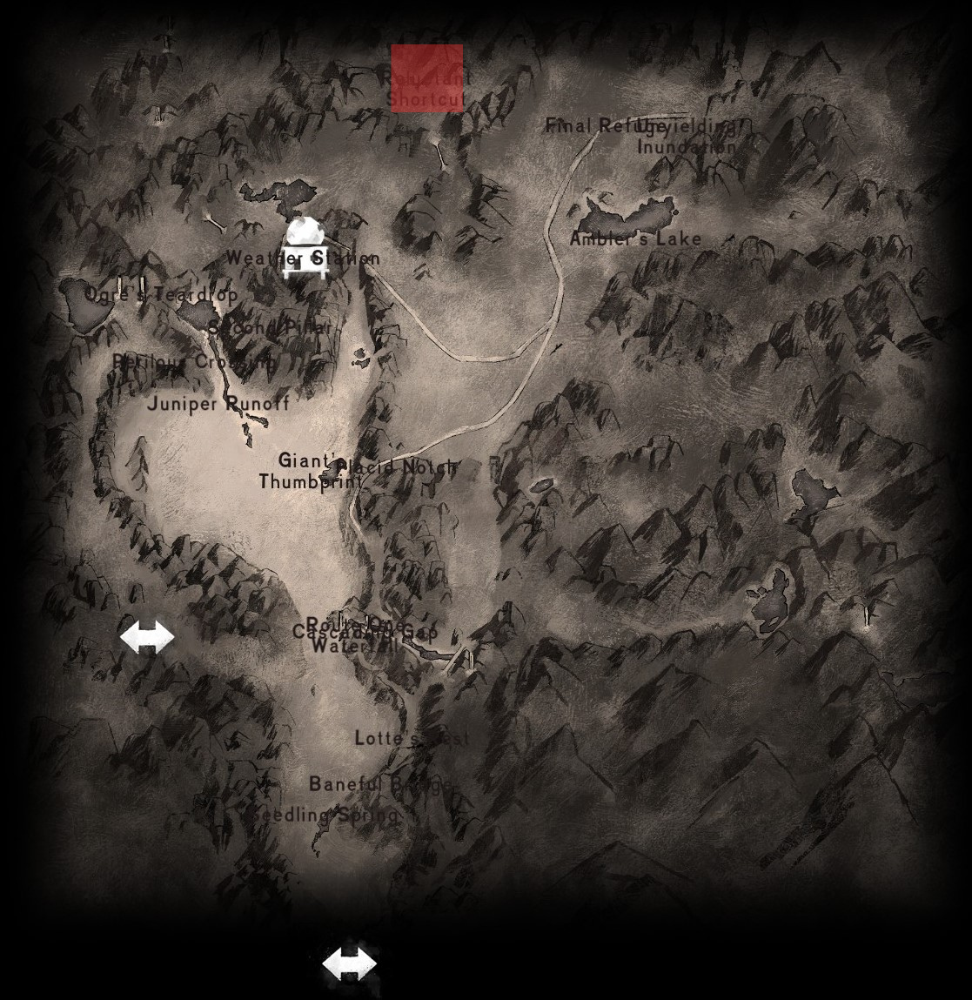

# Reluctant Shortcut

**Reluctant Shortcut**

| Property | Details |
| --- | --- |
|  |  / *Reluctant\_shortcut.jpg* |
| **Location** |  |
|  |  / *Reluctant\_Shortcut\_Location.png* |
| Region | [Sundered Pass](./Sundered%20Pass.md)\|- |
| **General** |  |
|  | Has no shelter\|} [Reluctant Shortcut](./Reluctant%20Shortcut.md) is an entrance to the [Abandoned Mine](./Abandoned%20Mine.md) in the [Sundered Pass](./Sundered%20Pass.md) region. / ## Overview / It can be accessed by a small footpath beginning from a road that branches off near the destroyed cabins at [Old Settlement](./Old%20Settlement.md) by taking the path right of the road to the destroyed bridge to the [Weather Station](./Weather%20Station.md), then past [Bolt Chopper's Haven](./Bolt%20Chopper%27s%20Haven.md) and across the tree bridge. / The area is littered by metal objects left behind from the mining operation, however no useful materials can be salvaged by the survivor. Some [Rabbits](./Rabbit.md) can spawn in the area.**Lua execution error in Module:Navbox function navbox** |
