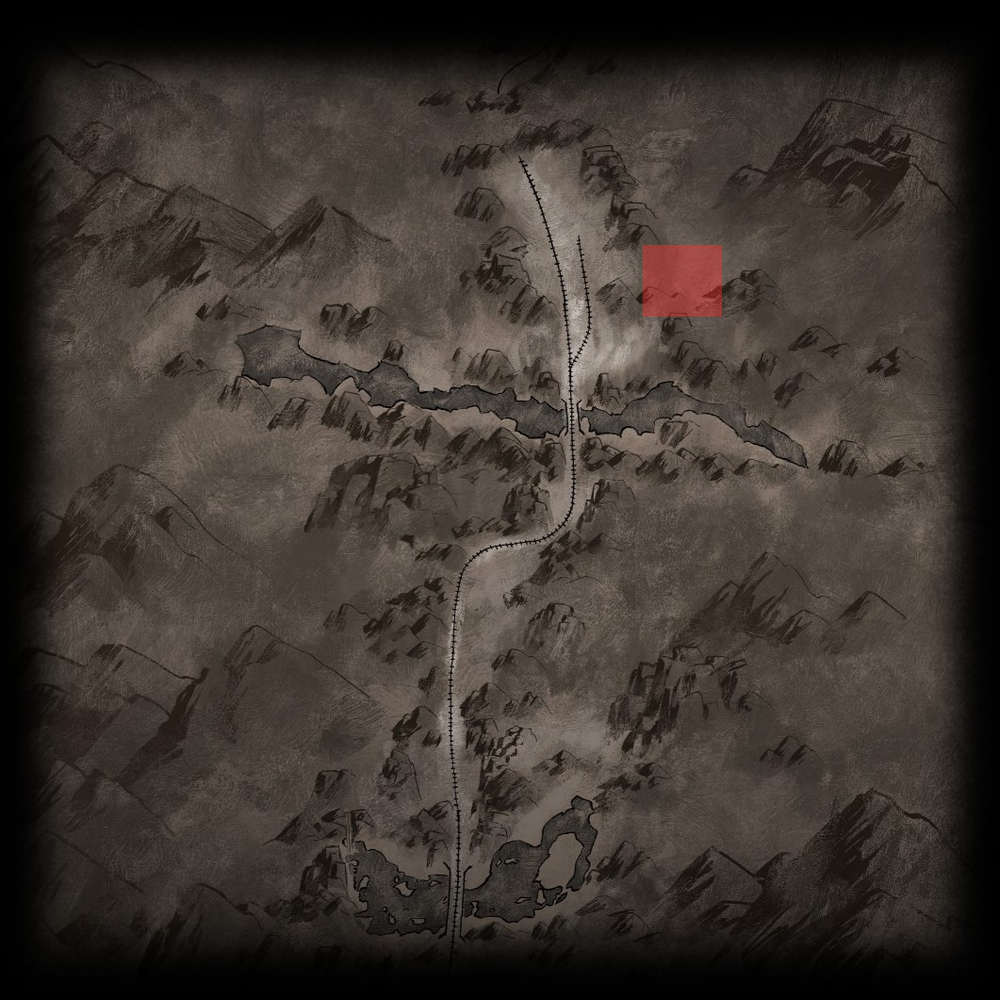
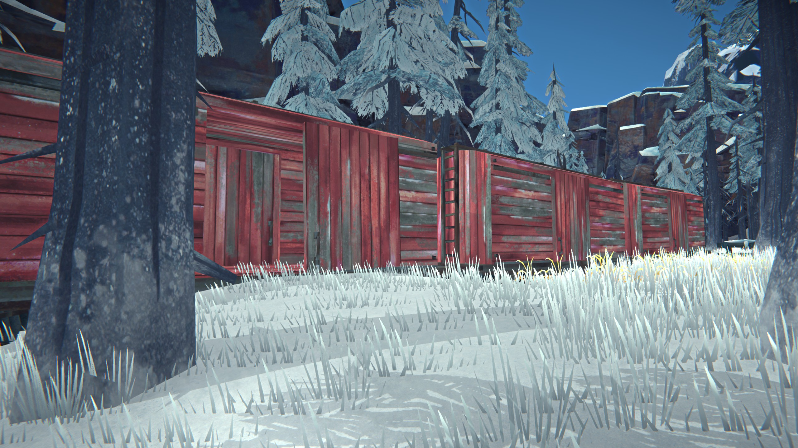

# Remnant Cave

**Remnant Cave**

| Property | Details |
| --- | --- |
|  |  / *Remnant\_Cave.jpg* |
| **Location** |  |
|  |  / *Remnant\_Cave\_Location.png* |
| Region | [Far Range Branch Line](./Far%20Range%20Branch%20Line.md)\|- |
| **General** |  |
|  / *bed\_icon.png* | Has a bed |
|  | Has an interior\|} / **Remnant Cave** is a small cave and unmarked location in the [Far Range Branch Line](./Far%20Range%20Branch%20Line.md) region. / Located between [Steely Chasm](./Steely%20Chasm.md) and [Freighthopper's Rockfall](./Freighthopper%27s%20Rockfall.md), the cave can be found just up a hill from some red boxcars located on a track separate from the main [Trans-Island Railway Line](./Trans-Island%20Railway%20Line.md). Rabbits spawn nearby near the mouth of the cave. / [Coal](./Coal.md) and food items can be found inside. One of the boxcars outside may also spawn loot. / \| Column 1 \| / \| --- \| / \|  / *Boxcars outside the cave* \| / **Lua execution error in Module:Navbox function navbox** |
|  |  / *Boxcars outside the cave* |
