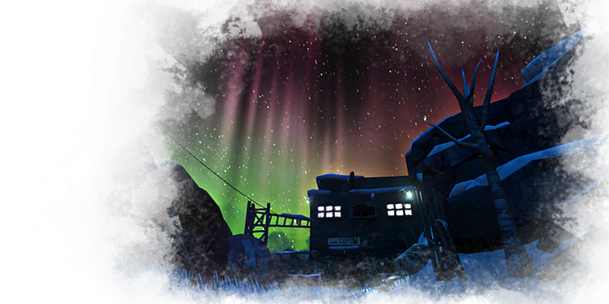

# Renewed Hope/Transcript

<table class="infobox">
<caption>Renewed Hope/Transcript</caption>
<colgroup>
<col style="width: 50%" />
<col style="width: 50%" />
</colgroup>
<tbody>
<tr>
<td colspan="2"><figure>

<figcaption>Missions_story_ep2_Renewed_Hope.png</figcaption>
</figure></td>
</tr>
<tr>
<td>
Episode
</td>
<td>
<a href="./Episode%202%20-%20Luminance%20Fugue.md" class="wikilink" title="Episode 2">Episode 2</a>|-
</td>
</tr>
<tr>
<td>
Previous
</td>
<td>
<a href="./What%20One%20Man%20Can%20Do%20%E2%80%94%20Transcript.md" class="wikilink" title="What One Man Can Do/Transcript">What One Man Can Do/Transcript</a>
</td>
</tr>
<tr>
<td>
Current
</td>
<td>
Renewed Hope/Transcript
</td>
</tr>
<tr>
<td>
Next
</td>
<td>
<a href="./Trauma%20%E2%80%94%20Transcript.md" class="wikilink" title="Trauma/Transcript">Trauma/Transcript</a>
</td>
</tr>
<tr>
<td>
Region
</td>
<td>
<a href="./Pleasant%20Valley.md" class="wikilink" title="Pleasant Valley">Pleasant Valley</a>
</td>
</tr>
<tr>
<td>
Characters
</td>
<td>
<a href="./Will%20Mackenzie.md" class="wikilink" title="Will Mackenzie">Will Mackenzie</a> 
<a href="./Jeremiah.md" class="wikilink" title="Jeremiah">Jeremiah</a> 
<a href="./Methuselah.md" class="wikilink" title="Methuselah">Methuselah</a> 
<a href="./Mathis.md" class="wikilink" title="Mathis">Mathis</a>
</td>
</tr>
</tbody>
</table>

This is the mission transcript for mission 5 <a href="./Renewed%20Hope.md" class="wikilink" title="Renewed Hope">Renewed Hope</a> of <a href="./Episode%202%20-%20Luminance%20Fugue.md" class="wikilink" title="Episode 2: Luminance Fugue">Episode 2: Luminance Fugue</a>.

## Transcript

*Mackenzie is standing outside the <a href="./Trapper%27s%20Homestead.md" class="wikilink" title="Trapper&#39;s Homestead">Trapper's Homestead</a> as the chapter begins*

CHAPTER FIVE

RENEWED HOPE

*If the player attempts to re-enter the Homestead, the door will be locked and Mackenzie will say:*

Mackenzie: "I'm done with him. Time to move on."

*Mackenzie makes his way to the Carter Staging Area just outside the hydro dam only to be greeted by a familiar face sitting by a campfire.*

Methuselah: "Ho, Mackenzie! So you're still alive."

Mackenzie: "Methuselah...you appear in the strangest places."

Methuselah: "You've left your mark. And have overcome great odds, so far...but this part of the world still holds some secrets."

Mackenzie: "I'm not sure this is the right time for..."

Methuselah: "There are still stories that need to be told, if you wish to play a part in them. There is always time, for that. But, if you are in a hurry, -- by all means go. Nobody would fault you for continuing your journey. Onward."

Mackenzie: "You know...it's been a hell of a slog out there, nevermind that damn bear. I've nearly died more times than I care to count. It couldn't have been easy for you, either. But you seem strangely calm about all the hostility of this place.

Methuselah: "I have wandered these paths a long time, friend. I was a walker, now I'm a watcher. I'm here to observe these times, and help where I may."

Mackenzie: "As strange as it is running into you again, it's good to meet a familiar face in all this frigid wilderness. And keep to your paths. If this is a reckoning, as you say, I hope our paths cross again."

*The player can wait for the <a href="./Aurora.md" class="wikilink" title="Aurora">Aurora</a> to appear at night while in the company of Methuselah, or go complete side missions in the meantime. Once the lights appear in the sky, Mackenzie walks to the Dam. He opens the door the the control room and turns a switch box on to the main elevators.*

Mackenzie: "There it is."

*Mackenzie finds a working elevator near the control room and presses the call button. The doors slide open.*

Mackenzie: "Well, I guess there's only one way to go from here."

*The elevator descends, but breaks as it reaches the bottom, with the doors partly opening and the elevator button sparking, too dangerous to touch.*

Mackenzie: "Holy shit, what was that?"

*Mackenzie uses a Prybar to force the doors open, and enters the turbine room. Making his way around the obvious hazards on the floor, he reaches the lower dam. Another door with a keypad is found labeled "Emergency Exit", but it will not open no matter what Mackenzie does, and he moves on. He reaches the lower turbine room and sees more sparking wires on the floor.*

Mackenzie: "I'd better watch out."

*He finds another switch box and turns the power off, then crosses the room and ascends a stairwell. After reaching the top, he spots a doorway off in the distance with another exit sign. As he approaches it, an unseen force hits him in the back of the head and knocks him out. As he comes too, a figure approaches him and places <a href="./Astrid%27s%20Hardcase.md" class="wikilink" title="Astrid&#39;s Hardcase">Astrid's Hardcase</a> on the floor at Mackenzie's feet. Mackenzie snaps awake and sees a man in a sheepskin coat wearing an orange jumpsuit, and realizes he is tied to a chair.*

<a href="./Mathis.md" class="wikilink" title="Mathis">Mathis</a>: "A locked case. Well, that is interesting."

*The man walks behind Mackenzie's chair and then in front of him.*

Mathis: "A locked metal case is a thing of the old world, stranger. It's a world of things closed doors and things being off limits."

*The man punches Mackenzie*

Mathis: "Yeah, see I was part of that world. But that world's over. This is my world now. And in my world, I make the rules. In my world, see, there are no locks."

*The man savagely punches Mackenzie again*

Mackenzie: "Your world sounds crazy."

Mathis: "What's in the case?"

Mackenzie: "I have no idea."

Mathis: "WHAT is in the case?"

Mackenzie: "I hope it's painkillers."

*The man smirks*

Mathis: "Your ID says you're a pilot. You have a plane somewhere?"

Mackenzie: "My plane wouldn't do you any good."

Mathis: "Ya. Should I show you what happened to the last person who tried to lie to me? She didn't look so pretty after I was done."

Mackenzie: "She?"

Mathis: "Oh so now he's ready to talk."

*The man reaches for a <a href="./Hatchet.md" class="wikilink" title="Hatchet">Hatchet</a> and approaches Mackenzie. The pilot looks around frantically, searching for a way to escape.*

Mathis: "Well, don't worry, pilot. You'll be with her soon."

*The man strikes Mackenzie with the back of the axe, and the episode ends.*

The story continues in <a href="./Trauma%20%E2%80%94%20Transcript.md" class="wikilink" title="Trauma">Trauma</a>.**Lua execution error in Module:Navbox function navbox**

