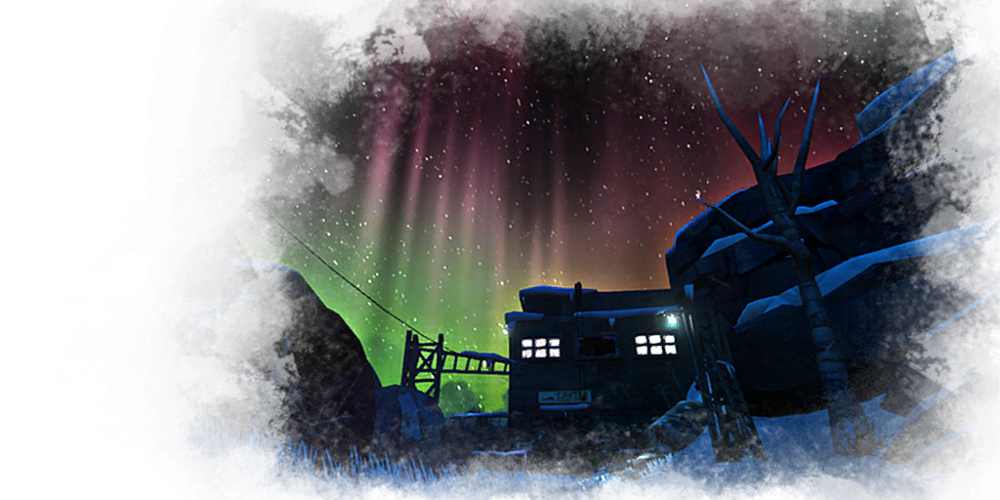

# Renewed Hope

**Renewed Hope**

| Property | Details |
| --- | --- |
|  |  / *Missions\_story\_ep2\_Renewed\_Hope.png* |
| Episode | [Episode 2](./Episode%202%20-%20Luminance%20Fugue.md)\|- |
| Previous | [What One Man Can Do](./What%20One%20Man%20Can%20Do.md) |
| Current | Renewed Hope |
| Next | [Trauma](./Trauma.md) |
| Region | [Pleasant Valley](./Pleasant%20Valley.md) |
| Characters | [Will Mackenzie](./Will%20Mackenzie.md) / [Jeremiah](./Jeremiah.md) / [Methuselah](./Methuselah.md) / [Mathis](./Mathis.md) |

**Template:spoiler**

> “**With the Old Bear no longer a risk, Jeremiah plots a course leading Mackenzie out of Mystery Lake with the means to contact Perseverance Mills, and one step closer to finding Astrid.**”
>
> — In-game description

**Renewed Hope** is the fifth and final mission in [Episode 2](./Episode%202%20-%20Luminance%20Fugue.md) of [Wintermute](./Wintermute.md). In this mission, [Mackenzie](./Will%20Mackenzie.md) makes his way to the Carter Hydro Dam in order to begin his journey to [Signal Hill](./Signal%20Hill.md) and later [Perseverance Mills](./Perseverance%20Mills.md).

## Tasks

- Get into the [dam](./Carter%20Hydro%20Dam.md) at night, when the [aurora](./Aurora.md) is in the sky.
- (Optional) speak with [Methuselah](./Methuselah.md)
- Find your way through Carter Hydro Dam.
  - Access the control room using Jeremiah's code.
- Explore the guts of the dam.

**Lua execution error in Module:Navbox function navbox****Lua execution error in Module:Navbox function navbox**
