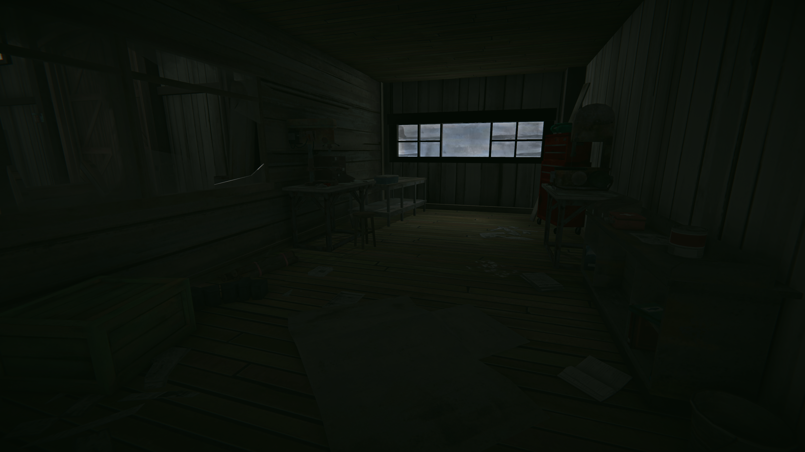
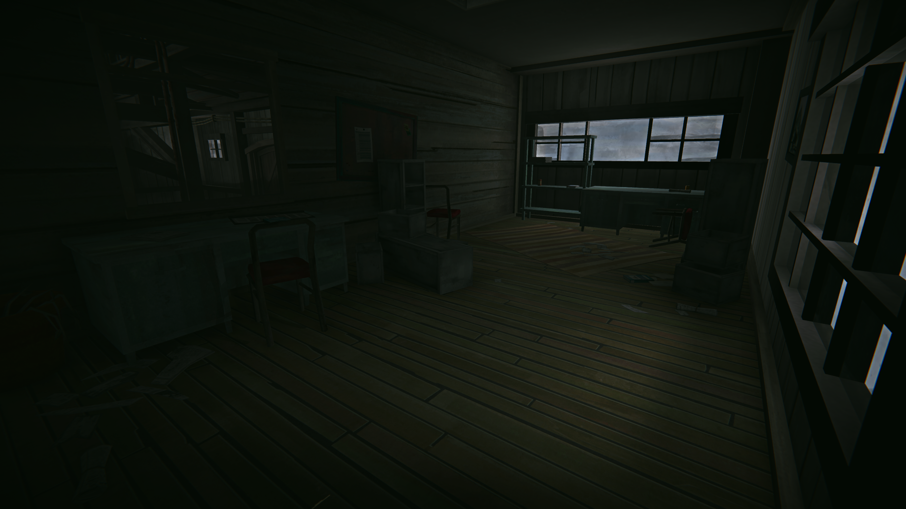
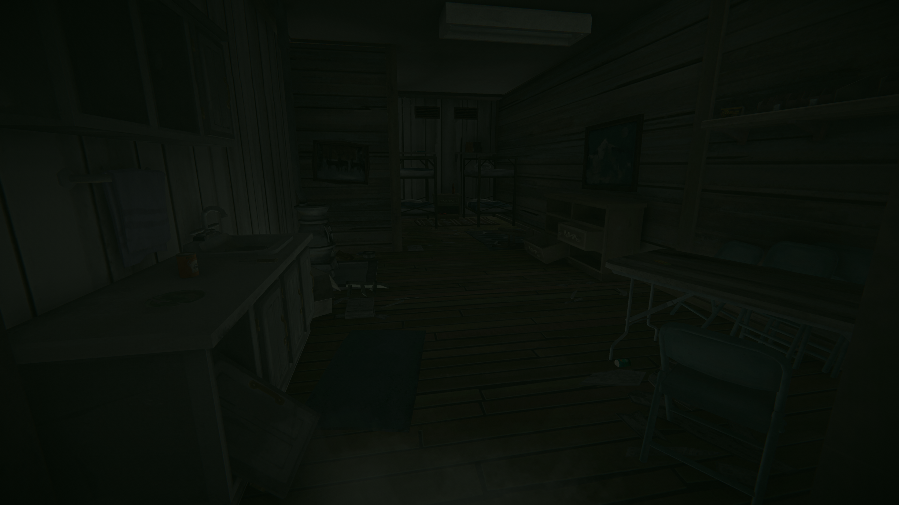

# Repair Depot

**Contents**

- [Overview](#Overview)
- [Anna Island -- Track Section 4](#Anna_Island_--_Track_Section_4)
- [Anna Island -- Track Section 2](#Anna_Island_--_Track_Section_2)
- [Gallery](#Gallery)
- [Anna Island -- Track Section 2](#Anna_Island_--_Track_Section_2_2)
- [Anna Island -- Track Section 4](#Anna_Island_--_Track_Section_4_2)

<table>
<colgroup>
<col style="width: 33%" />
<col style="width: 33%" />
<col style="width: 33%" />
</colgroup>
<tbody>
<tr>
<td width="40px"><figure>

<figcaption>Seal_icon.png</figcaption>
</figure></td>
<td>
<strong>DLC-Exclusive content.</strong> 

This content requires the <a href="./Iron%20Road.md" class="wikilink" title="Iron Road">Iron Road</a> addon to be installed before it can be seen or used in regular gameplay.

</td>
<td>
|}

<table class="infobox">
<caption>Repair Depot</caption>
<colgroup>
<col style="width: 50%" />
<col style="width: 50%" />
</colgroup>
<tbody>
<tr>
<td colspan="2"><figure>

<figcaption>Repair_Depot.png</figcaption>
</figure></td>
</tr>
<tr>
<td colspan="2" class="section">
<strong>Location</strong>
</td>
</tr>
<tr>
<td>
Region
</td>
<td></td>
</tr>
<tr>
<td>
Description
</td>
<td>
A Train Repair Depot for maintenance crews of Cauldron Island.
</td>
</tr>
<tr>
<td colspan="2" class="section">
<strong>General</strong>
</td>
</tr>
<tr>
<td>
Firebox
</td>
<td>
<a href="./Pot%20Belly%20Stove.md" class="wikilink" title="Pot Belly Stove">Pot Belly Stove</a>
</td>
</tr>
<tr>
<td><figure>

<figcaption>bed_icon.png</figcaption>
</figure></td>
<td>
Has a bed
</td>
</tr>
<tr>
<td><figure>

<figcaption>forge_icon_green.png</figcaption>
</figure></td>
<td></td>
</tr>
<tr>
<td><figure>

<figcaption>workbench_icon_green.png</figcaption>
</figure></td>
<td></td>
</tr>
<tr>
<td></td>
<td>
Has an interior|}

A <strong>Repair Depot</strong> is a major landmark building that can be found on <a href="./Cauldron%20Island.md" class="wikilink" title="Cauldron Island">Cauldron Island</a>. There are currently two in the game. Located on <a href="./Anna%20Island%20--%20Track%20Section%202.md" class="wikilink" title="Anna Island -- Track Section 2">Anna Island -- Track Section 2</a> and <a href="./Anna%20Island%20--%20Track%20Section%204.md" class="wikilink" title="Anna Island -- Track Section 4">Anna Island -- Track Section 4</a>.

<h2 id="Overview">Overview</h2>

The <a href="./Prototype%20Train.md" class="wikilink" title="Prototype Train">Prototype Train</a> can be driven into the Repair Depot by rolling through the red gate (even at full speed, this does not result in a crash), allowing the train to be transported inside and the Survivor to work on the train without being exposed to the elements. Leaving the Depot with the train inside will automatically spawn it outside, and vice versa when returning inside, until it is moved far enough away from the Depot doors.

Enough resources can be found to repair the Prototype Train, but there is no <a href="./Work%20Bench.md" class="wikilink" title="Work Bench">Work Bench</a> for Crafting at either location. The Depots also contain small to moderate amounts of clothing and food, along with several <a href="./Locker.md" class="wikilink" title="lockers">lockers</a>, and <a href="./Bed.md" class="wikilink" title="Beds">Beds</a>. Both Depots support <a href="./Safehouse%20Customization.md" class="wikilink" title="Safehouse Customization">Safehouse Customization</a>.

<a href="./Wolf.md" class="wikilink" title="Wolves">Wolves</a> and <a href="./Deer.md" class="wikilink" title="Deer">Deer</a> are common at these locations.

<h3 id="Anna_Island_--_Track_Section_4">Anna Island -- Track Section 4</h3>

The Repair Depot in <a href="./Anna%20Island%20--%20Track%20Section%204.md" class="wikilink" title="Anna Island -- Track Section 4">Anna Island -- Track Section 4</a> has a <a href="./Oil%20Tank.md" class="wikilink" title="Whale Oil Tank">Whale Oil Tank</a> and a <a href="./Water%20Tower.md" class="wikilink" title="Water Tower">Water Tower</a>. It is the first Repair Depot the player will encounter after acquiring the Prototype Train.

<h3 id="Anna_Island_--_Track_Section_2">Anna Island -- Track Section 2</h3>

The Repair Depot in <a href="./Anna%20Island%20--%20Track%20Section%202.md" class="wikilink" title="Anna Island -- Track Section 2">Anna Island -- Track Section 2</a> has a <a href="./Water%20Tower.md" class="wikilink" title="Water Tower">Water Tower</a> and the unique <a href="./McLeod%20Ultra-Efficiency%20Whale%20Oil%20Heater.md" class="wikilink" title="McLeod Ultra-Efficiency Whale Oil Heater">McLeod Ultra-Efficiency Whale Oil Heater</a>.

<h2 id="Gallery">Gallery</h2>
<h3 id="Anna_Island_--_Track_Section_2_2">Anna Island -- Track Section 2</h3>
<table class="gallery">
<colgroup>
<col style="width: 100%" />
</colgroup>
<tbody>
<tr>
<td><figure>

<figcaption><strong>Repair Depot Track Section 2</strong></figcaption>
</figure></td>
</tr>
</tbody>
</table>
<h3 id="Anna_Island_--_Track_Section_4_2">Anna Island -- Track Section 4</h3>
<table class="gallery">
<colgroup>
<col style="width: 25%" />
<col style="width: 25%" />
<col style="width: 25%" />
<col style="width: 25%" />
</colgroup>
<tbody>
<tr>
<td><figure>
[Missing image: Railyard_(Track_Section_4_West).jpg]
<figcaption><strong>Repair Depot Track Section 4</strong></figcaption>
</figure></td>
<td><figure>

<figcaption><strong>Repair Depot Interior</strong></figcaption>
</figure></td>
<td><figure>

<figcaption><strong>Repair Depot Interior</strong></figcaption>
</figure></td>
<td><figure>

<figcaption><strong>Repair Depot Interior</strong></figcaption>
</figure></td>
</tr>
<tr>
<td><figure>

<figcaption><strong>Repair Depot Interior</strong></figcaption>
</figure></td>
<td><figure>

<figcaption><strong>Repair Depot Bedroom</strong></figcaption>
</figure></td>
<td></td>
<td></td>
</tr>
</tbody>
</table>

<strong>Lua execution error in Module:Navbox function navboxLua execution error in Module:Navbox function navbox</strong>
</td>
</tr>
</tbody>
</table></td>
</tr>
</tbody>
</table>

