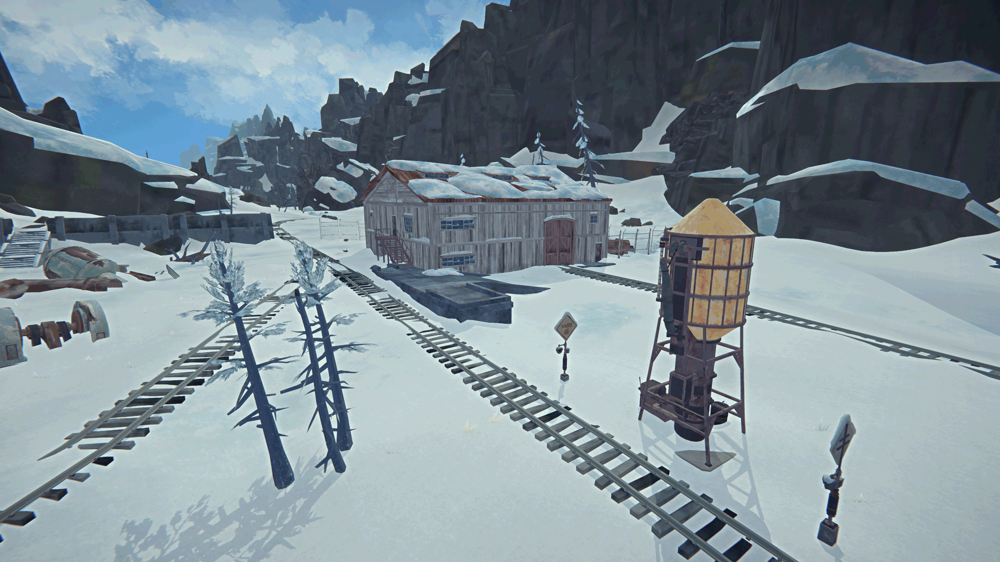
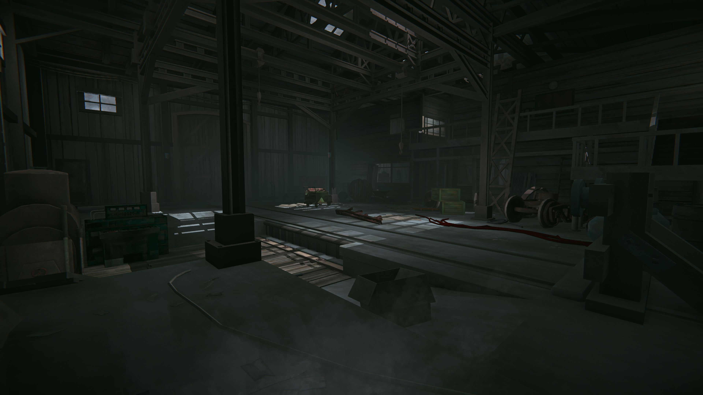

# Repair Depot

**Categories:** DLC Content, Indoor locations, Locations · **Source:** [Fandom](https://thelongdark.fandom.com/wiki/Repair_Depot)

**Contents**

- [Overview](#overview)
- [Anna Island -- Track Section 4](#anna-island----track-section-4)
- [Anna Island -- Track Section 2](#anna-island----track-section-2)
- [Gallery](#gallery)
- [Anna Island -- Track Section 2](#anna-island----track-section-2-1)
- [Anna Island -- Track Section 4](#anna-island----track-section-4-1)

_Seal\_icon.png_

**DLC-Exclusive content.** / This content requires the [Iron Road](./Iron%20Road.md) addon to be installed before it can be seen or used in regular gameplay.

_Repair\_Depot.png_

**Location**

Region

**Description:** A Train Repair Depot for maintenance crews of Cauldron Island.

**General**

**Firebox:** [Pot Belly Stove](./Pot%20Belly%20Stove.md)

_bed\_icon.png_

Has a bed

_forge\_icon\_green.png_

_workbench\_icon\_green.png_

_**Repair Depot Track Section 2**_

_**Repair Depot Track Section 4**_

_**Repair Depot Interior**_

_**Repair Depot Interior**_

_**Repair Depot Interior**_

_**Repair Depot Interior**_

_**Repair Depot Bedroom**_
