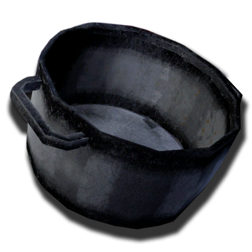
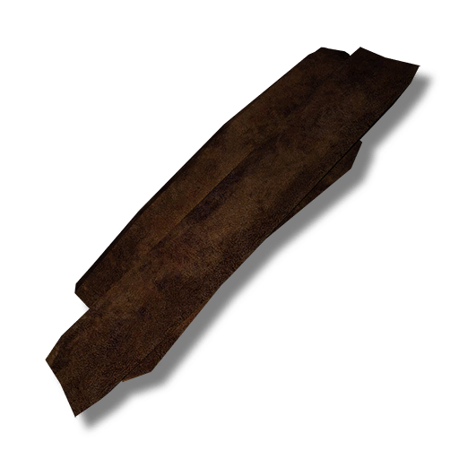
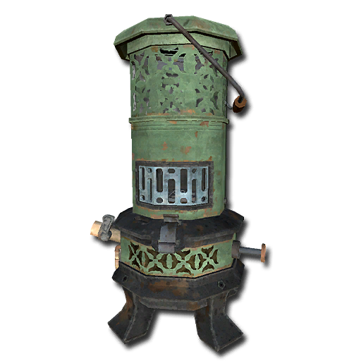

# Repair

**Repairing** is a secondary Survival <a href="./Skills.md" class="wikilink" title="Skill">Skill</a> that is used to repair or crafts tools. Higher levels in the repairing skill reduce the amount of time required to repair, and additionally increase the amount of condition restored to an item by repairing. <a href="./Mending.md" class="wikilink" title="Mending">Mending</a> is the corresponding skill used to repair or craft Clothing, and <a href="./Sharpening.md" class="wikilink" title="Sharpening">Sharpening</a> is the skill used to improve the condition of Hatchets and Knives.

## Repairing Tools

Most tools consume 1 <a href="./Scrap%20Metal.md" class="wikilink" title="Scrap Metal">Scrap Metal</a> per repair action, and may still consume metal upon a failed repair attempt. Players need <a href="./Simple%20Tools.md" class="wikilink" title="Simple Tools">Simple Tools</a> or <a href="./Quality%20Tools.md" class="wikilink" title="Quality Tools">Quality Tools</a> to repair other tools.

- Simple Tools increase the chance of repair successes by 10%, Quality Tools by 20%.
  - Either is usable for any affected item, but Quality Tools provide a higher chance of success, a faster repair time, and a higher Condition increase.
- Toolboxes are always found in 100% Condition and may be found in areas that other tools spawn, around workbenches, or inside tool chests or lockers. Both can also be repaired with Scrap Metal or with other toolboxes.
- Despite needing Scrap Metal and Quality/Simple tools to repair, <a href="./Improvised%20Crampons.md" class="wikilink" title="Improvised Crampons">Improvised Crampons</a> and <a href="./Crampons.md" class="wikilink" title="Crampons">Crampons</a> count towards the <a href="./Mending.md" class="wikilink" title="Mending">Mending</a> skill.

The player is able to repair the following items to improve their Condition:

<table>
<colgroup>
<col style="width: 25%" />
<col style="width: 25%" />
<col style="width: 25%" />
<col style="width: 25%" />
</colgroup>
<thead>
<tr>
<th>
Tool
</th>
<th>
Name
</th>
<th>
Repair Material
</th>
<th>
Repair Tool
</th>
</tr>
</thead>
<tbody>
<tr>
<td><figure>

<figcaption>Can_Opener_icon.png</figcaption>
</figure></td>
<td>
<a href="./Can%20Opener.md" class="wikilink" title="Can Opener">Can Opener</a>
</td>
<td>
1 x  <a href="./Scrap%20Metal.md" class="wikilink" title="Scrap Metal">Scrap Metal</a>
</td>
<td>
1 x  <a href="./Simple%20Tools.md" class="wikilink" title="Simple Tools">Simple Tools</a> 1 x  <a href="./Quality%20Tools.md" class="wikilink" title="Quality Tools">Quality Tools</a>
</td>
</tr>
<tr>
<td><figure>

<figcaption>cooking_Pot_icon.png</figcaption>
</figure></td>
<td>
<a href="./Cooking%20Pot.md" class="wikilink" title="Cooking Pot">Cooking Pot</a>
</td>
<td>
1 x  <a href="./Scrap%20Metal.md" class="wikilink" title="Scrap Metal">Scrap Metal</a>
</td>
<td>
1 x  <a href="./Simple%20Tools.md" class="wikilink" title="Simple Tools">Simple Tools</a> 1 x  <a href="./Quality%20Tools.md" class="wikilink" title="Quality Tools">Quality Tools</a>
</td>
</tr>
<tr>
<td><figure>

<figcaption>Cooking_Skillet_icon.png</figcaption>
</figure></td>
<td>
<a href="./Cooking%20Skillet.md" class="wikilink" title="Cooking Skillet">Cooking Skillet</a>
</td>
<td>
1 x  <a href="./Scrap%20Metal.md" class="wikilink" title="Scrap Metal">Scrap Metal</a>
</td>
<td>
1 x  <a href="./Simple%20Tools.md" class="wikilink" title="Simple Tools">Simple Tools</a> 1 x  <a href="./Quality%20Tools.md" class="wikilink" title="Quality Tools">Quality Tools</a>
</td>
</tr>
<tr>
<td><figure>

<figcaption>flashlight_icon.png</figcaption>
</figure></td>
<td>
<a href="./Flashlight.md" class="wikilink" title="Flashlight">Flashlight</a>
</td>
<td>
1 x  <a href="./Scrap%20Metal.md" class="wikilink" title="Scrap Metal">Scrap Metal</a>
</td>
<td>
1 x  <a href="./Simple%20Tools.md" class="wikilink" title="Simple Tools">Simple Tools</a> 1 x  <a href="./Quality%20Tools.md" class="wikilink" title="Quality Tools">Quality Tools</a>
</td>
</tr>
<tr>
<td><figure>

<figcaption>heavy_Hammer_icon.png</figcaption>
</figure></td>
<td>
<a href="./Heavy%20Hammer.md" class="wikilink" title="Heavy Hammer">Heavy Hammer</a>
</td>
<td>
1 x  <a href="./Fir%20Firewood.md" class="wikilink" title="Fir Firewood">Fir Firewood</a>
</td>
<td>
1 x  <a href="./Simple%20Tools.md" class="wikilink" title="Simple Tools">Simple Tools</a> 1 x  <a href="./Quality%20Tools.md" class="wikilink" title="Quality Tools">Quality Tools</a>
</td>
</tr>
<tr>
<td><figure>

<figcaption>hacksaw_icon.png</figcaption>
</figure></td>
<td>
<a href="./Hacksaw.md" class="wikilink" title="Hacksaw">Hacksaw</a>
</td>
<td>
1 x  <a href="./Scrap%20Metal.md" class="wikilink" title="Scrap Metal">Scrap Metal</a>
</td>
<td>
1 x  <a href="./Simple%20Tools.md" class="wikilink" title="Simple Tools">Simple Tools</a> 1 x  <a href="./Quality%20Tools.md" class="wikilink" title="Quality Tools">Quality Tools</a>
</td>
</tr>
<tr>
<td><figure>

<figcaption>Miner's_Flashlight_icon.png</figcaption>
</figure></td>
<td>
<a href="./Miner%27s%20Flashlight.md" class="wikilink" title="Miner&#39;s Flashlight">Miner's Flashlight</a>
</td>
<td>
1 x  <a href="./Scrap%20Metal.md" class="wikilink" title="Scrap Metal">Scrap Metal</a>
</td>
<td>
1 x  <a href="./Simple%20Tools.md" class="wikilink" title="Simple Tools">Simple Tools</a> 1 x  <a href="./Quality%20Tools.md" class="wikilink" title="Quality Tools">Quality Tools</a>
</td>
</tr>
<tr>
<td><figure>

<figcaption>Storm_Lantern_icon.png</figcaption>
</figure></td>
<td>
<a href="./Storm%20Lantern.md" class="wikilink" title="Storm Lantern">Storm Lantern</a>
</td>
<td>
1 x  <a href="./Scrap%20Metal.md" class="wikilink" title="Scrap Metal">Scrap Metal</a>
</td>
<td>
1 x  <a href="./Simple%20Tools.md" class="wikilink" title="Simple Tools">Simple Tools</a> 1 x  <a href="./Quality%20Tools.md" class="wikilink" title="Quality Tools">Quality Tools</a>
</td>
</tr>
<tr>
<td><figure>

<figcaption>Spelunker's_Lantern_icon.png</figcaption>
</figure></td>
<td>
<a href="./Spelunker%27s%20Lantern.md" class="wikilink" title="Spelunker&#39;s Lantern">Spelunker's Lantern</a>
</td>
<td>
1 x  <a href="./Scrap%20Metal.md" class="wikilink" title="Scrap Metal">Scrap Metal</a>
</td>
<td>
1 x  <a href="./Simple%20Tools.md" class="wikilink" title="Simple Tools">Simple Tools</a> 1 x  <a href="./Quality%20Tools.md" class="wikilink" title="Quality Tools">Quality Tools</a>
</td>
</tr>
<tr>
<td><figure>

<figcaption>McLeod_Ultra-Efficiency_Whale_Oil_Heater_icon.png</figcaption>
</figure></td>
<td>
<a href="./McLeod%20Ultra-Efficiency%20Whale%20Oil%20Heater.md" class="wikilink" title="McLeod Ultra-Efficiency Whale Oil Heater">McLeod Ultra-Efficiency Whale Oil Heater</a>
</td>
<td>
1 x  <a href="./Scrap%20Metal.md" class="wikilink" title="Scrap Metal">Scrap Metal</a>
</td>
<td>
1 x  <a href="./Simple%20Tools.md" class="wikilink" title="Simple Tools">Simple Tools</a> 1 x  <a href="./Quality%20Tools.md" class="wikilink" title="Quality Tools">Quality Tools</a>
</td>
</tr>
<tr>
<td><figure>
[Missing image: Travois_icon.png]
<figcaption>Travois_icon.png</figcaption>
</figure></td>
<td>
<a href="./Travois.md" class="wikilink" title="Travois">Travois</a>
</td>
<td><ul>
<li>1 x  <a href="./Cured%20Deer%20Hide.md" class="wikilink" title="Cured Deer Hide">Cured Deer Hide</a></li>
<li>1 x <a href="./Cured%20Gut.md" class="wikilink" title="Cured Gut">Cured Gut</a></li>
</ul></td>
<td><ul>
<li>No Tool</li>
<li>1 x <a href="./Hunting%20Knife.md" class="wikilink" title="Hunting Knife">Hunting Knife</a></li>
<li>1 x  <a href="./Survival%20Knife.md" class="wikilink" title="Survival Knife">Survival Knife</a></li>
<li>1 x  <a href="./Improvised%20Knife.md" class="wikilink" title="Improvised Knife">Improvised Knife</a></li>
<li>1 x  <a href="./Cougar%20Claw%20Knife.md" class="wikilink" title="Cougar Claw Knife">Cougar Claw Knife</a></li>
<li>1 x  <a href="./Hatchet.md" class="wikilink" title="Hatchet">Hatchet</a></li>
<li>1 x  <a href="./Improvised%20Hatchet.md" class="wikilink" title="Improvised Hatchet">Improvised Hatchet</a></li>
</ul></td>
</tr>
<tr>
<td><figure>

<figcaption>Simple_Tools_icon.png</figcaption>
</figure></td>
<td>
<a href="./Simple%20Tools.md" class="wikilink" title="Simple Tools">Simple Tools</a>
</td>
<td>
1 x  <a href="./Scrap%20Metal.md" class="wikilink" title="Scrap Metal">Scrap Metal</a>
</td>
<td>
1 x  <a href="./Simple%20Tools.md" class="wikilink" title="Simple Tools">Simple Tools</a> 1 x  <a href="./Quality%20Tools.md" class="wikilink" title="Quality Tools">Quality Tools</a>
</td>
</tr>
<tr>
<td><figure>

<figcaption>Quality_Tools_icon.png</figcaption>
</figure></td>
<td>
<a href="./Quality%20Tools.md" class="wikilink" title="Quality Tools">Quality Tools</a>
</td>
<td>
1 x  <a href="./Scrap%20Metal.md" class="wikilink" title="Scrap Metal">Scrap Metal</a>
</td>
<td>
1 x  <a href="./Simple%20Tools.md" class="wikilink" title="Simple Tools">Simple Tools</a> 1 x  <a href="./Quality%20Tools.md" class="wikilink" title="Quality Tools">Quality Tools</a>
</td>
</tr>
</tbody>
</table>

## Milling Machine

A second method to repair tools (including firearms) is to use a <a href="./Milling%20Machine.md" class="wikilink" title="Milling Machine">Milling Machine</a> and 1 Scrap Metal. This amount of condition restored is affected by the user's Repair skill; base skill has a 50% chance of success, for a 40% item condition repair and taking 20 minutes (in-game). It can be used to repair more tool condition than even Quality Tools, but at the cost of only being found in 2 regions and being available only during an <a href="./Aurora.md" class="wikilink" title="Aurora">Aurora</a>.

| Item | Repair Time | Restoration Time |
|----|----|----|
| Hand Tools |  |  |
|  <a href="./Hacksaw.md" class="wikilink" title="Hacksaw">Hacksaw</a> | 20.0 minutes | N/A |
|  <a href="./Hatchet.md" class="wikilink" title="Hatchet">Hatchet</a> | 20.0 minutes | N/A |
|  <a href="./Hunting%20Knife.md" class="wikilink" title="Hunting Knife">Hunting Knife</a> | 20.0 minutes | N/A |
|  <a href="./Improvised%20Hatchet.md" class="wikilink" title="Improvised Hatchet">Improvised Hatchet</a> | 20.0 minutes | N/A |
|  <a href="./Improvised%20Knife.md" class="wikilink" title="Improvised Knife">Improvised Knife</a> | 20.0 minutes | N/A |
|  <a href="./Cougar%20Claw%20Knife.md" class="wikilink" title="Cougar Claw Knife">Cougar Claw Knife</a> | 20.0 minutes | N/A |
|  <a href="./Survival%20Knife.md" class="wikilink" title="Survival Knife">Survival Knife</a> | 20.0 minutes | N/A |
| Firearms |  |  |
|  <a href="./Revolver.md" class="wikilink" title="Revolver">Revolver</a> | 30.0 minutes | 90.0 minutes |
|  <a href="./Forester%27s%20Revolver.md" class="wikilink" title="Forester&#39;s Revolver">Forester's Revolver</a> | 30.0 minutes | 90.0 minutes |
|  <a href="./Hunter%27s%20Revolver.md" class="wikilink" title="Hunter&#39;s Revolver">Hunter's Revolver</a> | 30.0 minutes | 90.0 minutes |
|  <a href="./Warden%27s%20Revolver.md" class="wikilink" title="Warden&#39;s Revolver">Warden's Revolver</a> | 30.0 minutes | 90.0 minutes |
|  <a href="./Hunting%20Rifle.md" class="wikilink" title="Hunting Rifle">Hunting Rifle</a> | 30.0 minutes | 90.0 minutes |
|  <a href="./Barb%27s%20Rifle.md" class="wikilink" title="Barb&#39;s Rifle">Barb's Rifle</a> | 30.0 minutes | 90.0 minutes |
|  <a href="./Bunker%20Rifle.md" class="wikilink" title="Bunker Rifle">Bunker Rifle</a> | 30.0 minutes | 90.0 minutes |
|  <a href="./Curator%27s%20Rifle.md" class="wikilink" title="Curator&#39;s Rifle">Curator's Rifle</a> | 30.0 minutes | 90.0 minutes |
|  <a href="./Vaughn%27s%20Rifle.md" class="wikilink" title="Vaughn&#39;s Rifle">Vaughn's Rifle</a> | 30.0 minutes | 90.0 minutes |

## Skill Levels

There is currently no <a href="./Research%20Book.md" class="wikilink" title="Research Book">Research Book</a> that allow players to increase their repairing skill.

The repairing skill does not unlock any perks, but gives a gradual increase to the successful chance to repair something, and additionally gives a gradual increase to the amount of Condition restored to an item by repairing it.

Repair experience is acquired by successfully:

- Repairing tools (1 point)
- Repairing firearms/hand tools at a Milling Machine (1 point)
- Repairing any component of the <a href="./Prototype%20Train.md" class="wikilink" title="Prototype Train">Prototype Train</a> (1 point)
- Repairing <a href="./Damaged%20Track.md" class="wikilink" title="Damaged Track">Damaged Track</a> (1 point)
- Using <a href="./Safehouse%20Customization.md" class="wikilink" title="Safehouse Customization">Safehouse Customization</a> and <a href="./Woodworking%20Tools.md" class="wikilink" title="Woodworking Tools">Woodworking Tools</a> to repair:
  - The damaged roof of <a href="./Mountaineer%27s%20Hut.md" class="wikilink" title="Mountaineer&#39;s Hut">Mountaineer's Hut</a> or <a href="./Bricklayer%27s%20Retreat.md" class="wikilink" title="Bricklayer&#39;s Retreat">Bricklayer's Retreat</a> (1 point)
  - Repairing damaged <a href="./Cupboard.md" class="wikilink" title="Cupboard">Cupboard</a> (1 point)

| Skill | Time to Repair | Chance of Success |
|-------|----------------|-------------------|
| 60    | 45m            | 60%               |
| 70    | 45m            | 70%               |
| 80    | 45m            | 80%               |
| 100   | 45m            | 100%              |

**Lua execution error in Module:Navbox function navbox**

