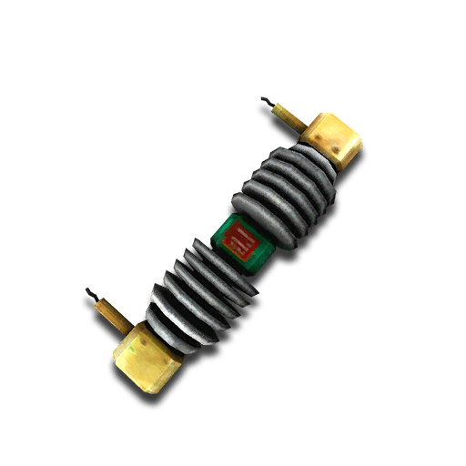

# Replacement Fuse

**Contents**

- [Use](#Use)
- [Story Mode](#Story_Mode)
- [Survival Mode](#Survival_Mode)
- [Update history](#Update_history)

<table>
<colgroup>
<col style="width: 33%" />
<col style="width: 33%" />
<col style="width: 33%" />
</colgroup>
<tbody>
<tr>
<td width="40px"><figure>
[Missing image: Ptarmigan_icon.png]
<figcaption>Ptarmigan_icon.png</figcaption>
</figure></td>
<td>
<strong>DLC-Exclusive content.</strong> 

This content requires the <a href="./Tales%20from%20the%20Far%20Territory.md" class="wikilink" title="Tales from the Far Territory">Tales from the Far Territory</a> addon to be installed before it can be seen or used in regular gameplay.

</td>
<td>
|}

<table class="infobox">
<caption>Replacement Fuse</caption>
<colgroup>
<col style="width: 50%" />
<col style="width: 50%" />
</colgroup>
<tbody>
<tr>
<td colspan="2"><figure>

<figcaption>Replacement_Fuse_icon.png</figcaption>
</figure></td>
</tr>
<tr>
<td>
Wintermute
</td>
<td>
No
</td>
</tr>
<tr>
<td colspan="2" class="section">
<strong>Properties</strong>
</td>
</tr>
<tr>
<td>
Item type
</td>
<td>
<a href="./Tools.md" class="wikilink" title="Tools">Tools</a>|-
</td>
</tr>
<tr>
<td>
Examine
</td>
<td>
Electrical fuse. Looks old, but appears to be in working order.
</td>
</tr>
<tr>
<td colspan="2" class="section">
<strong>Values</strong>
</td>
</tr>
<tr>
<td>
Weight
</td>
<td>
0.2 kg (0.44 lbs)
</td>
</tr>
<tr>
<td colspan="2" class="section">
<strong>Advanced data</strong>
</td>
</tr>
<tr>
<td>
Item key
</td>
<td>
STORY_ElevatorParts
</td>
</tr>
</tbody>
</table>

The <strong>Replacement Fuse</strong> is an item that was first added in <a href="./Episode%203%20-%20Crossroads%20Elegy.md" class="wikilink" title="Episode 3">Episode 3</a> of Story Mode. It was later added to survival mode in the <a href="./Tales%20from%20the%20Far%20Territory.md" class="wikilink" title="Tales from the Far Territory">Tales from the Far Territory</a> DLC.

<h2 id="Use">Use</h2>
<h3 id="Story_Mode">Story Mode</h3>

In Story Mode, the fuses are found in the <a href="./Cinder%20Hills%20Coal%20Mine.md" class="wikilink" title="Cinder Hills Coal Mine">Cinder Hills Coal Mine</a>. They are used to replace <a href="./Burned%20Out%20Fuse.md" class="wikilink" title="burned out fuses">burned out fuses</a> to power up the elevator and leave <a href="./Pleasant%20Valley.md" class="wikilink" title="Pleasant Valley">Pleasant Valley</a>.

<h3 id="Survival_Mode">Survival Mode</h3>

In Survival Mode, the fuses are used to repair <a href="./Transmitters.md" class="wikilink" title="transmitters">transmitters</a>. Three fuses are needed to repair each transmitter. Several fuses can often be found near the broken-down transmitter, but extra fuses can also be found scattered throughout the world in industrial locations.

<h2 id="Update_history">Update history</h2>

* UPDATE <strong>22 October 2019 (<a href="./The%20Long%20Dark%20%E2%80%94%20Changelog.md#1.60" class="wikilink" title="Update">Update</a>):</strong>

<ul>
<li><ul>
<li>Added to game.</li>
</ul></li>
<li>UPDATE <strong>30 March 2023 (<a href="./The%20Long%20Dark%20%E2%80%94%20Changelog.md#2.10" class="wikilink" title="Update">Update</a>):</strong>
<ul>
<li>Added to Survival Mode.</li>
</ul></li>
</ul>

<strong>Lua execution error in Module:Navbox function navbox</strong>

<a href="ru:%D0%A1%D0%BC%D0%B5%D0%BD%D0%BD%D1%8B%D0%B9_%D0%BF%D1%80%D0%B5%D0%B4%D0%BE%D1%85%D1%80%D0%B0%D0%BD%D0%B8%D1%82%D0%B5%D0%BB%D1%8C" class="wikilink" title="ru:Сменный предохранитель">ru:Сменный предохранитель</a>
</td>
</tr>
</tbody>
</table>

