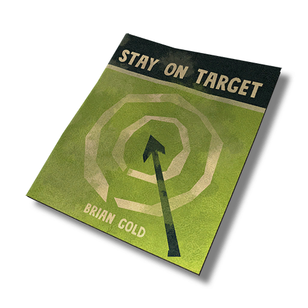
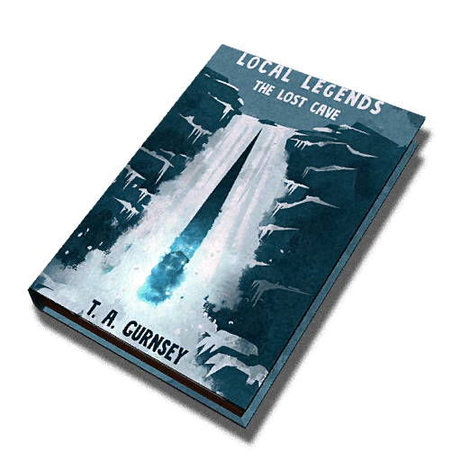
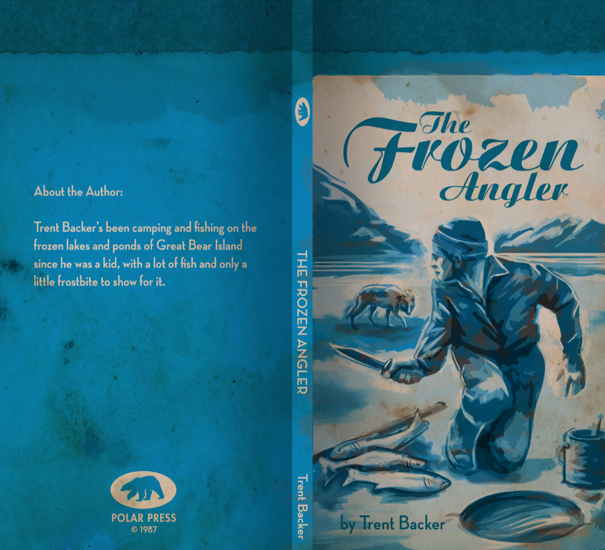
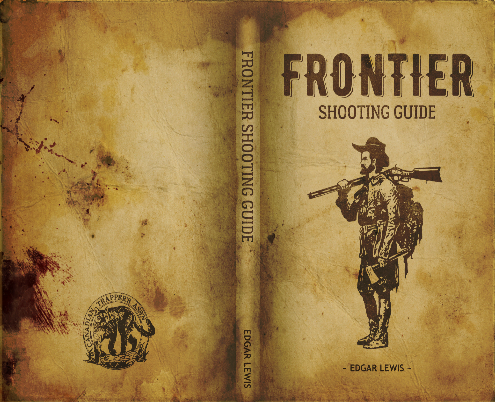
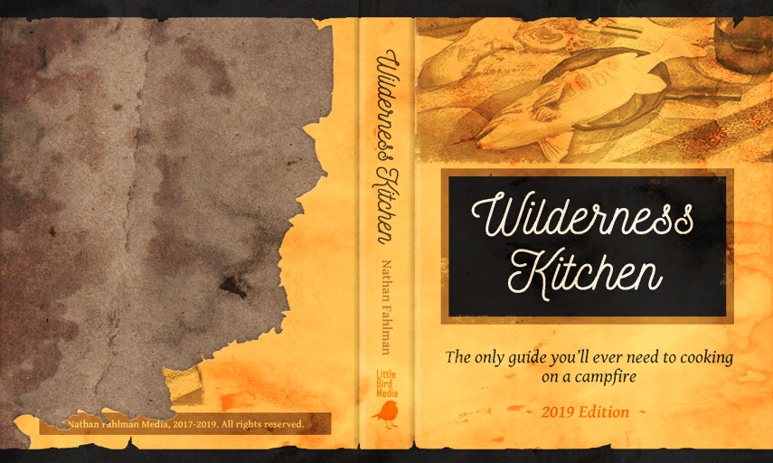

# Research Book

**Contents**

- [Overview](#Overview)
- [List of Research Books](#List_of_Research_Books)
- [Wintermute](#Wintermute)
- [Trivia](#Trivia)
- [Gallery](#Gallery)

\[Missing image: Research1.jpg\] A **Research Book** or **Skill Book** is both a Fuel and Tool item in <a href="./Survival%20Mode.md" class="wikilink" title="Survival Mode">Survival Mode</a> that can be researched to increase <a href="./Skills.md" class="wikilink" title="Skills">Skills</a>, and can be found as 10 separate in game items.

## Overview

Research Books are items that may be used as fuel for <a href="./Fire%20Starting.md" class="wikilink" title="Fire Starting">Fire Starting</a> and have the same weight (0.50kg) as normal books. However, they may also be read, which grants skill points to their respective Survival Skills when completed. Because of this, Research Books can be found in both the Fuel and Tools categories. Attempting to burn a Research Book that has not been fully read will give a confirmation warning before it can be burned. Once a Research Book is fully researched, it will no longer appear in the Tools section of the Backpack.

Multiple copies of the same book may be researched for additional benefit.

- Research Books are scattered throughout all regions similar to normal <a href="./Book.md" class="wikilink" title="Books">Books</a>, but are much rarer and have unique detailed covers.
- Books can only be read if the player is not in the dark or if the player is healthy enough: the player's <a href="./Needs.md" class="wikilink" title="Needs">Needs</a> (<a href="./Warmth.md" class="wikilink" title="Warmth">Warmth</a>, <a href="./Fatigue.md" class="wikilink" title="Fatigue">Fatigue</a>, <a href="./Thirst.md" class="wikilink" title="Thirst">Thirst</a>, <a href="./Hunger.md" class="wikilink" title="Calories">Calories</a>) are above 0% and they are not suffering from any negative <a href="./Afflictions.md" class="wikilink" title="Affliction">Affliction</a> (Affliction Risks do not count).
  - The only exception to this rule are permanent Afflictions, as this would make researching impossible:
    - <a href="./Frostbite.md" class="wikilink" title="Frostbite">Frostbite</a>, <a href="./Diminished%20Form.md" class="wikilink" title="Diminished Form">Diminished Form</a>, <a href="./Frigid%20Bones.md" class="wikilink" title="Frigid Bones">Frigid Bones</a>, <a href="./Haunted%20Mind.md" class="wikilink" title="Haunted Mind">Haunted Mind</a>, <a href="./Sour%20Stomach.md" class="wikilink" title="Sour Stomach">Sour Stomach</a>, <a href="./Rheumatic%20Joints.md" class="wikilink" title="Rheumatic Joints">Rheumatic Joints</a>, <a href="./Broken%20Body.md" class="wikilink" title="Broken Body">Broken Body</a>, <a href="./Cheated%20Death%20Penalty.md" class="wikilink" title="Cheated Death Penalty">Cheated Death Penalty</a> (Permanent Penalty).
    - The player can research outside at night, but only in clear weather (heavy fog/blizzards will make it too dark, in which case a light source must be used).
- Reaching 0% in any <a href="./Needs.md" class="wikilink" title="Needs">Needs</a> (or manually canceling) while researching will immediately end the research session and negate any progress for that research attempt. (i.e., if you complete 59 out of 60 in-game minutes of a 1-hour research session, and your character begins starving before completing the last minute of research, the character immediately forgets everything they researched in the last 59 minutes).
- *Frontier Shooting Guide* cannot be read once Rifle Firearm reaches Level 4, displaying the message "Your Skills are too advanced to research this." This is the only Research Book that has a Skill Level restriction.
- Since Skills cap at Level 5, any category of Research Books related to that Skill cannot be read, and can only be used as fuel at that point.
- On <a href="./Interloper.md" class="wikilink" title="Interloper">Interloper</a>, researching Skill Books burns calories at the rate of "Standing" (125 cal/h).

## List of Research Books

The <a href="./Feats.md" class="wikilink" title="Feat">Feat</a> "Book Smarts" increases the skill points gained from completing a research book by 10% (e.g. with the feat active, reading a "Small Arms Handbook" yields 11 revolver skill points instead of 10).

The Feat "Settled Mind" makes the user immune to <a href="./Cabin%20Fever.md" class="wikilink" title="Cabin Fever">Cabin Fever</a>, but also causes Research actions to happen 20% faster.

\<table-progress-tracking table-id="1" header-label="Collected?" unique-column-index="2"\>

<table style="width:100%;">
<colgroup>
<col style="width: 14%" />
<col style="width: 14%" />
<col style="width: 14%" />
<col style="width: 14%" />
<col style="width: 14%" />
<col style="width: 14%" />
<col style="width: 14%" />
</colgroup>
<thead>
<tr>
<th>
Image
</th>
<th>
Title
</th>
<th>
Skill
</th>
<th>
Points 
gained
</th>
<th>
W/ Book Smarts
</th>
<th>
Hours to 
research
</th>
<th>
W/ Settled Mind
</th>
</tr>
</thead>
<tbody>
<tr>
<td><figure>

<figcaption>Stay_on_Target_icon.png</figcaption>
</figure></td>
<td>
<em><a href="./Stay%20on%20Target.md" class="wikilink" title="Stay on Target">Stay on Target</a></em>
</td>
<td>
<a href="./Archery.md" class="wikilink" title="Archery">Archery</a>
</td>
<td>
10
</td>
<td>
11
</td>
<td>
5
</td>
<td>
4
</td>
</tr>
<tr>
<td><figure>

<figcaption>Field_Dressing_Your_Kill,_Vol._I_icon.png</figcaption>
</figure></td>
<td>
<em><a href="./Field%20Dressing%20Your%20Kill%2C%20Vol.%20I.md" class="wikilink" title="Field Dressing Your Kill, Vol. I">Field Dressing Your Kill, Vol. I</a></em>
</td>
<td>
<a href="./Carcass%20Harvesting.md" class="wikilink" title="Carcass Harvesting">Carcass Harvesting</a>
</td>
<td>
10
</td>
<td>
11
</td>
<td>
10
</td>
<td>
8
</td>
</tr>
<tr>
<td><figure>

<figcaption>Wilderness_Kitchen_icon.png</figcaption>
</figure></td>
<td>
<em><a href="./Wilderness%20Kitchen.md" class="wikilink" title="Wilderness Kitchen">Wilderness Kitchen</a></em>
</td>
<td>
<a href="./Cooking.md" class="wikilink" title="Cooking">Cooking</a>
</td>
<td>
10
</td>
<td>
11
</td>
<td>
5
</td>
<td>
4
</td>
</tr>
<tr>
<td><figure>

<figcaption>Survive_the_Outdoors!_icon.png</figcaption>
</figure></td>
<td>
<em><a href="./Survive%20the%20Outdoors!.md" class="wikilink" title="Survive the Outdoors!">Survive the Outdoors!</a></em>
</td>
<td>
<a href="./Fire%20Starting.md" class="wikilink" title="Fire Starting">Fire Starting</a>
</td>
<td>
10
</td>
<td>
11
</td>
<td>
5
</td>
<td>
4
</td>
</tr>
<tr>
<td><figure>

<figcaption>The_Frozen_Angler_icon.png</figcaption>
</figure></td>
<td>
<em><a href="./The%20Frozen%20Angler.md" class="wikilink" title="The Frozen Angler">The Frozen Angler</a></em>
</td>
<td>
<a href="./Ice%20Fishing.md" class="wikilink" title="Ice Fishing">Ice Fishing</a>
</td>
<td>
10
</td>
<td>
11
</td>
<td>
5
</td>
<td>
4
</td>
</tr>
<tr>
<td><figure>

<figcaption>A_Sewing_Primer_icon.png</figcaption>
</figure></td>
<td>
<em><a href="./A%20Sewing%20Primer.md" class="wikilink" title="A Sewing Primer">A Sewing Primer</a></em>
</td>
<td>
<a href="./Mending.md" class="wikilink" title="Mending">Mending</a>
</td>
<td>
10
</td>
<td>
11
</td>
<td>
5
</td>
<td>
4
</td>
</tr>
<tr>
<td><figure>

<figcaption>Frontier_Shooting_Guide_icon.png</figcaption>
</figure></td>
<td>
<em><a href="./Frontier%20Shooting%20Guide.md" class="wikilink" title="Frontier Shooting Guide">Frontier Shooting Guide</a></em>
</td>
<td>
<a href="./Rifle%20Firearm.md" class="wikilink" title="Rifle Firearm">Rifle Firearm</a>
</td>
<td>
5
</td>
<td>
6
</td>
<td>
4
</td>
<td>
4
</td>
</tr>
<tr>
<td><figure>

<figcaption>Advanced_Guns_Guns_Guns!_icon.png</figcaption>
</figure></td>
<td>
<em><a href="./Advanced%20Guns%20Guns%20Guns!.md" class="wikilink" title="Advanced Guns Guns Guns!">Advanced Guns Guns Guns!</a></em>
</td>
<td>
<a href="./Rifle%20Firearm.md" class="wikilink" title="Rifle Firearm">Rifle Firearm</a>
</td>
<td>
10
</td>
<td>
11
</td>
<td>
25
</td>
<td>
20
</td>
</tr>
<tr>
<td><figure>

<figcaption>Small_Arms_Handbook_icon.png</figcaption>
</figure></td>
<td>
<em><a href="./Small%20Arms%20Handbook.md" class="wikilink" title="Small Arms Handbook">Small Arms Handbook</a></em>
</td>
<td>
<a href="./Revolver%20Firearm.md" class="wikilink" title="Revolver Firearm">Revolver Firearm</a>
</td>
<td>
10
</td>
<td>
11
</td>
<td>
5
</td>
<td>
4
</td>
</tr>
<tr>
<td><figure>

<figcaption>Practical_Gunsmithing_icon.png</figcaption>
</figure></td>
<td>
<em><a href="./Practical%20Gunsmithing.md" class="wikilink" title="Practical Gunsmithing">Practical Gunsmithing</a></em>
</td>
<td>
<a href="./Gunsmithing.md" class="wikilink" title="Gunsmithing">Gunsmithing</a>
</td>
<td>
10
</td>
<td>
11
</td>
<td>
5
</td>
<td>
4
</td>
</tr>
</tbody>
</table>

\</table-progress-tracking\>

## Wintermute

**Template:spoiler**In <a href="./Wintermute.md" class="wikilink" title="Wintermute">Wintermute</a>, items that resemble Research Books may be found, but these items are instantly turned into <a href="./Collectibles.md" class="wikilink" title="Collectibles">Collectibles</a> when picked up and instead unlock side missions. \<table-progress-tracking table-id="2" header-label="Collected?" unique-column-index="2"\>

<table>
<colgroup>
<col style="width: 25%" />
<col style="width: 25%" />
<col style="width: 25%" />
<col style="width: 25%" />
</colgroup>
<thead>
<tr>
<th>
Image
</th>
<th>
Title
</th>
<th>
Episode
</th>
<th>
Unlocks Side Mission
</th>
</tr>
</thead>
<tbody>
<tr>
<td><figure>

<figcaption>A_Sewing_Primer_icon.png</figcaption>
</figure></td>
<td>
<em><a href="./A%20Sewing%20Primer%20%28The%20Basics%20of%20Survival%29.md" class="wikilink" title="A Sewing Primer">A Sewing Primer</a></em>
</td>
<td>
Episode 1
</td>
<td>
<a href="./The%20Basics%20of%20Survival.md" class="wikilink" title="The Basics of Survival">The Basics of Survival</a> Mend Clothing
</td>
</tr>
<tr>
<td><figure>

<figcaption>Medicinal_Plants_of_Great_Bear_icon.png</figcaption>
</figure></td>
<td>
<em><a href="./Medicinal%20Plants%20of%20Great%20Bear.md" class="wikilink" title="Medicinal Plants of Great Bear">Medicinal Plants of Great Bear</a></em>
</td>
<td>
Episode 1
</td>
<td>
<a href="./The%20Basics%20of%20Survival.md" class="wikilink" title="The Basics of Survival">The Basics of Survival</a> Preparing natural medicine
</td>
</tr>
<tr>
<td><figure>

<figcaption>Field_Dressing_Your_Kill,_Vol._I_icon.png</figcaption>
</figure></td>
<td>
<em><a href="./Field%20Dressing%20Your%20Kill%2C%20Vol.%20I%20%28The%20Basics%20of%20Survival%29.md" class="wikilink" title="Field Dressing Your Kill, Vol. I">Field Dressing Your Kill, Vol. I</a></em>
</td>
<td>
Episode 1
</td>
<td>
<a href="./The%20Basics%20of%20Survival.md" class="wikilink" title="The Basics of Survival">The Basics of Survival</a> Snaring a Rabbit
</td>
</tr>
<tr>
<td><figure>

<figcaption>The_Frozen_Angler_icon.png</figcaption>
</figure></td>
<td>
<em><a href="./The%20Frozen%20Angler%20%28Survival%20School%29.md" class="wikilink" title="The Frozen Angler">The Frozen Angler</a></em>
</td>
<td>
Episode 2
</td>
<td>
<a href="./Survival%20School.md" class="wikilink" title="Survival School">Survival School</a> Craft a Fishing Tackle and catch a fish from Mystery Lake
</td>
</tr>
<tr>
<td><figure>

<figcaption>Frontier_Shooting_Guide_icon.png</figcaption>
</figure></td>
<td>
<em><a href="./Frontier%20Shooting%20Guide%20%28Survival%20School%29.md" class="wikilink" title="Frontier Shooting Guide">Frontier Shooting Guide</a></em>
</td>
<td>
Episode 2
</td>
<td>
<a href="./Survival%20School.md" class="wikilink" title="Survival School">Survival School</a> Kill a Deer
</td>
</tr>
<tr>
<td><figure>

<figcaption>Advanced_Guns_Guns_Guns!_icon.png</figcaption>
</figure></td>
<td>
<em><a href="./Advanced%20Guns%20Guns%20Guns!%20%28Survival%20School%29.md" class="wikilink" title="Advanced Guns Guns Guns!">Advanced Guns Guns Guns!</a></em>
</td>
<td>
Episode 2
</td>
<td>
<a href="./Survival%20School.md" class="wikilink" title="Survival School">Survival School</a> Cull Wolves
</td>
</tr>
<tr>
<td><figure>

<figcaption>Local_Legends_-_Sasquatch_icon.png</figcaption>
</figure></td>
<td>
<em><a href="./Local%20Legends%20-%20Sasquatch.md" class="wikilink" title="Local Legends - Sasquatch">Local Legends - Sasquatch</a></em>
</td>
<td>
Episode 3
</td>
<td>
<a href="./Tall%20Tales.md" class="wikilink" title="Tall Tales">Tall Tales</a> Locals tell of a Sasquatch...
</td>
</tr>
<tr>
<td><figure>

<figcaption>Local_Legends_-_The_Big_One_icon.png</figcaption>
</figure></td>
<td>
<em><a href="./Local%20Legends%20-%20The%20Big%20One.md" class="wikilink" title="Local Legends - The Big One">Local Legends - The Big One</a></em>
</td>
<td>
Episode 3
</td>
<td>
<a href="./Tall%20Tales.md" class="wikilink" title="Tall Tales">Tall Tales</a> Locals tell of a magical pond...
</td>
</tr>
<tr>
<td><figure>

<figcaption>Local_Legends_-_The_Lost_Cave_icon.png</figcaption>
</figure></td>
<td>
<em><a href="./Local%20Legends%20-%20The%20Lost%20Cave.md" class="wikilink" title="Local Legends - The Lost Cave">Local Legends - The Lost Cave</a></em>
</td>
<td>
Episode 3
</td>
<td>
<a href="./Tall%20Tales.md" class="wikilink" title="Tall Tales">Tall Tales</a> Locals tell of a glowing cave...
</td>
</tr>
<tr>
<td><figure>

<figcaption>Local_Legends_-_Ghost_Stag_icon.png</figcaption>
</figure></td>
<td>
<em><a href="./Local%20Legends%20-%20Ghost%20Stag.md" class="wikilink" title="Local Legends - Ghost Stag">Local Legends - Ghost Stag</a></em>
</td>
<td>
Episode 3
</td>
<td>
<a href="./Tall%20Tales.md" class="wikilink" title="Tall Tales">Tall Tales</a> Locals tell of a hidden ghostly stag...
</td>
</tr>
</tbody>
</table>

\</table-progress-tracking\>

## Trivia

- Survival Skills levels are dependent to each save file.
- All varieties of books and research books may spawn regardless of Survival Mode (or loot settings, in Custom); this includes firearm-related books on Interloper difficulty.
- The <a href="./The%20Long%20Dark%20%E2%80%94%20Achievements.md" class="wikilink" title="Achievement">Achievement</a> "Penitent Scholar" requires reading all varieties of Research Books in a single save file.
- Research Books originally featured more varied sizes and cover art; however, currently their art and size are more uniform.

## Gallery

<table class="gallery">
<colgroup>
<col style="width: 25%" />
<col style="width: 25%" />
<col style="width: 25%" />
<col style="width: 25%" />
</colgroup>
<tbody>
<tr>
<td><figure>

<figcaption>Field Dressing Your Kill, Vol 1. Old Model</figcaption>
</figure></td>
<td><figure>

<figcaption>Advanced Guns Guns Guns! Old Model</figcaption>
</figure></td>
<td><figure>

<figcaption>The Frozen Angler Old Model</figcaption>
</figure></td>
<td><figure>

<figcaption>Frontier Shooting Guide Old Model</figcaption>
</figure></td>
</tr>
<tr>
<td><figure>

<figcaption>Wilderness Kitchen Old Model</figcaption>
</figure></td>
<td><figure>

<figcaption>Survive The Outdoors Old Model</figcaption>
</figure></td>
<td></td>
<td></td>
</tr>
</tbody>
</table>

**Lua execution error in Module:Navbox function navbox** <a href="ru:%D0%9A%D0%BD%D0%B8%D0%B3%D0%B0_%D0%BD%D0%B0%D0%B2%D1%8B%D0%BA%D0%BE%D0%B2" class="wikilink" title="ru:Книга навыков">ru:Книга навыков</a>

