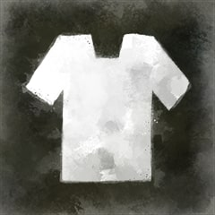

# Resolute Outfitter

<table class="infobox">
<caption>Resolute Outfitter</caption>
<colgroup>
<col style="width: 50%" />
<col style="width: 50%" />
</colgroup>
<tbody>
<tr>
<td colspan="2"><figure>

<figcaption>Resolute_Outfitter_icon.png</figcaption>
</figure></td>
</tr>
<tr>
<td>
Description
</td>
<td>
Fill all clothing slots with 100% condition gear.
</td>
</tr>
</tbody>
</table>

**Resolute Outfitter** is an <a href="./The%20Long%20Dark%20%E2%80%94%20Achievements.md" class="wikilink" title="achievement">achievement</a> in *<a href="./The%20Long%20Dark.md" class="wikilink" title="The Long Dark">The Long Dark</a>*.

## Guide

This achievement is obtained after filling every <a href="./Clothing.md" class="wikilink" title="Clothing">Clothing</a> slot with 100% Condition gear. It can easily be done in a single <a href="./Survival%20Mode.md" class="wikilink" title="Survival Mode">Survival Mode</a> game on Pilgrim, or any other game mode, so long as clothing and repair materials are high. You do not need a high <a href="./Mending.md" class="wikilink" title="Mending">Mending</a> skill to accomplish this achievement.

## Game history

This achievement was introduced on 1 April 2015 in <a href="./The%20Long%20Dark%20%E2%80%94%20Changelog.md#0.212" class="wikilink" title="version 0.212">version 0.212</a>.

## Trivia

This achievement's name is a reference to the V0.386 update Resolute Outfitter.**Lua execution error in Module:Navbox function navbox**

