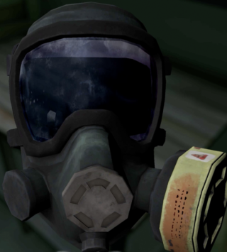
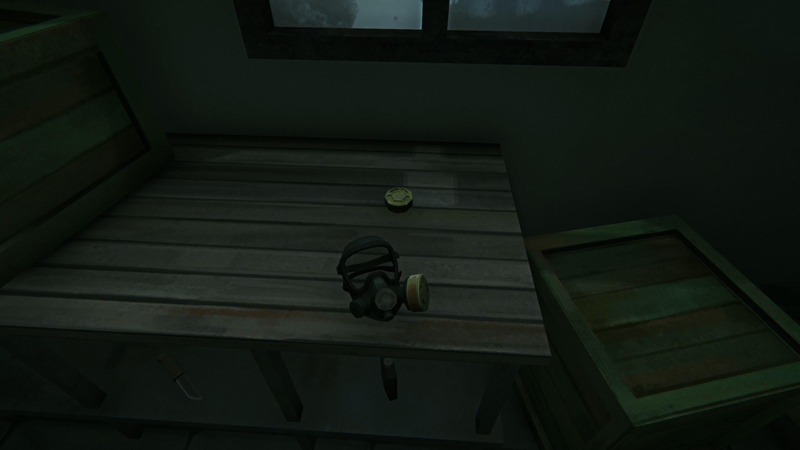
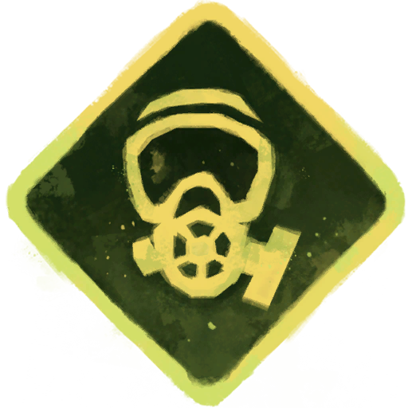

# Respirator

**Categories:** DLC Content, First Aid, Pages with update history · **Source:** [Fandom](https://thelongdark.fandom.com/wiki/Respirator)

**Contents**

- [Overview](#overview)
- [Gallery](#gallery)
- [Update history](#update-history)

**Respirator**

| Property | Details |
| --- | --- |
|  | [Respirator icon](../assets/Respirator_icon.png) |
| Release | [5 December 2023](./The%20Long%20Dark%20%E2%80%94%20Changelog.md#2-25-steam-tftft-part-four-buried-echoes-update) |
| Wintermute | yes |
| **Properties** |  |
| Item type | [First Aid](./First%20Aid.md) |
| Equipable | yes |
| Stackable | No |
| Examine | Equip to protect yourself from toxic gas and other environmental hazards. Requires Canisters to function. |
| **Values** |  |
| Weight | 0.00 kg (0 lbs) |
| **Advanced data** |  |
| Item key | GAMEPLAY\_Respirator |

[Ptarmigan icon](../assets/Ptarmigan_icon.png)

**DLC-Exclusive content.**; This content requires the [Tales from the Far Territory](./Tales%20from%20the%20Far%20Territory.md) addon to be installed before it can be seen or used in regular gameplay.

The **Respirator** is a [First Aid](./First%20Aid.md) item that was added as part of the Part 4 Buried Echoes update to the [Tales from the Far Territory](./Tales%20from%20the%20Far%20Territory.md) expansion.; It is one of the few items that cannot be dropped or placed in containers so it cannot be lost, similar to the [Handheld Shortwave Radio](./Handheld%20Shortwave%20Radio.md) and [Camera](./Camera.md).

## Overview

> “**Equip to protect yourself from toxic gas and other environmental hazards. Requires Canisters to function.**”
>
> — [What I Know](./What%20I%20Know.md) description

Despite appearing to be a Clothing/Tool item, the Respirator is classified as a First Aid item and weighs 0.00 kg in [Survival Mode](./Survival%20Mode.md). It is a must if the player travels through the [Zone of Contamination](./Zone%20of%20Contamination.md), as it prevents [Suffocation](./Suffocation.md) inside various areas of the [Langston Mine](./Langston%20Mine.md) (or [Last Prospect](./Last%20Prospect.md) if carried to [Blackrock](./Blackrock.md)). It also prevents [Chemical Poisoning](./Chemical%20Poisoning.md) from breathing spilled [Chemical Hazards](./Chemical%20Hazard.md) on the surface, and is best used in tandem with [Chemical Boots](./Chemical%20Boots.md) to fully protect one's lungs and feet when walking through chemical patches.

[Canisters](./Canister.md) are required for it to be useable, and are automatically changed out by hand when they wear out. They can be found in the world as well as inside various containers. One can always be found next to the Respirator on the table. Canisters in the Respirator last for 45 seconds in-game, and do not degrade while in a toxic environment when searching the inside of a container, but will degrade if the player is in the [Survival Menu](./Survival%20Menu.md). Once all Canisters are used up, the survivor will automatically take the Respirator off their head and begin suffocating again.

Keep in mind that wearing a Respirator prevents a player from eating or drinking until it is removed. It also partially obscures the player's vision below the nose line, and any dialogue made by the player character is distorted and amplified while still wearing the mask.

## Gallery

## Update history

- UPDATE **5 December 2023 ([Update](./The%20Long%20Dark%20%E2%80%94%20Changelog.md#2-25-steam-tftft-part-four-buried-echoes-update)):**
  - Added to game.
