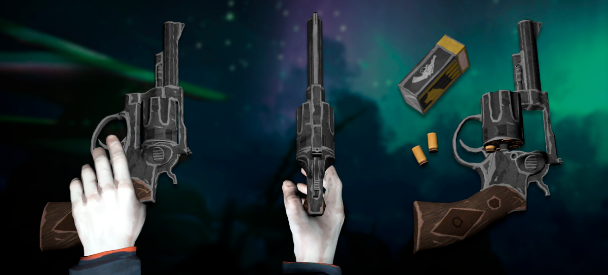

# Revolver Ammunition

**Contents**

- [Overview](#Overview)
- [Harvesting](#Harvesting)
- [Crafting](#Crafting)
- [Trivia](#Trivia)
- [Gallery](#Gallery)
- [Update history](#Update_history)

<table class="infobox">
<caption>Revolver ammunition</caption>
<colgroup>
<col style="width: 50%" />
<col style="width: 50%" />
</colgroup>
<tbody>
<tr>
<td colspan="2">
[[File:

<table class="gallery">
<colgroup>
<col style="width: 50%" />
<col style="width: 50%" />
</colgroup>
<tbody>
<tr>
<th><figure>

<figcaption>Box</figcaption>
</figure></th>
<td><figure>

<figcaption>Cartridge</figcaption>
</figure></td>
</tr>
</tbody>
</table>

Rifle ammunition icon.png|250px]]
</td>
</tr>
<tr>
<td colspan="2" class="section">
<strong>General</strong>
</td>
</tr>
<tr>
<td>
Item Type
</td>
<td></td>
</tr>
<tr>
<td>
Wintermute
</td>
<td>
No
</td>
</tr>
<tr>
<td>
Renewable
</td>
<td>
Yes (<a href="./Trader.md" class="wikilink" title="Trader">Trader</a> or rare <a href="./Beachcombing.md" class="wikilink" title="Beachcombing">Beachcombing</a> ) no (Interloper)
</td>
</tr>
<tr>
<td colspan="2" class="section">
<strong>Statistics</strong>
</td>
</tr>
<tr>
<td>
Weight
</td>
<td>
0.02 kg(0.04 lbs)
</td>
</tr>
<tr>
<td>
Harvest
</td>
<td>
Chance to produce:

1 × <a href="./Bullet.md" class="wikilink" title="Bullet">Bullet</a> 1 × <a href="./Revolver%20Shell%20Casing.md" class="wikilink" title="Revolver Shell Casing">Revolver Shell Casing</a>

0.01kg x <a href="./Can%20of%20Gunpowder.md" class="wikilink" title="Can of Gunpowder">Can of Gunpowder</a>

5 minutes
</td>
</tr>
</tbody>
</table>

<table>
<colgroup>
<col style="width: 33%" />
<col style="width: 33%" />
<col style="width: 33%" />
</colgroup>
<tbody>
<tr>
<td style="vertical-align: top; font-size: 3em; color: #5d5980; padding-right: 10px">
“
</td>
<td>
A box of Revolver cartridges.

&#10;

Boxed ammo In-game description

</td>
<td style="vertical-align: bottom; font-size: 3em; color: #5d5980; padding-left: 10px">
”
</td>
</tr>
</tbody>
</table>

<table>
<colgroup>
<col style="width: 33%" />
<col style="width: 33%" />
<col style="width: 33%" />
</colgroup>
<tbody>
<tr>
<td style="vertical-align: top; font-size: 3em; color: #5d5980; padding-right: 10px">
“
</td>
<td>
A single Revolver cartridge.

&#10;

Single Cartridge In-game description

</td>
<td style="vertical-align: bottom; font-size: 3em; color: #5d5980; padding-left: 10px">
”
</td>
</tr>
</tbody>
</table>

**Revolver Ammunition** and **Revolver Cartridge** is ammunition for the <a href="./Revolver.md" class="wikilink" title="Revolver">Revolver</a>. It can be found alone, as a single round, or as 10 rounds in a box. It can also be crafted at an <a href="./Ammunition%20Work%20Bench.md" class="wikilink" title="Ammunition Work Bench">Ammunition Work Bench</a>. The box is branded as a product called *Bullseye*.

## Overview

When fired, an empty <a href="./Revolver%20Shell%20Casing.md" class="wikilink" title="Revolver Shell Casing">Revolver Shell Casing</a> will reside inside the Revolver until it is reloaded, in which it is immediately drop to the ground and can then be picked up for creating new cartridges. If the Revolver is manually unloaded in the Backpack menu, all casings and unspent ammunition is placed in the player's inventory.

### Harvesting

When harvested, a single Revolver Cartridge has a chance to produce the following after 5 minutes of <a href="./Harvesting.md" class="wikilink" title="Harvesting">Harvesting</a> (higher <a href="./Gunsmithing.md" class="wikilink" title="Gunsmithing">Gunsmithing</a> Skill leads to a higher chance to recover most or all materials):

- 1 <a href="./Bullet.md" class="wikilink" title="Bullet">Bullet</a>
- 1 <a href="./Revolver%20Shell%20Casing.md" class="wikilink" title="Revolver Shell Casing">Revolver Shell Casing</a>
- 0.01kg <a href="./Can%20of%20Gunpowder.md" class="wikilink" title="Can of Gunpowder">Can of Gunpowder</a>

### Crafting

Crafting at an <a href="./Ammunition%20Work%20Bench.md" class="wikilink" title="Ammunition Work Bench">Ammunition Work Bench</a> requires the following recourses:

<table class="infobox">
<caption>Revolver Cartridge</caption>
<tbody>
<tr>
<td colspan="2">
<strong>Template:pic link plain</strong><a href="./Gunsmithing.md" class="wikilink" title="Gunsmithing">Gunsmithing</a>
</td>
</tr>
<tr>
<td colspan="2">
1
</td>
</tr>
<tr>
<td colspan="2">
5 minutes
</td>
</tr>
<tr>
<td colspan="2" class="section">
<strong>Requirements</strong>
</td>
</tr>
<tr>
<td>
Facility
</td>
<td>
<strong>Template:iconlink</strong>
</td>
</tr>
<tr>
<td colspan="2" class="section">
<strong>Materials</strong>
</td>
</tr>
<tr>
<td colspan="2" class="section">
<strong>Template:iconlink plain</strong>
</td>
</tr>
<tr>
<td>
Item
</td>
<td>
<a href="./Bullet.md" class="wikilink" title="Bullet">Bullet</a>
</td>
</tr>
<tr>
<td>
Quantity
</td>
<td>
1
</td>
</tr>
<tr>
<td colspan="2" class="section">
<strong>Template:iconlink plain</strong>
</td>
</tr>
<tr>
<td colspan="2">
<a href="./Revolver%20Shell%20Casing.md" class="wikilink" title="Revolver Shell Casing">Revolver Shell Casing</a>
</td>
</tr>
<tr>
<td colspan="2">
1
</td>
</tr>
<tr>
<td colspan="2" class="section">
<strong>Template:iconlink plain</strong>
</td>
</tr>
<tr>
<td colspan="2">
<a href="./Can%20of%20Gunpowder.md" class="wikilink" title="Can of Gunpowder">Can of Gunpowder</a>
</td>
</tr>
<tr>
<td colspan="2">
0.01 kg
</td>
</tr>
</tbody>
</table>

Crafting quality Condition Revolver Ammunition is based on the <a href="./Gunsmithing.md" class="wikilink" title="Gunsmithing">Gunsmithing</a> skill, with lower level Gunsmithing producing lower quality cartridges that are more likely to misfire, no matter the condition of the Revolver. The quality and Condition of the crafted ammunition will always be found next to the name of the ammo:

- Poor 20% (Level 1)
- Mediocre 40% (Level 2)
- Good 60% (Level 3)
- Great 80% (Level 4)
- Perfect 100% (Level 5)

Ammunition that is found in the game world will always be in "Perfect" condition.

## Trivia

- Since the Revolver is lacking a speed loader mechanism, the character will load cartridges one by one.
- The default Revolver in-game most closely resembles a Smith & Wesson Model 27, which uses .357 Magnum ammunition; however, in-game Revolver Ammunition appears to be .32 S&W Long. A cut icon for Revolver Bullets named <a href="../assets/Revolver_44_Mag_Bullet_icon.png" class="wikilink" title=".44 Magnum">.44 Magnum</a> might also be the correct cartridge caliber.
- Revolver Ammunition size is much smaller than the <a href="./Rifle%20Ammunition.md" class="wikilink" title="Rifle Ammunition">Rifle Ammunition</a> and can thus be hard to spot on the ground.
- 10 or more dropped rounds appear as a box of rounds.
- Ammunition for the revolver is much more abundant than ammo for the rifle, and can be found randomly in most locations.

## Gallery

<table class="gallery">
<colgroup>
<col style="width: 100%" />
</colgroup>
<tbody>
<tr>
<td><figure>

<figcaption>an unreleased Pre Alpha revolver, with ammunition and casings</figcaption>
</figure></td>
</tr>
</tbody>
</table>

## Update history

- UPDATE **6 May 2019 (<a href="./The%20Long%20Dark%20%E2%80%94%20Changelog.md#1.48" class="wikilink" title="Update">Update</a>):**
  - Added to game.

**Lua execution error in Module:Navbox function navbox** <a href="ru:%D0%9F%D0%B0%D1%82%D1%80%D0%BE%D0%BD%D1%8B_%D0%B4%D0%BB%D1%8F_%D1%80%D0%B5%D0%B2%D0%BE%D0%BB%D1%8C%D0%B2%D0%B5%D1%80%D0%B0" class="wikilink" title="ru:Патроны для револьвера">ru:Патроны для револьвера</a>

