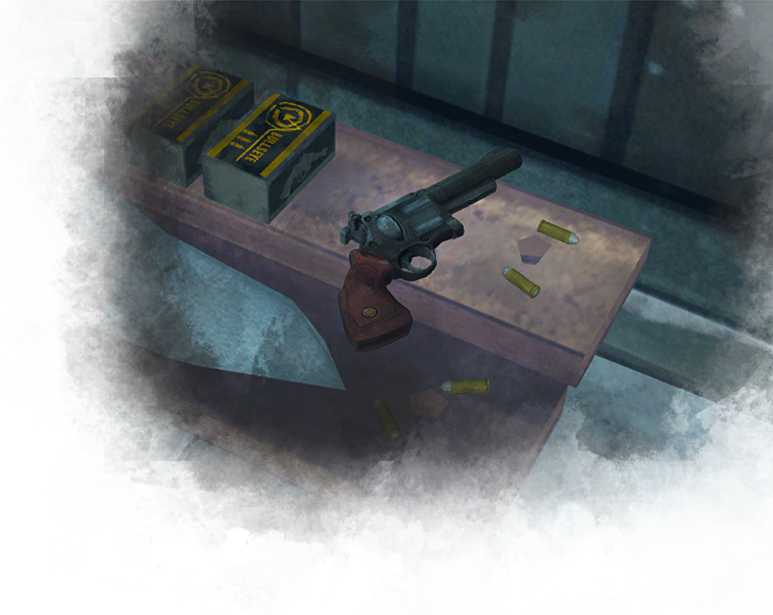

# Revolver Firearm

<table class="infobox">
<caption>Revolver Firearm</caption>
<colgroup>
<col style="width: 50%" />
<col style="width: 50%" />
</colgroup>
<tbody>
<tr>
<td colspan="2"><figure>

<figcaption>Revolver_Firearm_background.png</figcaption>
</figure></td>
</tr>
<tr>
<td>
Release
</td>
<td>
<a href="./The%20Long%20Dark%20%E2%80%94%20Changelog.md#1.48" class="wikilink" title="Steadfast Ranger (v1.48)">Steadfast Ranger (v1.48)</a>
</td>
</tr>
<tr>
<td>
Date
</td>
<td>
6 May 2019
</td>
</tr>
</tbody>
</table>

<figure>
[Missing image: Revolver_Firearm.png]
<figcaption>Revolver_Firearm.png</figcaption>
</figure>

**Revolver Firearm** is a <a href="./Skills.md" class="wikilink" title="survival skill">survival skill</a> that involves the use of a <a href="./Revolver.md" class="wikilink" title="revolver">revolver</a> to defend oneself from hostile <a href="./Wildlife.md" class="wikilink" title="wildlife">wildlife</a>, or as a sub-optimal hunting tool.

A firearm's ability to attack from range allows can frighten or killing wildlife from relative safety.

## Overview

The <a href="./Revolver.md" class="wikilink" title="Revolver">Revolver</a> is a self defense tool used to fire <a href="./Revolver%20Ammunition.md" class="wikilink" title="Revolver Ammunition">Revolver Ammunition</a> at targets. The high-velocity rounds travel in a straight line and can cause significant injury to smaller animals, including <a href="./Wolf.md" class="wikilink" title="wolves">wolves</a> and <a href="./Timberwolf.md" class="wikilink" title="timberwolves">timberwolves</a>. However the weapon lacks of stopping power, making it ineffective against <a href="./Bear.md" class="wikilink" title="bear">bear</a> and <a href="./Moose.md" class="wikilink" title="moose">moose</a>. Revolvers may also be selected to defend oneself during a Wolf <a href="./Struggle.md" class="wikilink" title="Struggle">Struggle</a>, and if loaded, the option to "Take Shot" may appear, which if selected will end the struggle immediately: scaring off or killing the wolf.

Shots from the Revolver which hit an animal's head or torso (indicated by a bloodsplatter, or blood drops), are always lethal but due to the weapon's low stopping power, this may take several hours (in-game) for it to bleed to death.

## Revolver Firearm Skill

Revolver skill is increased by scoring hits on live <a href="./Wildlife.md" class="wikilink" title="wildlife">wildlife</a> with the Revolver, or by fully reading the research book *<a href="./Small%20Arms%20Handbook.md" class="wikilink" title="Small Arms Handbook">Small Arms Handbook</a>*. Multiple copies of the book can be read, each granting skill points when fully read.

- A Revolver round striking a live animal (except <a href="./Crow.md" class="wikilink" title="crows">crows</a>) grants 1 skill point.
- Selecting a loaded Revolver for self-defense during a Wolf struggle, and firing it during the struggle grants 1 skill point.
- *<a href="./Small%20Arms%20Handbook.md" class="wikilink" title="Small Arms Handbook">Small Arms Handbook</a>* grants 10 skill points (5 hours of reading).

Note: *Revolver skill is not increased by selecting to use a carried Revolver during a Wolf struggle (bludgeoning the Wolf with the revolver), but instead having it loaded, selecting it, and choosing the "Take Shot" option during the struggle (if it appears). However, increased "Struggle Effectiveness" from the Revolver Skill does affect struggle success regardless of the weapon being loaded or not.*

Once players have reached a new skill level, they unlock a new bonus/bonuses get better. \<table-progress-tracking table-id="1" unique-column-index="1"\>

<table>
<colgroup>
<col style="width: 20%" />
<col style="width: 20%" />
<col style="width: 20%" />
<col style="width: 20%" />
<col style="width: 20%" />
</colgroup>
<thead>
<tr>
<th>
Level
</th>
<th>
Skill points needed
</th>
<th>
Points to next level
</th>
<th style="text-align: left; width: 35%;">
Effects
</th>
<th>
Flavor Text
</th>
</tr>
</thead>
<tbody>
<tr>
<td>
1
</td>
<td>
0
</td>
<td>
10
</td>
<td style="text-align: left;"><ul>
<li>Basic Revolver skill</li>
</ul></td>
<td>
You're very new to handguns, and the Revolver remains an awkward tool. You know how to load it, find a target, and fire, but no much else.
</td>
</tr>
<tr>
<td>
2
</td>
<td>
10
</td>
<td>
15
</td>
<td style="text-align: left;"><ul>
<li>Recoil compensation increased by 25%</li>
<li>+2 condition per repair action</li>
</ul></td>
<td>
You have a little more shooting experience under your belt. You can pick your targets and you know how to keep your Revolver clean enough to fire.
</td>
</tr>
<tr>
<td>
3
</td>
<td>
25
</td>
<td>
25
</td>
<td style="text-align: left;"><ul>
<li>Struggle effectiveness increased by 10%</li>
<li>Recoil compensation increased by 35%</li>
<li>+3 condition per repair action</li>
</ul></td>
<td>
You've become skilled with the Revolver. your steady hand finds targets reliably and you know how to keep your Revolver in good condition.
</td>
</tr>
<tr>
<td>
4
</td>
<td>
50
</td>
<td>
50
</td>
<td style="text-align: left;"><ul>
<li>Aim Assist: Minor</li>
<li>Struggle effectiveness increased by 20%</li>
<li>Recoil compensation increased by 50%</li>
<li>+4 condition per repair action</li>
</ul></td>
<td>
You're efficient and deadly with the Revolver. Your shots are clean and effective, especially in defensive situations.
</td>
</tr>
<tr>
<td>
5
</td>
<td>
100
</td>
<td>
Max level
</td>
<td style="text-align: left;"><ul>
<li>Per-use degradation reduced by 50%</li>
<li>Aim assist: Moderate</li>
<li>Recoil compensation increased by 70%</li>
<li>Struggle effectiveness increased by 30%</li>
<li>+5 condition per repair action</li>
</ul></td>
<td>
There's little stopping you with a Revolver in your hands. Your stance is strong, your eyes sharp, and your targets always in sight. More than a tool, it's become an extension of your will to survive.
</td>
</tr>
</tbody>
</table>

\</table-progress-tracking\>

**Lua execution error in Module:Navbox function navbox**<a href="ru:%D0%9D%D0%B0%D0%B2%D1%8B%D0%BA%D0%B8#%D0%A0%D0%B5%D0%B2%D0%BE%D0%BB%D1%8C%D0%B2%D0%B5%D1%80" class="wikilink" title="ru:Навыки#Револьвер">ru:Навыки#Револьвер</a> <a href="fr:Armes_%C3%A0_feu:_Revolver" class="wikilink" title="fr:Armes à feu: Revolver">fr:Armes à feu: Revolver</a>

