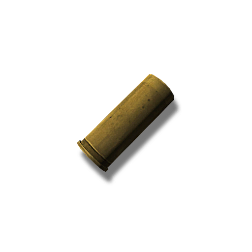

# Revolver Shell Casing

**Contents**

- [Overview](#Overview)
- [Products](#Products)
- [Notes](#Notes)
- [Gallery](#Gallery)

<table class="infobox">
<caption>Revolver Shell Casing</caption>
<colgroup>
<col style="width: 50%" />
<col style="width: 50%" />
</colgroup>
<tbody>
<tr>
<td colspan="2"><figure>

<figcaption>Revolver_Shell_Casing_icon.png</figcaption>
</figure></td>
</tr>
<tr>
<td colspan="2" class="section">
<strong>General</strong>
</td>
</tr>
<tr>
<td>
Item Type
</td>
<td>
Material|-
</td>
</tr>
<tr>
<td colspan="2" class="section">
<strong>Statistics</strong>
</td>
</tr>
<tr>
<td>
Weight
</td>
<td>
0.005 kg(0.01 lbs)
</td>
</tr>
</tbody>
</table>

<table>
<colgroup>
<col style="width: 33%" />
<col style="width: 33%" />
<col style="width: 33%" />
</colgroup>
<tbody>
<tr>
<td style="vertical-align: top; font-size: 3em; color: #5d5980; padding-right: 10px">
“
</td>
<td>
Empty casing from firing a Revolver. Used for Crafting new Ammunition.

&#10;

In-game description

</td>
<td style="vertical-align: bottom; font-size: 3em; color: #5d5980; padding-left: 10px">
”
</td>
</tr>
</tbody>
</table>

**Revolver Shell Casings** are a crafting material in *The Long Dark*.

## Overview

Revolver Shell Casings are an ingredient in the crafting of <a href="./Revolver%20Ammunition.md" class="wikilink" title="Revolver Ammunition">Revolver Ammunition</a> with the <a href="./Gunsmithing.md" class="wikilink" title="Gunsmithing">Gunsmithing</a> Skill. They cannot be crafted but may be acquired by:

- When a <a href="./Revolver.md" class="wikilink" title="Revolver">Revolver</a> is fired and then unloaded/reloaded, spent Revolver Shell Casing will fall to the ground nearby.
- Inside containers, indoors, or near structures (primarily in <a href="./Bleak%20Inlet.md" class="wikilink" title="Bleak Inlet">Bleak Inlet</a>).
- Harvesting Revolver Ammunition (higher chance to receive at higher Gunsmithing skill).

## Products

## Notes

- The revolver casing is one of the first items (along with <a href="./Bullet.md" class="wikilink" title="bullet">bullet</a>) to have a weight of less than the minimum displayed weight in-game (0.005 kg vs 0.01 kg). Having one casing in the inventory will therefore appear to weigh 0.00 kg.

## Gallery

<table class="gallery">
<colgroup>
<col style="width: 100%" />
</colgroup>
<tbody>
<tr>
<td><figure>

<figcaption>an unreleased Pre Alpha revolver, with ammunition and casings</figcaption>
</figure></td>
</tr>
</tbody>
</table>

**Lua execution error in Module:Navbox function navbox** <a href="ru:%D0%A0%D0%B5%D0%B2%D0%BE%D0%BB%D1%8C%D0%B2%D0%B5%D1%80%D0%BD%D0%B0%D1%8F_%D0%B3%D0%B8%D0%BB%D1%8C%D0%B7%D0%B0" class="wikilink" title="ru:Револьверная гильза">ru:Револьверная гильза</a>

