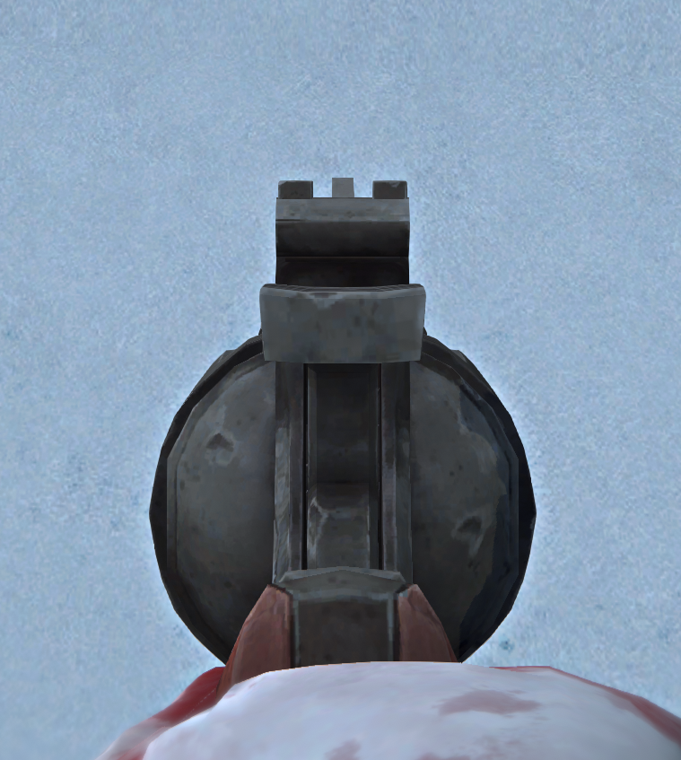
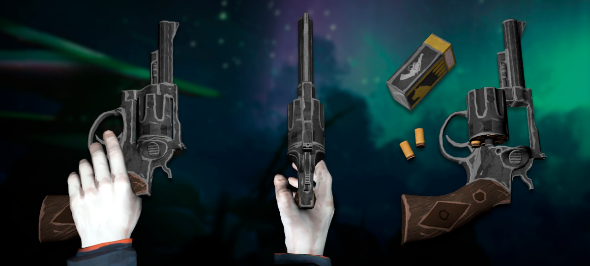

# Revolver

**Contents**

- [Overview](#Overview)
- [Mechanics](#Mechanics)
- [Loading](#Loading)
- [Aiming](#Aiming)
- [Jamming](#Jamming)
- [Jamming Chances](#Jamming_Chances)
- [Cleaning](#Cleaning)
- [Use in Struggle](#Use_in_Struggle)
- [Variants](#Variants)
- [Locations](#Locations)
- [Ash Canyon](#Ash_Canyon)
- [Blackrock](#Blackrock)
- [Bleak Inlet](#Bleak_Inlet)
- [Broken Railroad](#Broken_Railroad)
- [Coastal Highway](#Coastal_Highway)
- [Desolation Point](#Desolation_Point)
- [Forsaken Airfield](#Forsaken_Airfield)
- [Mountain Town](#Mountain_Town)
- [Mystery Lake](#Mystery_Lake)
- [Timberwolf Mountain](#Timberwolf_Mountain)
- [Forlorn Muskeg](#Forlorn_Muskeg)
- [Pleasant Valley](#Pleasant_Valley)
- [Hushed River Valley](#Hushed_River_Valley)
- [Trivia](#Trivia)
- [Gallery](#Gallery)
- [Photos](#Photos)
- [Videos](#Videos)
- [Update history](#Update_history)

<table class="infobox">
<caption>Revolver</caption>
<colgroup>
<col style="width: 50%" />
<col style="width: 50%" />
</colgroup>
<tbody>
<tr>
<td colspan="2"><figure>

<figcaption>Revolver_icon.png</figcaption>
</figure></td>
</tr>
<tr>
<td colspan="2" class="section">
<strong>General</strong>
</td>
</tr>
<tr>
<td>
Item Type
</td>
<td>
Tool|-
</td>
</tr>
<tr>
<td>
Renewable
</td>
<td>
Yes (<a href="./Trader.md" class="wikilink" title="Trader">Trader</a> only)
</td>
</tr>
<tr>
<td colspan="2" class="section">
<strong>Statistics</strong>
</td>
</tr>
<tr>
<td>
Weight
</td>
<td>
1.50 kg(3.3 lbs)
</td>
</tr>
<tr>
<td>
Harvest
</td>
<td>
Unharvestable
</td>
</tr>
<tr>
<td>
Repair
</td>
<td>
<a href="./Firearm%20Cleaning%20Kit.md" class="wikilink" title="Firearm cleaning kit">Firearm cleaning kit</a>
</td>
</tr>
</tbody>
</table>

<table>
<colgroup>
<col style="width: 33%" />
<col style="width: 33%" />
<col style="width: 33%" />
</colgroup>
<tbody>
<tr>
<td style="vertical-align: top; font-size: 3em; color: #5d5980; padding-right: 10px">
“
</td>
<td>
A powerful handgun, the Revolver has great stopping power in defensive situations. Not a Hunting weapon.

&#10;

In-game description

</td>
<td style="vertical-align: bottom; font-size: 3em; color: #5d5980; padding-left: 10px">
”
</td>
</tr>
</tbody>
</table>

*This article is about the normal revolver. For variants, see <a href="./Hunter%27s%20Revolver.md" class="wikilink" title="Hunter&#39;s Revolver">Hunter's Revolver</a>, <a href="./Forester%27s%20Revolver.md" class="wikilink" title="Forester&#39;s Revolver">Forester's Revolver</a>, and <a href="./Warden%27s%20Revolver.md" class="wikilink" title="Warden&#39;s Revolver">Warden's Revolver</a>.*

The **Revolver** is a double-action weapon with a six-round cylinder used primarily for self-defense against hostile wildlife. The <a href="./Revolver%20Firearm.md" class="wikilink" title="Revolver Firearm">Revolver Firearm</a> Skill is improved when a living animal is hit, or by reading the <a href="./Research%20Book.md" class="wikilink" title="Research Book">Research Book</a> *Small Arms Handbook.*

## Overview

The Revolver is the second firearm added to <a href="./The%20Long%20Dark.md" class="wikilink" title="The Long Dark"><em>The Long Dark</em></a>, and unlike its counterparts the <a href="./Hunting%20Rifle.md" class="wikilink" title="Hunting Rifle">Hunting Rifle</a> and the <a href="./Survival%20Bow.md" class="wikilink" title="Survival Bow">Survival Bow</a>, it is less than ideal for hunting with limited damage, range, and accuracy.

It is most effective in defensive situations against hostile wildlife—particularly <a href="./Wolf.md" class="wikilink" title="Wolves">Wolves</a> and <a href="./Timberwolf.md" class="wikilink" title="Timberwolves">Timberwolves</a>. A hit will nearly always stop a wolf charge (if the wolf isn't killed outright) and inflict great damage on timberwolf pack morale. Even a near-miss will often deter a charging wolf and will somewhat reduce timberwolf pack morale.

Although the Revolver can be used to kill any <a href="./Wildlife.md" class="wikilink" title="Wildlife">Wildlife</a>, it is less effective against large animals due to its low damage, even at very high <a href="./Revolver%20Firearm.md" class="wikilink" title="Revolver Firearm">Revolver Firearm</a> Skill Levels. Any animal except the <a href="./Moose.md" class="wikilink" title="Moose">Moose</a> and <a href="./Cougar.md" class="wikilink" title="Cougar">Cougar</a> shot by the revolver will eventually die from blood loss, but it may take a while to bleed out (a Bear can die from one Revolver shot, but will take half a day to bleed out). Shots fired from the Revolver have a chance of stopping charging moose, but this is not guaranteed. They will, however, cause moose to pause their charge for at a moment, providing an opportunity to take further shots. If the player shoots all six rounds in the cylinder at the moose in quick succession, the animal will usually be scared off. Shooting at a charging bear will not stop it, unless the player manages to kill it outright before it reaches them.

- Fast rate of fire, low recoil, and accurate.
- Range of 30m.
- Can hold 6 rounds, loaded individually
- Gunshots frighten nearby wildlife (except timberwolves, and predators if charging)
- Can defend oneself during a Wolf <a href="./Struggle.md" class="wikilink" title="Struggle">Struggle</a>, and with increased effectiveness at higher Revolver Firearm Skill
- Low stopping power and long bleed-out time: a single round will kill any struck animal eventually (except moose/cougar) through blood loss, but <a href="./Deer.md" class="wikilink" title="Deer">Deer</a>/<a href="./Bear.md" class="wikilink" title="Bear">Bears</a> may take hours
- May aim indefinitely (unlike Rifle/Bow), but may not move while aiming
- <a href="./Revolver%20Ammunition.md" class="wikilink" title="Revolver Ammunition">Revolver Ammunition</a> is relatively abundant, while Revolvers themselves are quite rare
- Lighter than Hunting Rifles (1.50kg VS 4.00kg), but heavier than a survival bow (0.50kg, and 0.15kg per arrow)
- Spent casings are not immediately ejected, but contained in the cylinder until the next reload, when they will then be dropped on the ground
- Unloading the Revolver from the Inventory menu places spent and unspent rounds directly into the Inventory

## Mechanics

### Loading

The Revolver holds 1-6 rounds, each of which must be loaded individually. It is possible to unload a Revolver through the Actions menu in the inventory.

Firing a Revolver will leave a <a href="./Revolver%20Shell%20Casing.md" class="wikilink" title="Revolver Shell Casing">Revolver Shell Casing</a> inside the gun, which will drop to the ground when the gun is reloaded and can be picked up. Casings cannot be removed unless a player has spare ammo to reload a Revolver or they manually unload the gun.

Manually unloading the gun in the player's Backpack will automatically place casings in your inventory. Spent casings still within the chamber do not add to the gun's weight. Some Revolvers can be found with live ammo and casings already inside though there is currently no way to identify if casings are inside a gun until it is unloaded.

### Aiming

The default action of the Revolver is a hipfire. Aiming using the gun's sight improves accuracy but disables walking. Aiming is also improved as Revolver Firearm Skill improves. Aiming at a hostile wolf will cause it to immediately charge.

Sway with the Revolver is lower than that of the Hunting Rifle, but increases if some <a href="./Needs.md" class="wikilink" title="Needs">Needs</a> are low (<a href="./Fatigue.md" class="wikilink" title="Fatigued">Fatigued</a> or Freezing), making aiming more difficult.

### Jamming

The Revolver will begin jamming under the 30% condition threshold, then it has the chance to improperly fire the next cartridge. Attempting to fire will result in a misfire jam. To clear the jam, the cylinder must be opened manually by pressing the reload button/key. Doing so will eject the unspent live cartridge onto the ground near the player, from where it can be picked up and used again. Unloading and reloading the Revolver in the player's backpack will also clear the jam without dropping any ammo.

Low quality Ammunition created from <a href="./Gunsmithing.md" class="wikilink" title="Gunsmithing">Gunsmithing</a> can also cause a misfire, even if the gun is in relatively good condition.

### Jamming Chances

| Condition      | 30% | 25%  | 20% | 15%  | 10% | 5%    | 1%    | 0%  |
|----------------|-----|------|-----|------|-----|-------|-------|-----|
| Jamming Chance | 0%  | 2.5% | 5%  | 7.5% | 10% | 12.5% | 14.5% | 15% |

### Cleaning

Firing a Revolver degrades it's condition by 1%, and 0.5% if the player has a level 5 revolver firearm skill. Non-ruined Revolvers may be repaired with a <a href="./Firearm%20Cleaning%20Kit.md" class="wikilink" title="Firearm Cleaning Kit">Firearm Cleaning Kit</a>, which will increase the <a href="./Cleaning.md" class="wikilink" title="Cleaning Skill">Cleaning Skill</a>, or repaired at a <a href="./Milling%20Machine.md" class="wikilink" title="Milling Machine">Milling Machine</a> during an active <a href="./Aurora.md" class="wikilink" title="Aurora">Aurora</a> for 1 <a href="./Scrap%20Metal.md" class="wikilink" title="Scrap Metal">Scrap Metal</a>, increasing <a href="./Gunsmithing.md" class="wikilink" title="Gunsmithing Skill">Gunsmithing Skill</a>.

At 0% Condition, the Revolver will become "Ruined" and cannot be fired. Ruined Revolvers can be repaired for use again at a Milling Machine for 4 <a href="./Scrap%20Metal.md" class="wikilink" title="Scrap Metal">Scrap Metal</a>, 1 <a href="./Fir%20Firewood.md" class="wikilink" title="Fir Firewood">Fir Firewood</a>, and takes 4 hours.

### Use in Struggle

Revolvers may be selected for self-defense during a struggle with a Wolf. If selected at the Struggle's start, the butt of the revolver will be used to strike the Wolf.

At half the struggle bar the option to "Take a shot" will appear during a struggle if the Revolver is loaded; selecting this will fire 1 Revolver Ammunition and end the Struggle immediately, scaring the Wolf or potentially killing it instantly.

- Note: a single non-fatal shot fired at a *charging* wolf will usually not deter it, but multiple have a high chance of a kill as the head of the wolf is the most exposed, making critical hits (headshots) easier. A charging wolf will often flee if several shots are fired in quick succession, even if said shots miss.

## Variants

The revolver has 3 variants, each having distinct differences from the base revolver.

- <a href="./Forester%27s%20Revolver.md" class="wikilink" title="Forester&#39;s Revolver">Forester's Revolver</a> - More durable
- <a href="./Hunter%27s%20Revolver.md" class="wikilink" title="Hunter&#39;s Revolver">Hunter's Revolver</a> - Longer effective firing range, but heavier
- <a href="./Warden%27s%20Revolver.md" class="wikilink" title="Warden&#39;s Revolver">Warden's Revolver</a> - Lighter and faster, but shorter effective firing range

## Locations

The Revolver may spawn in any of following locations in all survival modes except Interloper. It is possible for more than one revolver to spawn in any given game.

### **<a href="./Ash%20Canyon.md" class="wikilink" title="Ash Canyon">Ash Canyon</a>**

- <a href="./Homesteader%27s%20Respite.md" class="wikilink" title="Homesteader&#39;s Respite">Homesteader's Respite</a>, on a table next to the armchair
- Next to a corpse at the <a href="./Mining%20Camp.md" class="wikilink" title="Mining Camp">Mining Camp</a>, along the frozen stream heading east

### **<a href="./Blackrock.md" class="wikilink" title="Blackrock">Blackrock</a>**

- In Cellblock 3 at <a href="./Blackrock%20Prison.md" class="wikilink" title="Blackrock Prison">Blackrock Prison</a> building, in the room where the went exits, behind the big grey piece of machinery in one of the outcoves.

### **<a href="./Bleak%20Inlet.md" class="wikilink" title="Bleak Inlet">Bleak Inlet</a>**

- Cannery Workshop, under the locker
- Cannery Workshop, next to the trash can
- Cannery Workshop, behind the stacked sinks
- Cannery Workshop, in a narrow gap between the pillar and the wall
- Ice fishing hut, in a plastic container
- Cannery, inside the <a href="./Safe.md" class="wikilink" title="Safe">Safe</a>

### **<a href="./Broken%20Railroad.md" class="wikilink" title="Broken Railroad">Broken Railroad</a>**

- On a metal shelf in the basement of the <a href="./Hunting%20Lodge.md" class="wikilink" title="Hunting Lodge">Hunting Lodge</a>
- In a car or a truck parked outside the Hunting Lodge
- Under a bed on the second floor of the Hunting Lodge
- In the sheltered office attached to the <a href="./Maintenance%20Yard.md" class="wikilink" title="Maintenance Yard">Maintenance Yard</a> in a flower pot
- Next to a corpse located near the Maintenance Yard bathroom adjacent to the forge

### **<a href="./Coastal%20Highway.md" class="wikilink" title="Coastal Highway">Coastal Highway</a>**

- Behind the counter in <a href="./Quonset%20Garage.md" class="wikilink" title="Quonset Gas Station">Quonset Gas Station</a>
- Under the bed in the house on <a href="./Jackrabbit%20Island.md" class="wikilink" title="Jackrabbit Island">Jackrabbit Island</a>
- In a backpack in the middle level of <a href="./Cinder%20Hills%20Coal%20Mine.md" class="wikilink" title="Cinder Hills Coal Mine">Cinder Hills Coal Mine</a>
- Next to a corpse leaning against a tree on an island between misanthrope's homestead and jackrabbit Island.
- In the fishing hut in between misanthrope's homestead and jackrabbit Island.

### **<a href="./Desolation%20Point.md" class="wikilink" title="Desolation Point">Desolation Point</a>**

- Under a pillow on the bed in the <a href="./Lonely%20Lighthouse.md" class="wikilink" title="Lonely Lighthouse">Lonely Lighthouse</a>
- Near a corpse in the <a href="./Stone%20Church.md" class="wikilink" title="Stone Church">Stone Church</a>
- In the larger of the two portable housing units outside <a href="./Hibernia%20Processing.md" class="wikilink" title="Hibernia Processing">Hibernia Processing</a> under a fallen metal shelf
- Inside the safe in Hibernia Processing
- Near a corpse on a ledge inside Hibernia Processing
- On top of a barrel in <a href="./Abandoned%20Mine%20No.%205.md" class="wikilink" title="Abandoned Mine No. 5">Abandoned Mine No. 5</a>
- Near the corpse on the snowdrift of the processing hall inside Hibernia Processing
- On a ledge inside Hibernia Processing access by going the slanted pipe near the red toolbox in the main warehouse.

### **<a href="./Forsaken%20Airfield.md" class="wikilink" title="Forsaken Airfield">Forsaken Airfield</a>**

- Behind the loose boards at <a href="./Mindful%20Cabin.md" class="wikilink" title="Mindful Cabin">Mindful Cabin</a>.
- On a table in the <a href="./Cargomaster%27s%20Trailer.md" class="wikilink" title="Cargomaster&#39;s Trailer">Cargomaster's Trailer</a>

### **<a href="./Mountain%20Town.md" class="wikilink" title="Mountain Town">Mountain Town</a>**

- Under Grey Mother's bed in the <a href="./Milton%20House%20%28Grey%20Mother%27s%29.md" class="wikilink" title="Milton House (Grey Mother&#39;s)">Milton House (Grey Mother's)</a>
- In a backpack at the wreckage of the plane that serves as the setting for the beginning of <a href="./Episode%201%20-%20Do%20Not%20Go%20Gentle.md" class="wikilink" title="Episode 1">Episode 1</a> (inside the cave)
- In the safe in <a href="./Milton%20Credit%20Union.md" class="wikilink" title="Milton Credit Union">Milton Credit Union</a>
- In a car behind the <a href="./Milton%20Post%20Office.md" class="wikilink" title="Milton Post Office">Milton Post Office</a> (Post-refresh)
- In the cave close to the radio tower next to a backpack (post-refresh)
- In <a href="./St.%20Christopher%27s%20Church.md" class="wikilink" title="St. Christopher&#39;s Church">St. Christopher's Church</a> on a pew closest to the campfire (post-refresh)
- Next to a <a href="./Frozen%20Corpse.md" class="wikilink" title="Frozen Corpse">Frozen Corpse</a> under <a href="./Spruce%20Falls%20Bridge.md" class="wikilink" title="Spruce Falls Bridge">Spruce Falls Bridge</a> (post-refresh)
- Next to a bed in the house on a hill just outside Milton.

### **<a href="./Mystery%20Lake%20%28disambiguation%29.md" class="wikilink" title="Mystery Lake">Mystery Lake</a>**

- Lower <a href="./Carter%20Hydro%20Dam.md" class="wikilink" title="Dam">Dam</a>, on a desk by the turbines, next to a computer
- In the lower dam, in a box under some stairs
- In the safe at <a href="./Trapper%27s%20Homestead.md" class="wikilink" title="Trapper&#39;s Cabin">Trapper's Cabin</a>
- On the table at Trapper's Cabin
- Next to a dead body in the cave at <a href="./Lake%20Overlook.md" class="wikilink" title="Lake Overlook">Lake Overlook</a>
- Upper <a href="./Carter%20Hydro%20Dam.md" class="wikilink" title="Dam">Dam</a>, in the safe
- Upper Dam, turbine hall[^1], under a staircase
- <a href="./Destroyed%20Lookout.md" class="wikilink" title="Destroyed Lookout">Destroyed Lookout</a>, next to a corpse on the stairs
- In the derailment next to a corpse

### **<a href="./Timberwolf%20Mountain.md" class="wikilink" title="Timberwolf Mountain">Timberwolf Mountain</a>**

- Cave on Summit, next to the dead body
- Next to a frozen corpse on <a href="./Echo%20Peak%20West.md" class="wikilink" title="Echo Peak West">Echo Peak West</a>.

### **<a href="./Forlorn%20Muskeg.md" class="wikilink" title="Forlorn Muskeg">Forlorn Muskeg</a>**

- Near the bed above the forge at <a href="./Old%20Spence%20Family%20Homestead.md" class="wikilink" title="Old Spence Family Homestead">Old Spence Family Homestead</a>
- In a backpack next to the corpse in the explorable cave leading to <a href="./Marsh%20Ridge.md" class="wikilink" title="Marsh Ridge">Marsh Ridge</a>
- In the secret safe in the barn of the Old Spence Family Homestead
- Next to the corpse on the plateau south of <a href="./Broken%20Railroad.md" class="wikilink" title="Broken Railroad">Broken Railroad</a> passage
- Next to a body underneath the bridge leading to the <a href="./Bunkhouses.md" class="wikilink" title="Bunkhouses">Bunkhouses</a>

### **<a href="./Pleasant%20Valley.md" class="wikilink" title="Pleasant Valley">Pleasant Valley</a>**

- In the fishing hut on <a href="./Pensive%20Pond.md" class="wikilink" title="Pensive Pond">Pensive Pond</a>
- Inside <a href="./Prepper%27s%20Abandoned%20Cache.md" class="wikilink" title="Prepper&#39;s Abandoned Cache">Prepper's Abandoned Cache</a> (next to a bed, right corner behind ladder)
- Inside a vent in Prepper's Abandoned Cache
- In a pile of hay inside of the <a href="./Barn%20%28Molly%27s%29.md" class="wikilink" title="Barn">Barn</a> nearest to the farmhouse (Molly's barn)
- Inside the <a href="./Skeeter%27s%20Ridge.md" class="wikilink" title="Skeeter&#39;s Ridge">Skeeter's Ridge</a> basement (on a shelf)
- At the <a href="./Misty%20Falls%20Picnic%20Area.md" class="wikilink" title="Misty Falls Picnic Area">Misty Falls Picnic Area</a> (next to a body inside the explorable cave)
- In the radio hut at <a href="./Signal%20Hill.md" class="wikilink" title="Signal Hill">Signal Hill</a> (on top of the bunk bed, on a desk, or under the bottom corner of the shelf by the door)
- In one of the houses at <a href="./Thomson%27s%20Crossing.md" class="wikilink" title="Rural Crossroads">Rural Crossroads</a> (under a bed)
- In Story Mode, the revolver is found in the locker the farmstead's basement

### **<a href="./Hushed%20River%20Valley.md" class="wikilink" title="Hushed River Valley">Hushed River Valley</a>**

- At the <a href="./Mysterious%20Signal%20Fire.md" class="wikilink" title="Mysterious Signal Fire">Mysterious Signal Fire</a>
- Next to the backpack in the <a href="./Lake%20Cave.md" class="wikilink" title="Lake Cave">Lake Cave</a>
- Next to the backpack near the deer carcass across the three log bridges below the first ice cave

## Trivia

- The Revolver in-game most closely resembles a [Smith & Wesson Model 27](https://guns.fandom.com/wiki/Smith_%26_Wesson_Model_27) or [28](https://guns.fandom.com/wiki/Smith_%26_Wesson_Model_28) (leaning more towards the former), which both use .357 Magnum ammunition; however, in-game Revolver Ammunition appears to be .32 S&W Long or .38 Special.
  - A cut image of a <a href="../assets/Revolver_44_Mag_Bullet_icon.png" class="wikilink" title=".44 Magnum Bullet">.44 Magnum Bullet</a> can be found in the game files, suggesting that the Revolver could also be a [Smith & Wesson Model 29](https://guns.fandom.com/wiki/Smith_%26_Wesson_Model_29).
- The Revolver is the first weapon equipped by the Weapons Hotkey ("2"), second in priority to the Hunting Rifle.
- Shooting a <a href="./Recycled%20Can.md" class="wikilink" title="Recycled Can">Recycled Can</a> or <a href="./Spray%20Paint.md" class="wikilink" title="Spray Paint">Spray Paint</a> with a Revolver will cause the cans to fly through the air a moderate distance. These are the only items with physics that react to bullet projectiles.

## Gallery

### Photos

<table class="gallery">
<colgroup>
<col style="width: 25%" />
<col style="width: 25%" />
<col style="width: 25%" />
<col style="width: 25%" />
</colgroup>
<tbody>
<tr>
<td><figure>

<figcaption>The Revolvers iron sights</figcaption>
</figure></td>
<td><figure>

<figcaption>Revolver Ground Model</figcaption>
</figure></td>
<td><figure>
[Missing image: The_Long_Dark_--_STEADFAST_RANGER_(Survival_Mode_Update)]
<figcaption>The_Long_Dark_--_STEADFAST_RANGER_(Survival_Mode_Update)</figcaption>
</figure></td>
<td><figure>

<figcaption>The unreleased Pre Alpha Revolver, with ammunition and casings</figcaption>
</figure></td>
</tr>
<tr>
<td><figure>
[Missing image: Grate_Revolver.jpg]
<figcaption>A Revolver found hidden behind a <a href="./Grate.md" class="wikilink" title="Grate">Grate</a></figcaption>
</figure></td>
<td></td>
<td></td>
<td></td>
</tr>
</tbody>
</table>

### Videos

## Update history

- UPDATE **6 May 2019 (<a href="./The%20Long%20Dark%20%E2%80%94%20Changelog.md#1.48" class="wikilink" title="Update">Update</a>):**
  - Added to game.

==References== **Template:reflist**

**Lua execution error in Module:Navbox function navbox**

<a href="ru:%D0%A0%D0%B5%D0%B2%D0%BE%D0%BB%D1%8C%D0%B2%D0%B5%D1%80" class="wikilink" title="ru:Револьвер">ru:Револьвер</a> <a href="fr:Revolver" class="wikilink" title="fr:Revolver">fr:Revolver</a>

## Notes

[^1]: <https://steamcommunity.com/app/305620/discussions/0/5545618081298867512/>
