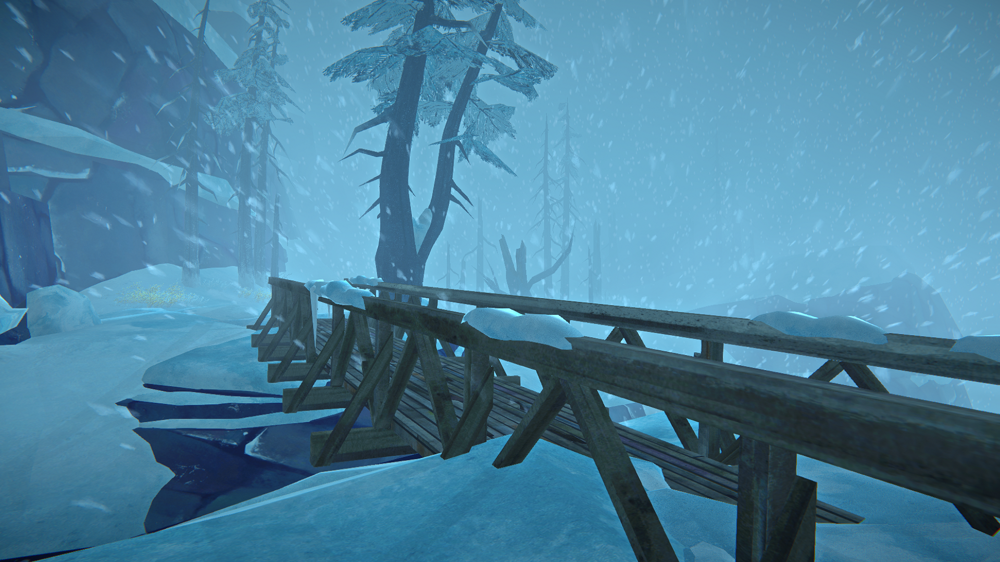

# Rickety Foot Bridge

**Categories:** Landmarks, Locations, Locations in Broken Railroad, Outdoor locations · **Source:** [Fandom](https://thelongdark.fandom.com/wiki/Rickety_Foot_Bridge)

**Rickety Foot Bridge**

[Broken railroad hidden bridge](../assets/Broken_railroad_hidden_bridge.jpg)

**Location**

[Rickety Foot Bridge Location](../assets/Rickety_Foot_Bridge_Location.png)

**Region:** [Broken Railroad](./Broken%20Railroad.md)

**Type:** Landmark

## Overview

The Rickety Foot Bridge is a landmark found in the mountains to the East of the [Hunting Lodge](./Hunting%20Lodge.md). While sparse in loot, it does offer plentiful [Old Man's Beard Lichen](./Old%20Man%27s%20Beard%20Lichen.md) and [Reishi Mushrooms](./Reishi%20Mushroom.md), as well as [Green Birch Saplings](./Green%20Birch%20Sapling.md) as the player continues to follow the path past the bridge. It makes a good side path when when returning to the [Maintenance Yard](./Maintenance%20Yard.md) to avoid wolves. A [Rope Climbing](./Rope%20Climbing.md) section is found at the end of the mountain path, but requires a [Mountaineering Rope](./Mountaineering%20Rope.md) to scale the cliffside at the end of the path ahead. _The bridge during a Blizzard_
