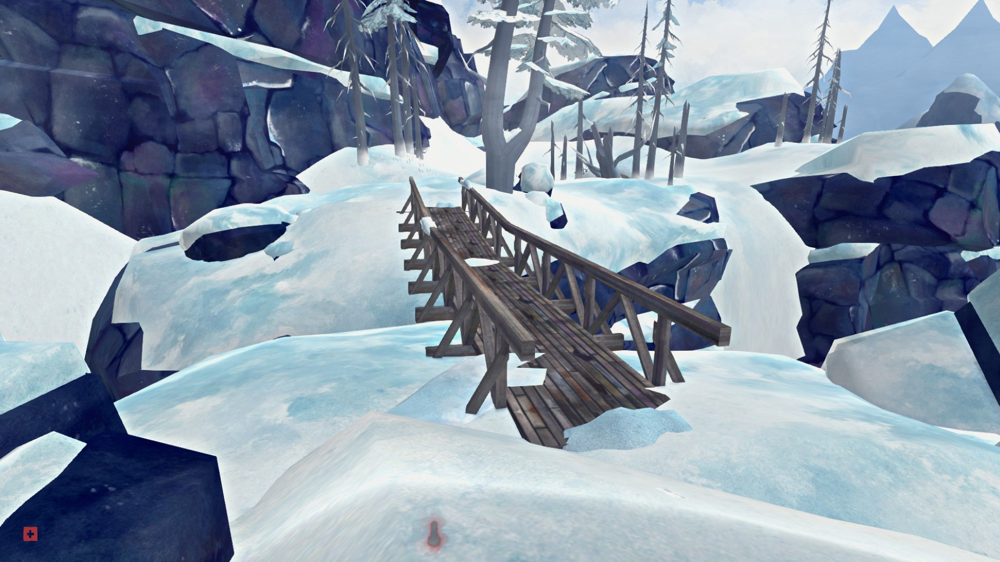
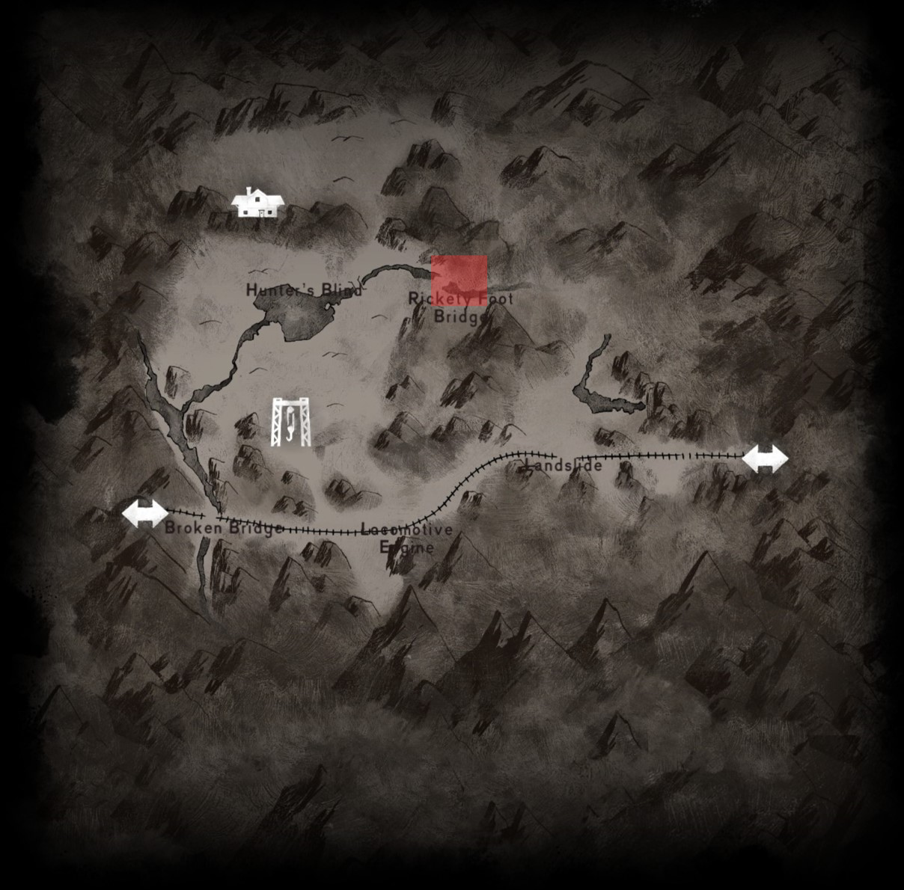

# Rickety Foot Bridge

**Rickety Foot Bridge**

| Property | Details |
| --- | --- |
|  |  / *Broken\_railroad\_hidden\_bridge.jpg* |
| **Location** |  |
|  |  / *Rickety\_Foot\_Bridge\_Location.png* |
| Region | [Broken Railroad](./Broken%20Railroad.md)\|- |
| Type | Landmark\|- |
