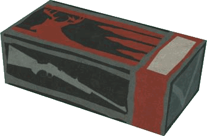
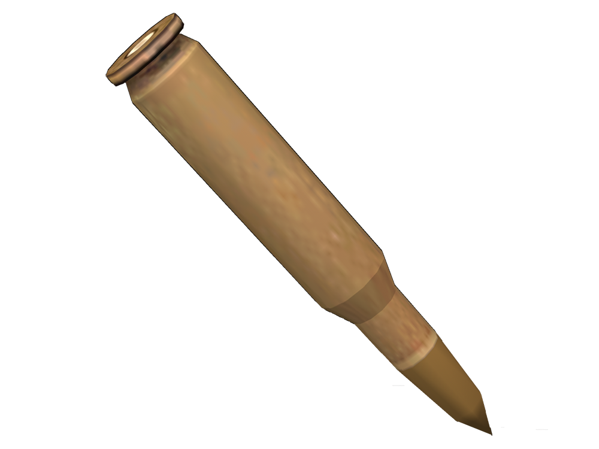
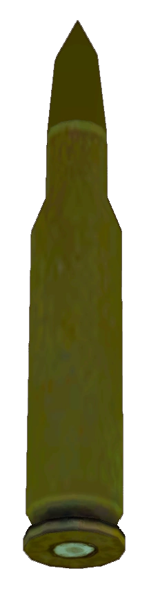

# Rifle Ammunition

**Categories:** Tools · **Source:** [Fandom](https://thelongdark.fandom.com/wiki/Rifle_Ammunition)

**Contents**

- [Overview](#overview)
- [Harvesting](#harvesting)
- [Crafting](#crafting)
- [Notes](#notes)
- [Tips](#tips)
- [Gallery](#gallery)

**Rifle Ammunition**

**General**

Item Type

Wintermute

No

Renewable

Yes ([Trader](./Trader.md) or rare [Beachcombing](./Beachcombing.md)) no (Interloper)

**Statistics**

Weight

0.02 kg(0.04 lbs)

> “**A box of rifle cartridges.**”
>
> — Boxed ammo In-game description

> “**A single .303 rifle cartridge.**”
>
> — Single cartridge In-game description

**Rifle Ammunition** and **Rifle Cartridge** is .303 ammunition for the [Hunting Rifle](./Hunting%20Rifle.md). It can be found as a single round, or in boxes of 5. It can also be crafted at an [Ammunition Work Bench](./Ammunition%20Work%20Bench.md). The box is branded as a product called _Bullseye_.

## Overview

When fired, an empty [Rifle Shell Casing](./Rifle%20Shell%20Casing.md) will immediately drop to the ground, which can then be picked up for creating new cartridges. If the Hunting Rifle is manually unloaded in the Backpack menu, all unspent ammunition is placed in the player's inventory.

### Harvesting

When harvested, a single Rifle Cartridge has a chance to produce the following after 5 minutes of [Harvesting](./Harvesting.md) (higher [Gunsmithing](./Gunsmithing.md) leads to a higher chance to recover most or all materials):

- 1 [Bullet](./Bullet.md)
- 1 [Rifle Shell Casing](./Rifle%20Shell%20Casing.md)
- 0.01 [Can of Gunpowder](./Can%20of%20Gunpowder.md)

### Crafting

Crafting at an [Ammunition Work Bench](./Ammunition%20Work%20Bench.md) requires the following recourses:

**Rifle Cartridge**

1

5 minutes

[Rifle Shell Casing](./Rifle%20Shell%20Casing.md)

1

[Can of Gunpowder](./Can%20of%20Gunpowder.md)

0.01 kg

**Requirements**

**Item:** [Bullet](./Bullet.md)

**Quantity:** 1

Crafting quality Condition Rifle Ammunition is based on the [Gunsmithing](./Gunsmithing.md) skill, with lower level Gunsmithing producing lower quality cartridges that are more likely to misfire, no matter the condition of the Hunting Rifle. The quality and Condition of the crafted ammunition will always be found next to the name of the ammo:

- Poor 20% (Level 1)
- Mediocre 40% (Level 2)
- Good 60% (Level 3)
- Great 80% (Level 4)
- Perfect 100% (Level 5)

Ammunition that is found in the game world will always be in "Perfect" condition.

## Notes

- The character will load five rounds into the magazine at a time using stripper clips. Any number of rounds less than five are loaded one-by-one.
- Rifle rounds can be found on [corpses](./Frozen%20Corpse.md), lying on the floor inside of buildings, or in [hunting blinds](./Hunter%27s%20Blinds.md).
- Dropped rounds appear as a box of rounds when dropping more than one at a time, even if an actual box of ammunition is never found.
- Empty shell casings always drop directly beneath the player regardless of firing angle, even though it is ejected to the side from the action.
- The ammo's real life counterpart is the .303 British Rifle cartridge, which was produced from the late 1890s until the early 1950s for use by the British Army. However, unlike the real .303, the cartridge depicted in-game is rimless rather than rimmed.

## Tips

- Rifle rounds in The Long Dark are rare. They are best saved for hunting big game.
- Multiple rounds should not be used once a target is hit unless hunting [Moose](./Moose.md) or [Cougar](./Cougar.md), as the bleeding wound will result in the death of the target.
- Use your ammunition wisely even if it is renewable, since trips to ammunition workbenches are dangerous, resource-intensive, and time-consuming.
- Rifle rounds are found in a small, red and grey colored cardboard box, or, if the player has a keen eye, can be spotted singly in fishing huts and other buildings.
- Hunting [Rabbits](./Rabbit.md) with the hunting rifle is not very efficient, as rabbits can be hunted effectively with [Stones](./Stone.md), [Fire Hardened Arrows](./Fire%20Hardened%20Arrow.md), or the [Revolver](./Revolver.md) if desperate.

## Gallery

