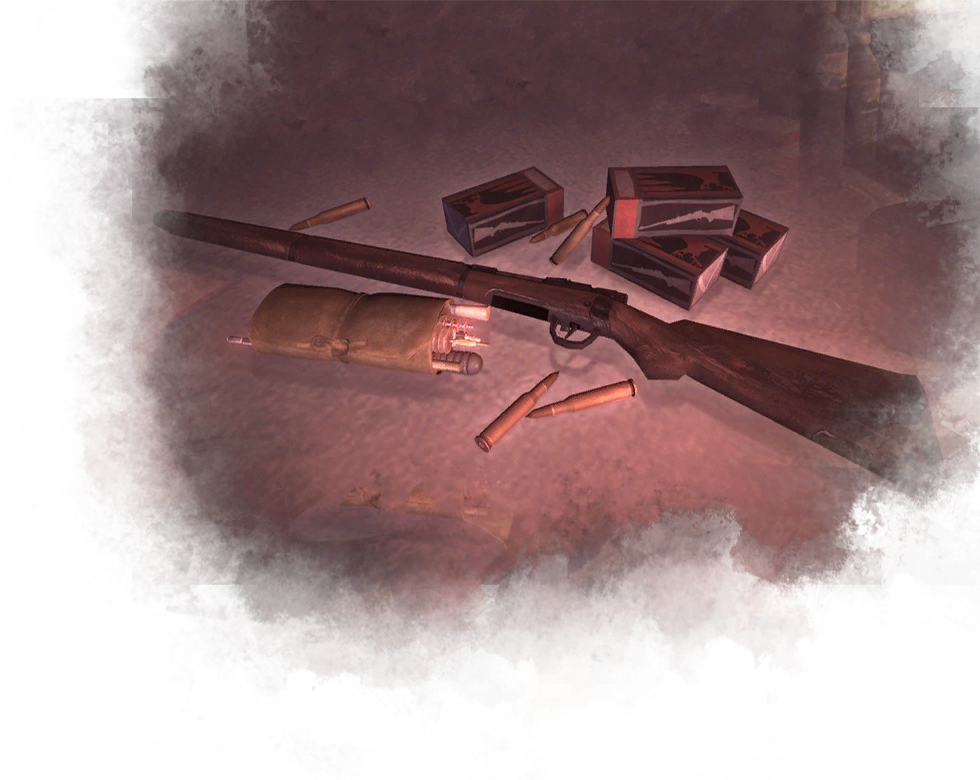

# Rifle Firearm

**Contents**

- [Overview](#Overview)
- [Equipment](#Equipment)
- [Condition Loss](#Condition_Loss)
- [Rifle ammunition](#Rifle_ammunition)
- [Hunting](#Hunting)
- [Critical hits](#Critical_hits)
- [Bleeding](#Bleeding)
- [Skill levels](#Skill_levels)
- [Trivia](#Trivia)

<table class="infobox">
<caption>Rifle Firearm</caption>
<colgroup>
<col style="width: 50%" />
<col style="width: 50%" />
</colgroup>
<tbody>
<tr>
<td colspan="2"><figure>

<figcaption>Rifle_Firearm_background.png</figcaption>
</figure></td>
</tr>
<tr>
<td>
Release
</td>
<td>
<a href="./The%20Long%20Dark%20%E2%80%94%20Early%20Access%20Changelog.md#0.346" class="wikilink" title="Penitent Scholar (v0.346)">Penitent Scholar (v0.346)</a>
</td>
</tr>
<tr>
<td>
Date
</td>
<td>
23 June 2016
</td>
</tr>
</tbody>
</table>

 **Rifle Firearm** or **Firearms** is a <a href="./Skills.md" class="wikilink" title="Survival Skill">Survival Skill</a> that involves the use of a <a href="./Hunting%20Rifle.md" class="wikilink" title="Hunting Rifle">Hunting Rifle</a> to <a href="./Hunting.md" class="wikilink" title="hunt">hunt</a> <a href="./Wildlife.md" class="wikilink" title="animals">animals</a>.

The rifle's range allows it to wound or kill animals from relatively safe distances.

## Overview

\[Missing image: Riflesights.jpg\] The hunting rifle is a tool used to fire <a href="./Rifle%20Ammunition.md" class="wikilink" title="Rifle round">Rifle rounds</a> at targets. The rifle operates as a hit-scan weapon; unlike the bow, its bullets are not affected by projectile drop. The high velocity rounds it fires will travel in a straight line and cause massive internal injuries to any animal struck by it, with the potential to kill instantly. If a shot hits the targeted animal (indicated by a spurt of blood) but fails to immediately kill it, the round will inflict a bleeding wound that leaves a blood trail on the ground. Over the course of several game hours (depending on where the animal was hit), the wound will eventually kill the animal. After a round is fired, a shell casing will be ejected from the gun where the player stands and can be picked up.

- All rifles except for the <a href="./Curator%27s%20Rifle.md" class="wikilink" title="Curator&#39;s Rifle">Curator's Rifle</a> currently have a maximum range of approximately fifty paces with a Beginner Firearms Skill. (The Curators' has a range of ~66 paces) Targets beyond the maximum range cannot be hit, even if the aiming reticle lines up accurately.
- Hitting a fleshy target will produce a blood spray effect.
- Hitting a solid target will produce a smoke effect often accompanied with a "clank" sound.
- Hitting most environmental targets will produce a snow scatter effect.
- Firing indoors will temporarily hinder hearing.

## Equipment

Players need both a rifle and ammunition before they can start practicing the firearms skill.

### Condition Loss

The hunting rifle (and its variants) are tools used to fire rifle rounds at targets. The rifle's condition will degrade every shot (the amount degraded depends on the variant). Rifles can be repaired by using a <a href="./Firearm%20Cleaning%20Kit.md" class="wikilink" title="Firearm Cleaning Kit">Firearm Cleaning Kit</a> to keep the weapon in optimal condition. A <a href="./Milling%20Machine.md" class="wikilink" title="Milling Machine">Milling Machine</a> can be used to greatly repair a rifle, even being able to restore a 0% Ruined Condition rifle, but this takes considerably more time then a repair. At level 5 Rifle Firearm skill, Per-use condition <a href="./Decay.md" class="wikilink" title="degradation">degradation</a> reduced by 50%.

<table>
<thead>
<tr>
<th></th>
<th colspan="4">
Rifle Variant
</th>
</tr>
</thead>
<tbody>
<tr>
<td>
Skill Level
</td>
<td>
<a href="./Hunting%20Rifle.md" class="wikilink" title="Hunting Rifle">Hunting Rifle</a> and <a href="./Curator%27s%20Rifle.md" class="wikilink" title="Curator&#39;s Rifle">Curator's Rifle</a>
</td>
<td>
<a href="./Vaughn%27s%20Rifle.md" class="wikilink" title="Vaughn&#39;s Rifle">Vaughn's Rifle</a>
</td>
<td>
<a href="./Barb%27s%20Rifle.md" class="wikilink" title="Barb&#39;s Rifle">Barb's Rifle</a>
</td>
<td>
<a href="./Bunker%20Rifle.md" class="wikilink" title="Bunker Rifle">Bunker Rifle</a>
</td>
</tr>
<tr>
<td>
1
</td>
<td>
1.333% 75 shots from full
</td>
<td>
2% 50 shots from full
</td>
<td>
1% 100 shots from full
</td>
<td>
4% 25 shots from full
</td>
</tr>
<tr>
<td>
5
</td>
<td>
0.666% 150 shots from full
</td>
<td>
1% 100 shots from full
</td>
<td>
.5% 200 shots from full
</td>
<td>
2% 50 shots from full
</td>
</tr>
</tbody>
</table>

### Rifle ammunition

Rifle ammunition for hunting rifles can be found as single cartridges, or in 5-round boxes. It can be crafted at the <a href="./Ammunition%20Work%20Bench.md" class="wikilink" title="Ammunition Workbench">Ammunition Workbench</a>, a crafting station found in both <a href="./Bleak%20Inlet.md" class="wikilink" title="Bleak Inlet">Bleak Inlet</a> and <a href="./Blackrock.md" class="wikilink" title="Blackrock">Blackrock</a>.

The rifle holds a maximum of 10 rounds at a time and can be loaded with 5 round stripper clips; rounds will be loaded individually if there are 6 or more rounds in the magazine or if the player has fewer than 5 rounds. Loading will continue until interrupted, either by clicking or canceling, or until the magazine is fully loaded. Unlike the <a href="./Revolver.md" class="wikilink" title="Revolver">Revolver</a>, shell casings will be ejected onto the ground automatically after firing due to how a bolt action system works.

## Hunting

  
*Main article: <a href="./Hunting.md" class="wikilink" title="Hunting">Hunting</a>*

**Hunting** animals allows players to kill and then harvest their flesh, pelts, and guts to acquire <a href="./Food%20And%20Drink.md" class="wikilink" title="food">food</a> and materials in *<a href="./The%20Long%20Dark.md" class="wikilink" title="The Long Dark">The Long Dark</a>*. Hitting animals with projectiles, such as rifle ammunition, is the most effective way to kill game while completely bypassing the animals' natural defenses. Rifle shots move too quickly to be blocked or dodged and can be fired from outside the animal's zone of perception, allowing a (potentially) safe source of food.

### Critical hits

Critical hits are random occurrences but are more likely in designated critical areas. Shots to the head and neck have the best chance to cause a critical hit, followed by shots to the shoulders and chest. Shots to the hind are immune to critical hits.

### Bleeding

Direct hits to an animal with a rifle round that are not critical will cause bleeding wounds. Animals will bleed out according to which area they were shot in last. Multiple shots to the same area will not make the animal bleed out any faster. However, shooting an animal in an area that bleeds faster than a previous wound it has already received will cause it to bleed out as if the faster wound were caused when the first wound was.

<table>
<thead>
<tr>
<th></th>
<th colspan="4">
Hit zone
</th>
</tr>
</thead>
<tbody>
<tr>
<td>
Animal
</td>
<td>
Head
</td>
<td>
Chest
</td>
<td>
Hind
</td>
<td>
Foot
</td>
</tr>
<tr>
<td>
<a href="./Rabbit.md" class="wikilink" title="Rabbit">Rabbit</a>
</td>
<td>
Instant
</td>
<td>
Instant
</td>
<td>
Instant
</td>
<td>
Instant
</td>
</tr>
<tr>
<td>
<a href="./Deer.md" class="wikilink" title="Deer">Deer</a>
</td>
<td>
Instant
</td>
<td>
45 minutes
</td>
<td>
60 minutes
</td>
<td>
240 minutes
</td>
</tr>
<tr>
<td>
<a href="./Wolf.md" class="wikilink" title="Wolf">Wolf</a>
</td>
<td>
Instant
</td>
<td>
Instant
</td>
<td>
60 minutes
</td>
<td>
120 minutes
</td>
</tr>
<tr>
<td>
<a href="./Bear.md" class="wikilink" title="Bear">Bear</a>
</td>
<td>
60 minutes
</td>
<td>
240 minutes
</td>
<td>
360 minutes
</td>
<td>
480 minutes
</td>
</tr>
<tr>
<td>
<a href="./Moose.md" class="wikilink" title="Moose">Moose</a>
</td>
<td>
N/A<a href="#fn1" class="footnote-ref" id="fnref1" role="doc-noteref">1</a>
</td>
<td>
N/A<a href="#fn2" class="footnote-ref" id="fnref2" role="doc-noteref">2</a>
</td>
<td>
N/A<a href="#fn3" class="footnote-ref" id="fnref3" role="doc-noteref">3</a>
</td>
<td>
N/A<a href="#fn4" class="footnote-ref" id="fnref4" role="doc-noteref">4</a>
</td>
</tr>
</tbody>
</table>
<section id="footnotes" class="footnotes footnotes-end-of-document" role="doc-endnotes">

<ol>
<li id="fn1">Moose do not bleed out.<a href="#fnref1" class="footnote-back" role="doc-backlink">↩︎</a></li>
<li id="fn2"></li>
<li id="fn3"></li>
<li id="fn4"></li>
</ol>
</section>

## Skill levels

Rifle Skill is increased by scoring hits on live wildlife with the <a href="./Hunting%20Rifle.md" class="wikilink" title="Hunting Rifle">Hunting Rifle</a>, <a href="./Barb%27s%20Rifle.md" class="wikilink" title="Barb&#39;s Rifle">Barb's Rifle</a>, <a href="./Vaughn%27s%20Rifle.md" class="wikilink" title="Vaughn&#39;s Rifle">Vaughn's Rifle</a>, or <a href="./Curator%27s%20Rifle.md" class="wikilink" title="Curator&#39;s Rifle">Curator's Rifle</a>, or by fully reading *<a href="./Frontier%20Shooting%20Guide.md" class="wikilink" title="Frontier Shooting Guide">Frontier Shooting Guide</a>* or *<a href="./Advanced%20Guns%20Guns%20Guns!.md" class="wikilink" title="Advanced Guns Guns Guns!">Advanced Guns Guns Guns!</a>*. Multiple copies of each book can be read, each granting skill points when fully read.

- A rifle round striking a live animal (except <a href="./Crow.md" class="wikilink" title="crows">crows</a> and <a href="./Ice%20Fishing.md" class="wikilink" title="fish">fish</a>) grants 1 skill point.
- *Frontier Shooting Guide* grants 5 skill points (4 hours of reading) The book **<u>cannot</u>** be read if you are skill level 4 or above.
- *Advanced Guns Guns Guns!* grants 10 skill points (25 hours of reading).

Once players have reached a new skill level, they unlock the effects described in the table below: \<table-progress-tracking table-id="1" unique-column-index="1"\>

<table>
<colgroup>
<col style="width: 20%" />
<col style="width: 20%" />
<col style="width: 20%" />
<col style="width: 20%" />
<col style="width: 20%" />
</colgroup>
<thead>
<tr>
<th>
Level
</th>
<th>
Skill points needed
</th>
<th>
Points to next level
</th>
<th style="text-align: left; width: 40%;">
Effects
</th>
<th>
Flavor Text
</th>
</tr>
</thead>
<tbody>
<tr>
<td>
1
</td>
<td>
0
</td>
<td>
10
</td>
<td style="text-align: left;"><ul>
<li>Basic rifle skill</li>
</ul></td>
<td>
You're very new to firearms, and aren't yet comfortable with using the Rifle. You know how to load it and how to fire it, and you know what end to point at the target, and that's about it.
</td>
</tr>
<tr>
<td>
2
</td>
<td>
10
</td>
<td>
15
</td>
<td style="text-align: left;"><ul>
<li>Critical hit chance increased by 10%</li>
<li>2 additional percent of condition per repair action</li>
</ul></td>
<td>
You have a little more shooting experience under your belt. You're more accurate and you know how to keep your Rifle in working order.
</td>
</tr>
<tr>
<td>
3
</td>
<td>
25
</td>
<td>
25
</td>
<td style="text-align: left;"><ul>
<li>Accuracy range increased by 20%</li>
<li>Critical Hit chance increased by 15%</li>
<li>3 additional percent of condition per repair action</li>
</ul></td>
<td>
You've become skilled with the Rifle. You're able to hit things further away, and you've developed a better feel for how your shots can be most effective. You know how to keep your Rifle in good condition.
</td>
</tr>
<tr>
<td>
4
</td>
<td>
50
</td>
<td>
50
</td>
<td style="text-align: left;"><ul>
<li>Damage increased by 10%</li>
<li>Accuracy range increased by 30%</li>
<li>Critical Hit chance increased by 20%</li>
<li>4 additional percent of condition per repair action</li>
</ul></td>
<td>
You've developed a strong feeling for the Rifle. Your shots hit more often and you take down your targets more reliably. It is your constant companion.
</td>
</tr>
<tr>
<td>
5
</td>
<td>
100
</td>
<td>
Max level
</td>
<td style="text-align: left;"><ul>
<li>Damage increased by 20%</li>
<li>Accuracy range increased by 40%</li>
<li>Critical hit chance increased by 30%</li>
<li>5 additional percent of condition per repair action</li>
<li>Per-use condition <a href="./Decay.md" class="wikilink" title="degradation">degradation</a> reduced by 50%</li>
</ul></td>
<td>
When you aim down those sights the world melts away and there's only you, the Rifle, the bullet, and your target. The trigger is death. The trigger is life.
</td>
</tr>
</tbody>
</table>

\</table-progress-tracking\>

## Trivia

- The rifle can't be used with a <a href="./Sprained%20Wrist.md" class="wikilink" title="Sprained Wrist">Sprained Wrist</a>.
- Bullets are more likely to cause a critical wound, and do more damage compared to arrows.
- Bullets cause less severe bleeding compared to arrows, resulting in longer bleed-out times.
- Firing the rifle indoors will cause temporary deafness.
- The rifle will be dropped in any <a href="./Struggle.md" class="wikilink" title="Struggle">Struggle</a> if the player loses.

**Lua execution error in Module:Navbox function navbox**<a href="ru:%D0%9D%D0%B0%D0%B2%D1%8B%D0%BA%D0%B8#%D0%9E%D0%B3%D0%BD%D0%B5%D1%81%D1%82%D1%80%D0%B5%D0%BB%D1%8C%D0%BD%D0%BE%D0%B5_%D0%BE%D1%80%D1%83%D0%B6%D0%B8%D0%B5" class="wikilink" title="ru:Навыки#Огнестрельное оружие">ru:Навыки#Огнестрельное оружие</a> <a href="es:Arma_de_fuego:_Rifle" class="wikilink" title="es:Arma de fuego: Rifle">es:Arma de fuego: Rifle</a> <a href="fr:Armes_%C3%A0_feu:_Fusil" class="wikilink" title="fr:Armes à feu: Fusil">fr:Armes à feu: Fusil</a>

## Notes

