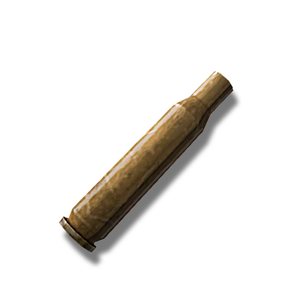

# Rifle Shell Casing

**Categories:** Materials · **Source:** [Fandom](https://thelongdark.fandom.com/wiki/Rifle_Shell_Casing)

**Rifle Shell Casing**

| Property | Details |
| --- | --- |
|  |  / _Rifle\_Shell\_Casing\_icon.png_ |
| **General** |  |
| Item Type | Material\|- |
| Renewable | Yes ([Trader](./Trader.md)) no (Interloper) |
| **Statistics** |  |
| Weight | 0.01 kg(0.02 lbs) |

> “__Empty casing from firing a Rifle. Used for Crafting new Ammunition.__”
>
> — In-game description

**Rifle Shell Casings** are a crafting material in _The Long Dark_.

## Overview

Rifle Shell Casings are an ingredient in the crafting of [Rifle Ammunition](./Rifle%20Ammunition.md) with the [Gunsmithing](./Gunsmithing.md) Skill. They cannot be crafted but may be acquired by:

- When a loaded [Hunting Rifle](./Hunting%20Rifle.md) is fired, a spent Rifle Shell Casing is ejected to the ground nearby.
- Inside containers, indoors, or near Hunting Blinds outdoors.
- Harvesting Rifle Ammunition (higher chance to receive at higher Gunsmithing skill).

## Products

**Template:materials** [ru:Ружейная гильза](ru:%D0%A0%D1%83%D0%B6%D0%B5%D0%B9%D0%BD%D0%B0%D1%8F_%D0%B3%D0%B8%D0%BB%D1%8C%D0%B7%D0%B0)
