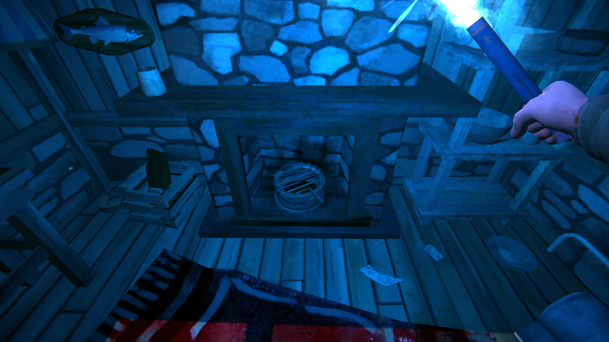

# Rim Grill

<table class="infobox">
<caption>Rim Grill</caption>
<colgroup>
<col style="width: 50%" />
<col style="width: 50%" />
</colgroup>
<tbody>
<tr>
<td colspan="2"><figure>

<figcaption>screen_ab2c5b97-8817-4398-a5b1-fb4b96024b93_hi.png</figcaption>
</figure></td>
</tr>
<tr>
<td colspan="2" class="section">
<strong>Statistics</strong>
</td>
</tr>
<tr>
<td>
Cooking slots
</td>
<td>
2
</td>
</tr>
</tbody>
</table>

The **rim grill** is an immovable <a href="./Fire.md#Contained_fires" class="wikilink" title="contained fire">contained fire</a> introduced in the Errant Pilgrim update. The rim grill functions identically to other contained fires and player-made <a href="./Campfire.md" class="wikilink" title="Campfire">Campfire</a>. The rim grill provides no advantage over other contained fires, but it does allow protection against wind, unlike the player-made campfire. It has two <a href="./Cooking.md" class="wikilink" title="Cooking">Cooking</a> slots.

The rim grill can be re-lit indefinitely, though it requires fresh starter, tinder, and fuel each time.

## Location

Currently, only four exist: the <a href="./Cabin.md" class="wikilink" title="cabin">cabin</a> in <a href="./Bleak%20Inlet.md" class="wikilink" title="Bleak Inlet">Bleak Inlet</a>, one outside the <a href="./Pleasant%20Valley%20Farmstead.md" class="wikilink" title="Pleasant Valley Farmstead">Pleasant Valley Farmstead</a>, one in <a href="./Indolent%20Hoppers.md" class="wikilink" title="Indolent Hoppers">Indolent Hoppers</a>, and one near the <a href="./Pump%20House.md" class="wikilink" title="Pump House">Pump House</a> (Caution, using the last location risks <a href="./Chemical%20Poisoning.md" class="wikilink" title="Chemical Poisoning">Chemical Poisoning</a>). There can also be a rim grill at the <a href="./Miserable%20Haunt.md" class="wikilink" title="Miserable Haunt">Miserable Haunt</a> cave in <a href="./Sundered%20Pass.md" class="wikilink" title="Sundered Pass">Sundered Pass</a>, but it is not a guaranteed spawn.

In <a href="./Wintermute.md" class="wikilink" title="Wintermute">Wintermute</a>, <a href="./Methuselah.md" class="wikilink" title="Methuselah">Methuselah</a> uses a Rim Grill as a fireplace inside the <a href="./Orca%20Gas%20Station.md" class="wikilink" title="Orca Gas Station">Orca Gas Station</a>.

## Gallery

<table class="gallery">
<colgroup>
<col style="width: 100%" />
</colgroup>
<tbody>
<tr>
<td><figure>

<figcaption>The rim grill in the cabin</figcaption>
</figure></td>
</tr>
</tbody>
</table>

**Lua execution error in Module:Navbox function navboxLua execution error in Module:Navbox function navbox** <a href="ru:%D0%93%D1%80%D0%B8%D0%BB%D1%8C" class="wikilink" title="ru:Гриль">ru:Гриль</a>

