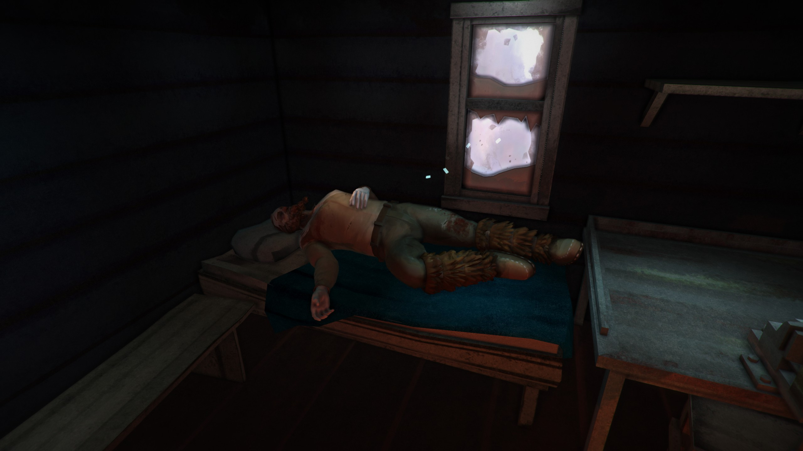

# Risk of Infection/Transcript

**Categories:** Episode 2 · **Source:** [Fandom](https://thelongdark.fandom.com/wiki/Risk_of_Infection%2FTranscript)

**Contents**

- [Opening cutscene](#opening-cutscene)
- [Find, and enter the abandoned dam.](#find-and-enter-the-abandoned-dam)
- [Search for medical supplies that can help the old trapper.](#search-for-medical-supplies-that-can-help-the-old-trapper)
- [Get the meds back to the trapper before he dies.](#get-the-meds-back-to-the-trapper-before-he-dies)

**Risk of Infection/Transcript**

**Episode:** [Episode 2](./Episode%202%20-%20Luminance%20Fugue.md)

**Previous:** [Paradise Lost (Predux)/Transcript](./Paradise%20Lost%20%28Predux%29%20%E2%80%94%20Transcript.md)

**Current:** Risk of Infection/Transcript

**Next:** [You Fix My Rifle?/Transcript](./You%20Fix%20My%20Rifle%3F.md)

**Region:** [Mystery Lake (region)](./Mystery%20Lake%20%28region%29.md)

**Characters:** [Will Mackenzie](./Will%20Mackenzie.md) [Jeremiah](./Jeremiah.md)

This is the transcript for Chapter 1 [Risk of Infection](./Risk%20of%20Infection.md) for Predux [Episode 2: Luminance Fugue](./Episode%202%20-%20Luminance%20Fugue.md).

## Opening cutscene

_The intro "By the Lion's Roar" plays_

_The scene starts with Mackenzie sitting in a chair, as the man he saved from the bear is sitting on a cot in a cabin. A Wood Stove burning by their side. Eventually the man awakes grunting in pain, and Mackenzie goes over to check on him._

[Jeremiah](./Jeremiah.md): "...where...bear...aaah!!"

_The wounded man struggles to get out of bed as Mackenzie walks over_

[Will Mackenzie](./Will%20Mackenzie.md): "Easy...easy. You're ok now. The bear's gone."

_Mackenzie takes a seat on the bench next to him_

Jeremiah: "...who...who are you?"

Mackenzie: "Name's Mackenzie. I found you when...the bear was..."

_The wounded man groans in pain before relaxing_

Jeremiah: "I remember now." _Coughs_ "You get the bear?"

Mackenzie: "It ran away. I think I hit it. Or scared it off."

_The wounded man laughs before coughing as he lays in the cot_

Jeremiah: "Ha! Scared it off? Not the way you shoot."

Mackenzie: "Glad your memory's coming back."

Jeremiah: "So...cold."

Mackenzie: "I got a fire going. That should warm things up a bit."

Jeremiah: "Pain...pain...need...something for the pain."

_Mackenzie looks around on the bench, and finds a bottle of Antibiotics_

Mackenzie: "Here...take these. They should help."

_The trapper takes a hand full of Antibiotics and swallows them, groaning in his pain_

Mackenzie: "Listen. You're going to need more than some pills and bandages. You're hurt, badly. That bite will get infected. Maybe worse. You have any stronger meds?"

_The trapper struggles to form words through the pain_

Jeremiah: "No."

_The trapper coughs and spits, pointing to the door_

Jeremiah: "Old...dam. Map. Back of the door... \[gurgles and passes out\]"

_Mackenzie gets up to check on him_

Mackenzie: "Can you hear me old man? Damn it. He's passed out."

_Mackenzie walks to the door and looks at the map the trapper mentioned_

Mackenzie: "Hmm...looks like an old hydroelectric dam not too far from here. Might be a good place to look for supplies."

_Mackenzie turns around to look at the old man on the bed_

Mackenzie: "Hang in there...whatever your name is."

## Find, and enter the abandoned dam.

_The cutscene ends as the player is in control again. Mackenzie makes note of the route to the Dam on the map and leaves the cabin._

Mackenzie: "That trapper's my key to getting out of here. He'd better not die on me."

_If the player attempts to enter [The Ravine](./The%20Ravine.md) by the Carter Staging Area, [Forlorn Muskeg](./Forlorn%20Muskeg.md) by the [Rail Tunnel](./Rail%20Tunnel.md), or re-enter [Mountain Town](./Mountain%20Town.md) by Trapper's Cabin, Mackenzie will say:_

Mackenzie: "I have to stay focused on the task at hand."

_Otherwise, Mackenzie wastes no time making his way to the Dam, walking over the hills and then taking the tracks to reach his destination. Upon finding the Dam, he finds the gate locked. Mackenzie sees two trailers nearby and enters them, finding the [Carter Hydro Staging Area Gate Key](./Carter%20Hydro%20Staging%20Area%20Gate%20Key.md) in a Locker and returning to open the gate_

Mackenzie: "Carter Dam...hmm. This place has seen better days."

_Mackenzie passes through the Staging Area and walks inside_

## Search for medical supplies that can help the old trapper.

_Mackenzie finds himself in a lobby_

_Mackenzie: "If the old trapper gets sick and dies...what he knows will die with him."_

_Approaching the two doors near the reception, a cutscene plays. Mackenzie ducks under two fallen girders pinned between two Metal Shelves. He ducks under another fallen girder before finding a door with the words CONTROL ROOM on it, with a [Keypad](./Keypad.md) nearby_

_Mackenzie: "What the hell happened here, anyways? Control room? That sounds promising."_

_Mackenzie tries to force the handle but cannot open the door_

_Mackenzie: "Hmm...looks like this thing isn't opening unless I can get the power working again. Maybe the Trapper knows more about it. I'd better find those first-aid supplies and get back to him."_

_Mackenzie enters a nearby room with an elevator, but the "Call Elevator" buttons do not work either. He turns around and sees a stairwell downstairs, but it is blocked by a locked gate. He turns around and finds a bathroom with a Frozen Corpse inside_

_He reluctantly frisks the body, and finds an [Admin Office Key](./Admin%20Office%20Key.md). Mackenzie finds another stairwell near the bathroom, and heads upstairs to an office space, and spots a [Medical Locker](./Medical%20Locker.md) under a sign labeled "AIDS STATION"._

_Mackenzie: "A ha....here it is."_

_He finds it locked, and walks to the nearby office and unlocks it with the Admin Office Key. He finds the [Aid Station Medical Locker Key](./Aid%20Station%20Medical%20Locker%20Key.md) and [Elevator Maintenance Note](./Elevator%20Maintenance%20Note.md), and takes both. He returns to unlock the Medical Locker, finding [Carter Hydro Medical Supplies](./Carter%20Hydro%20Medical%20Supplies.md) inside._

_Mackenzie: "This is what I'm looking for. There - - that should help. And...morphine? Looks expired but...you never know."_

## Get the meds back to the trapper before he dies.

_With medical supplies in tow, Mackenzie leaves the dam and returns to the Staging Area._

Mackenzie: "I'd better check in on that old Trapper."

_He and makes his way back to the Trapper's Cabin while passing a Wolf feasting on a Deer Carcass near the [Train Bridge](./Train%20Bridge.md), and eventually reaches the front door._

_A 3rd person cutscene begins. Mackenzie walks up to the old trapper_

Mackenzie: "Hey...old guy. Hey. Hey...you still with me?"

_Mackenzie waves him over, but gets no response_

Mackenzie: "Shit. I'm too late."

_The wounded trapper lurches out of bed, gasping for air and coughing as Mackenzie sits next to him on the bench_

Mackenzie: "Hey...you're still alive...umm...what's your name?"

_The man spits and coughs some more before looking at Mackenzie_

Jeremiah: "Call me Jeremiah."

Mackenzie: "I went to the Dam. I found some supplies that should help."

_Mackenzie reaches over and grabs a bottle of Antibiotics and the vial of Morphine_

Jeremiah: "...thanks...cause my insides hurt like hell. What'd...you find?"

Mackenzie: "General meds. Painkillers, antibiotics...and what looks to be some old vials of morphine."

Jeremiah: "Morphine?"

Mackenzie: "Easy. Hopefully your pain won't get that bad. You alone out here?"

Jeremiah: "What's it to you? What the hell are you doing out here anyway?"

Mackenzie: "Hey...don't get excited. I'm just looking for someone."

Jeremiah: "The only thing you should be looking for is a way to kill that bear."

Mackenzie: "Bear?"

Jeremiah: "Yeah. He'll be back soon enough. And when he is, I'll be ready." _He begins coughing in bed_ "Shit..."

Mackenzie: "Ready for what? You can barely sit up."

Jeremiah: "That bear's a mankiller. If we don't finish him off...no telling what savage fury he'll unleash."

Mackenzie: "We? I'm...I'm just on my way through the area. That bear's got nothing to do with me."

Jeremiah: "Ha. Listen stranger. You aren't going anywhere. Like it or not, you and me have a problem in common. Neither of us is going to survive unless we kill that damn bear."

_The cutscene ends and a dialogue compass appears_

- PAIN?

Mackenzie **(Text)**: "How's your pain?"

Jeremiah **(Text)**: "Everything hurts like hell. But I'll live."

Mackenzie **(Text)**: "You want something stronger than painkillers?"

Jeremiah **(Text)**: "No...I...yeah, I do. But...I'll be ok."

Mackenzie **(Text)**: "You seemed pretty excited when I mentioned Morphine."

Jeremiah **(Text)**: "Morphine? Nah. That stuff's dangerous. Especially the old stuff. Addictive. Makes you feel...like you're floating. In a dream..."

Mackenzie **(Text)**: "Right."

- BEAR?

Mackenzie **(Text)**: "What's the story with this bear?"

Jeremiah **(Text)**: "Story's real simple. That bear and me, we have unfinished business."

Mackenzie **(Text)**: "Unfinished business?"

Jeremiah **(Text)**: "Yeah. You could call it a trade in kind. Every time we meet, we each leave with a little of the other's blood."

Mackenzie **(Text)**: "Sounds like a losing proposition."

Jeremiah **(Text)**: "I'm sure it will be. For one of us."

- AREA?

Mackenzie **(Text)**: "Can you tell me more about the area around us?"

Jeremiah **(Text)**: "This whole area takes its name from Mystery Lake, nearby. Not much here. Some old cabins here and there. Railroad passes through. Campground around the lake's closed for the season. Mostly dead most of the year.

Mackenzie **(Text)**: "You alone out here?"

Jeremiah **(Text)**: "Pretty much. Whole Island's mostly abandoned now. Few scattered groups left. No real industry. Rare supply boat from the mainland. That's really the only lifeline for the few folks that still live on Great Bear..."

Mackenzie **(Text)**: "Sounds like a pretty quiet place..."

Jeremiah **(Text)**: "Just the way we like it."

Mackenzie **(Text)**: "We?"

Jeremiah **(Text)**: "You're from the mainland. You wouldn't understand."

- ALONE?

Mackenzie **(Text)**: "You alone out here?"

Jeremiah **(Text)**: "Yeah, I keep to myself. Hunt a bit. Fish in the summer. Keep my traplines full. Once a couple of month's, I head down to Rupert's Landing. Trade for what I need."

Mackenzie **(Text)**: "You have some way to call out of here? Like a radio?"

Jeremiah **(Text)**: "No. Who would I need to talk to?"

Mackenzie **(Text)**: "Don't like people much?"

Jeremiah **(Text)**: "I don't."

- DAM?

Mackenzie **(Text)**: "Seems odd to have a dam in such a pristine piece of wilderness."

Jeremiah **(Text)**: "Yeah. This place has always been ruined by greed."

Mackenzie **(Text)**: "That dam looks like it's been abandoned for a while."

Jeremiah **(Text)**: "Yeah. The big quake years ago shut that nonsense down."

Mackenzie **(Text)**: "Quake?"

Jeremiah **(Text)**: "Shit...don't you know anything, Mainlander?"

Mackenzie **(Text)**: "Err...I guess I must have forgot."

Jeremiah **(Text)**: "Railroads. Coal. Logging. Mining. Hydro. Whole island's basically a perfect wilderness that's been slowly destroyed by industry over the past, oh...hundred years or so."

Mackenzie **(Text)**: "Well...that's kind of the price of progress right? People need jobs. Need to feed their families..."

Jeremiah **(Text)**: "Bah. It doesn't matter. Quake put an end to that. And things are changing."

Mackenzie **(Text)**: "What things?"

Jeremiah **(Text)**: "Haven't you noticed? Since the lights in the sky? The world is quiet now."

- FINISHED

_A 3rd person cutscene plays_

Mackenzie: "You see those lights in the sky a few nights ago?"

_Mackenzie gets off the bench as Jeremiah lies in bed_

Jeremiah: "Yeah...I saw 'em. We see the Northern Lights lots this far up, but I've never seen anything quite like that."

Mackenzie: "I'm a bush pilot. Those lights took my plane down. Nearly died in the crash. Now I need to find my..." _Mackenzie hesitates to finish the sentence_ "I had a passenger with me."

Jeremiah: "Dead?"

Mackenzie: "I sure hope not. We were on our way to Perseverance Mills. You know it?"

Jeremiah: "Shit nothing town a few hours North?"

Mackenzie: "Sounds about right."

Jeremiah: "Yeah I know it. You're the first person I've seen in months. I haven't seen your friend."

Mackenzie: "The phone lines are down. Nothing electrical seems to be working. You think it has something to do with the flash of light?"

Jeremiah: "Could be. Wildlife's been acting weird too. Wolves, mostly. Been hanging around more than usual. Like they're waiting."

Mackenzie: "Waiting? For what?"

Jeremiah: "I dunno...but I have a bad feeling about it. Look. Maybe we can help each other."

Mackenzie: "I don't know. I need to get out there and look for my friend."

Jeremiah: "I might have an idea that might help you find who you're looking for. But with that bear out there and me laid up in here...well, you're as good as dead."

Mackenzie: "Thanks for the vote of confidence. What do you have in mind?"

Jeremiah: "Well... With that bear out on the prowl, you'll never survive long enough to find your friend. And I can't do shit from in here. But I can guide you. You do what I say, and I'll keep you alive."

Mackenzie: "And what's in it for you?"

Jeremiah: "We'll talk about that. For now...you need some protection."

_Jeremiah points to his Hunting Rifle_

Jeremiah: "Hand me my rifle."

_Mackenzie grabs it from the bench and hands it over to the trapper, who studies it in bed_

Jeremiah: "Ah shit... What I was afraid of. That shot you took hurt the rifle more than the bear. My rifle's done."

Mackenzie: "Shit...sorry. You have a...backup?"

Jeremiah: "No. No backup. But I know where you might be able to fix it."

Mackenzie: "Great. Where?"

Jeremiah: "Old railway yard, about a day's travel south, along the tracks. There's a machine shop there. I used to trade for time on the tools, to keep my gear in order. Bush pilot like you should be able to handle 'em."

_Jeremiah hands his [Broken Rifle](./Jeremiah%27s%20Broken%20Rifle.md) to Mackenzie_

Mackenzie: "I'll see what I can do."

Jeremiah: "Listen. Stay along the tracks. Keep your eyes open for the Old Bear. If you see him, hide and pray he doesn't pick up your scent. Don't get cocky, or we'll both end up dead."

Mackenzie: "Got it."

Jeremiah: "Good luck, pilot. Maybe we'll make a survivor out of you yet."
