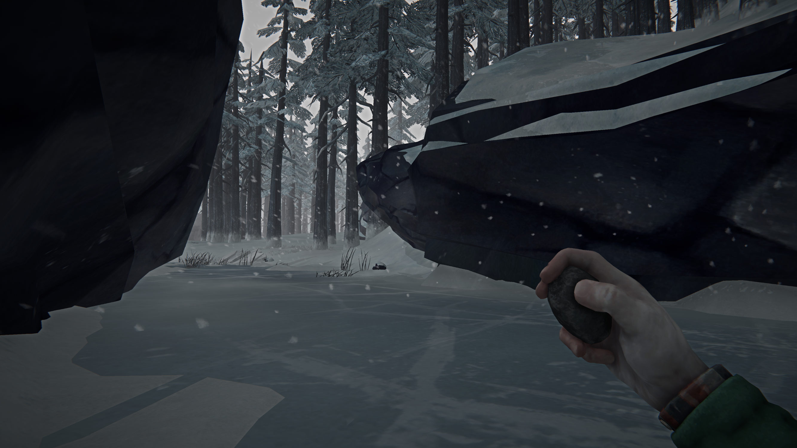

# River \(Southern Access\)

<table class="infobox">
<caption>River (Southern Access)</caption>
<colgroup>
<col style="width: 50%" />
<col style="width: 50%" />
</colgroup>
<tbody>
<tr>
<td colspan="2"><figure>

<figcaption>River_Southern_Access.png</figcaption>
</figure></td>
</tr>
<tr>
<td colspan="2" class="section">
<strong>Location</strong>
</td>
</tr>
<tr>
<td colspan="2"><figure>
[Missing image: River_(Southern_Access)_Location.png]
<figcaption>River_(Southern_Access)_Location.png</figcaption>
</figure></td>
</tr>
<tr>
<td>
Region
</td>
<td>
<a href="./Mystery%20Lake%20%28region%29.md" class="wikilink" title="Mystery Lake">Mystery Lake</a>|-
</td>
</tr>
<tr>
<td colspan="2" class="section">
<strong>General</strong>
</td>
</tr>
<tr>
<td></td>
<td>
Has no shelter|}

The <strong>River (Southern Access)</strong> is an unmarked location in <a href="./Mystery%20Lake%20%28region%29.md" class="wikilink" title="Mystery Lake">Mystery Lake</a>, located not far from the titular <a href="./Mystery%20Lake%20%28location%29.md" class="wikilink" title="Mystery Lake">Mystery Lake</a>.

The river connects Mystery Lake to the <a href="./Carter%20Hydro%20Dam.md" class="wikilink" title="Carter Hydro Dam">Carter Hydro Dam</a> and runs under the <a href="./Train%20Bridge.md" class="wikilink" title="Train Bridge">Train Bridge</a>. Along the river a <a href="./Rabbit.md" class="wikilink" title="Rabbit">Rabbit</a> and <a href="./Wolf.md" class="wikilink" title="Wolf">Wolf</a> spawn can be found as well as many <a href="./Cat%20Tail.md" class="wikilink" title="Cat Tail">Cat Tail</a> Plants and <a href="./Stone.md" class="wikilink" title="Stones">Stones</a>. A rope climbing section can be found nearby that leads up the side of the mountain to a cave and <a href="./Lake%20Overlook.md" class="wikilink" title="Lake Overlook">Lake Overlook</a>. <a href="./Alan%27s%20Cave.md" class="wikilink" title="Alan&#39;s Cave">Alan's Cave</a> can easily be accessed by following the river.

<strong>Lua execution error in Module:Navbox function navbox</strong>
</td>
</tr>
</tbody>
</table>

