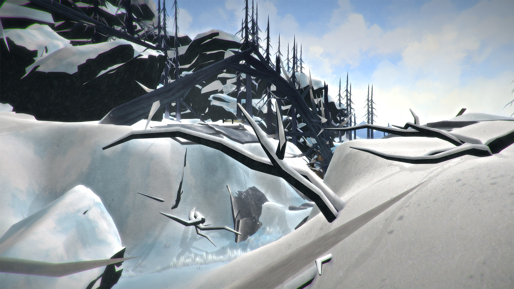
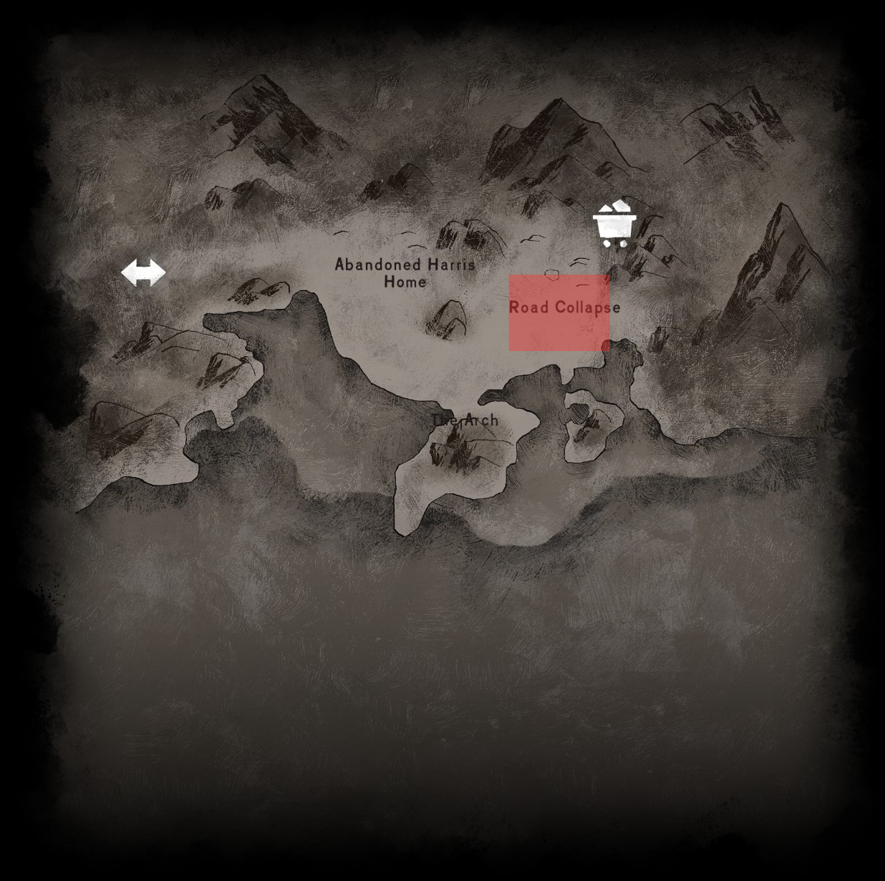

# Road Collapse

**Road Collapse**

| Property | Details |
| --- | --- |
|  |  / *Road\_Collapse.jpg* |
| **Location** |  |
|  |  / *Road\_Collapse\_Location.png* |
| Region | [Old Island Connector](./Crumbling%20Highway.md)\|- |
| **General** |  |
| Type | Landmark\|- |
