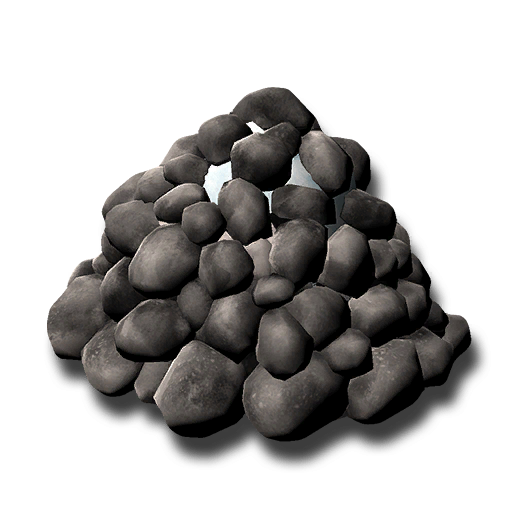
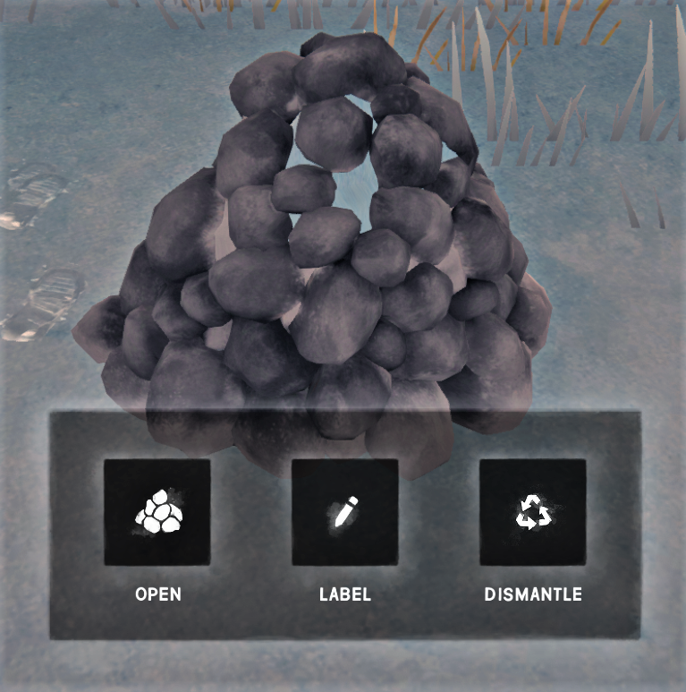
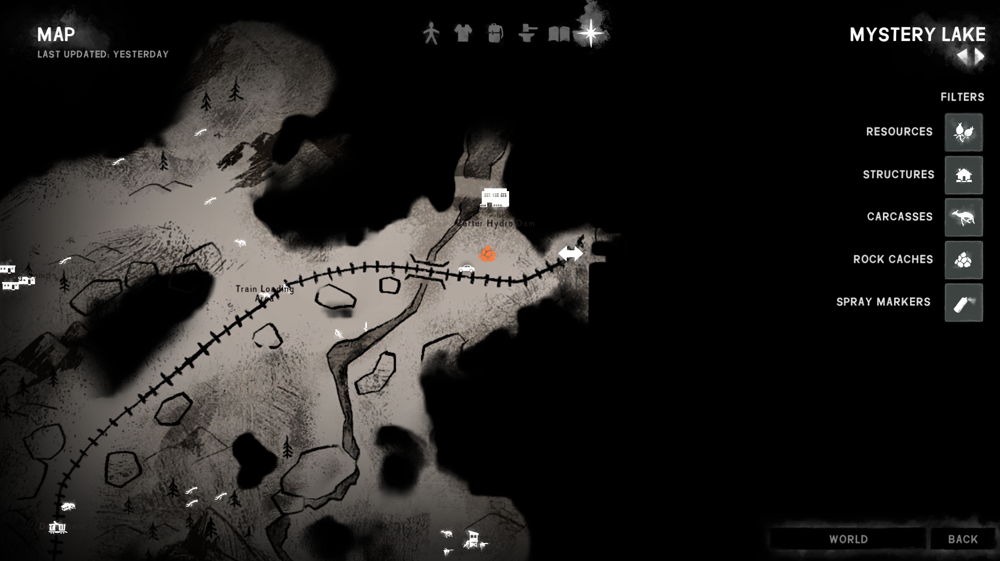

# Rock Cache

**Contents**

- [Overview](#Overview)
- [Crafting](#Crafting)
- [Harvesting](#Harvesting)
- [Gallery](#Gallery)
- [Notes](#Notes)

<table class="infobox">
<caption>Rock Cache</caption>
<colgroup>
<col style="width: 50%" />
<col style="width: 50%" />
</colgroup>
<tbody>
<tr>
<td colspan="2"><figure>

<figcaption>Rock_Cache_icon.png</figcaption>
</figure></td>
</tr>
<tr>
<td colspan="2" class="section">
<strong>General</strong>
</td>
</tr>
<tr>
<td>
Item Type
</td>
<td>
Item
</td>
</tr>
<tr>
<td>
Wintermute
</td>
<td>
No
</td>
</tr>
</tbody>
</table>

A **Rock Cache** is a craftable form of storage that appears as a landmark on the player's <a href="./Map.md" class="wikilink" title="map">map</a>.

Not to be confused with <a href="./Mementos.md" class="wikilink" title="Memento Rock Caches">Memento Rock Caches</a>.

## Overview 

Rock caches are the only form of outdoors craftable storage.

Each Rock Cache can hold up to 30kg of items and up to 5 can be built per <a href="./Region.md" class="wikilink" title="region">region</a>, for a total of 150kg of extra storage per region. 

This makes them useful particularly in Regions such as <a href="./Timberwolf%20Mountain.md" class="wikilink" title="Timberwolf Mountain">Timberwolf Mountain</a> and <a href="./Hushed%20River%20Valley.md" class="wikilink" title="Hushed River Valley">Hushed River Valley</a> where storage containers are more limited. Furthermore, they will show up on the <a href="./Map.md" class="wikilink" title="map">map</a> when crafted and can be renamed remotely.

Rock caches can be viewed in the Journal, where the player can leave notes of what items are stored inside of it, making it a useful way to keep inventory. 

Rock caches do not lose condition over time, but food and clothing items inside them decay as in other containers. 

## Crafting

<table class="infobox">
<caption>Rock Cache</caption>
<tbody>
<tr>
<td colspan="2">
-
</td>
</tr>
<tr>
<td colspan="2">
-
</td>
</tr>
<tr>
<td colspan="2">
15 minutes
</td>
</tr>
<tr>
<td colspan="2" class="section">
<strong>Requirements</strong>
</td>
</tr>
<tr>
<td>
Facility
</td>
<td>
[[File:Anywhere icon.png
</td>
</tr>
<tr>
<td colspan="2" class="section">
<strong>Materials</strong>
</td>
</tr>
<tr>
<td colspan="2" class="section">
<strong>Template:iconlink plain</strong>
</td>
</tr>
<tr>
<td>
Item
</td>
<td>
<a href="./Stone.md" class="wikilink" title="Stone">Stone</a>
</td>
</tr>
<tr>
<td>
Quantity
</td>
<td>
50
</td>
</tr>
</tbody>
</table>

Rock Caches can be constructed outdoors for 50 <a href="./Stone.md" class="wikilink" title="stones">stones</a> with the <a href="./Radial%20Menu.md" class="wikilink" title="Radial Menu">Radial Menu</a> under "Navigation".  

Up to 5 Rock Caches can be built per region, including 'transition zones', though they cannot be placed directly next to each other.

## Harvesting

They can be dismantled over 15 in-game minutes for a full refund of 50 stones, however they must be empty.

## Gallery

<table class="gallery">
<colgroup>
<col style="width: 33%" />
<col style="width: 33%" />
<col style="width: 33%" />
</colgroup>
<tbody>
<tr>
<td><figure>

<figcaption>Rockcache2.png</figcaption>
</figure></td>
<td><figure>

<figcaption>Rockcache.png</figcaption>
</figure></td>
<td><figure>

<figcaption>How a rock cache appears on the map, shown in orange</figcaption>
</figure></td>
</tr>
</tbody>
</table>

## Notes

In v. 1.76 meat did not degrade when placed in a rock cache, however this was hotfixed in v. 1.78

**Lua execution error in Module:Navbox function navbox**

