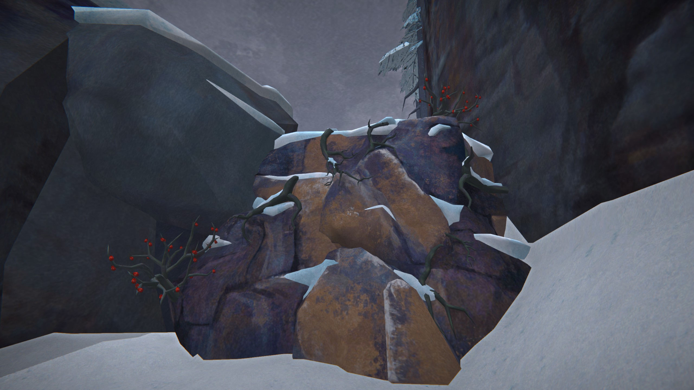

# Rock Climb

 **Rock Climbs** are an interactable object found in various regions, and are used to vertically traverse the land at certain chokepoints. A survivor can choose to climb up or down a rock wall and a unique animation will play when doing so.

They often contain 1 or 2 [Rose Hip](./Rose%20Hip.md) bushes that can be harvested. A player can avoid using them to climb down by simply walking off the top, though some rock climbs are much higher than they may seem and great care must be taken to avoid [Torn Clothing](./Torn%20Clothing.md), [Bruising](./Minor%20Bruising.md), and Sprains from falls. **Lua execution error in Module:Navbox function navbox**
