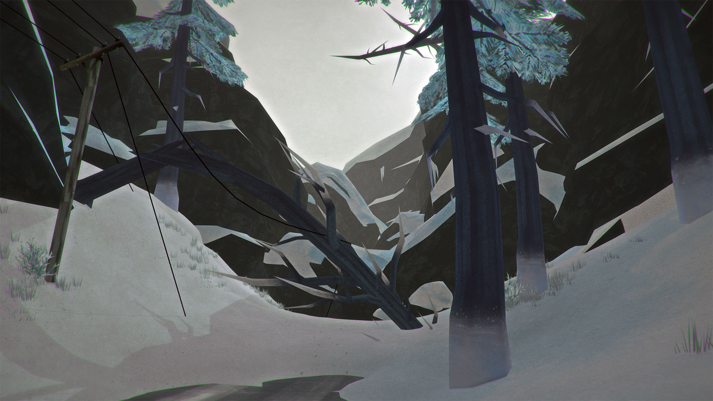
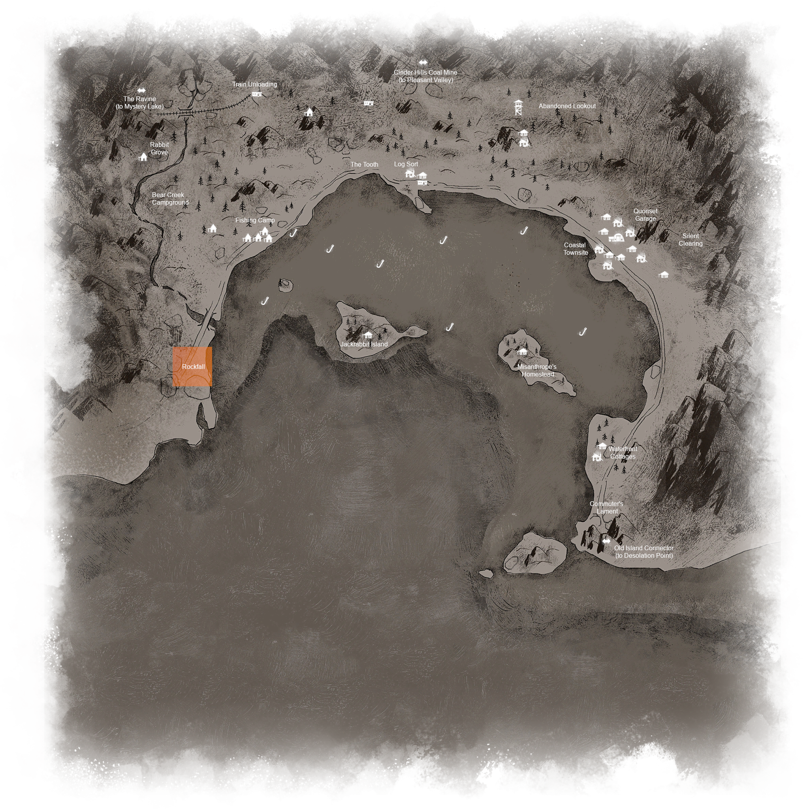

# Rockfall

**Rockfall**

| Property | Details |
| --- | --- |
| \[\[File: / \| Column 1 \| / \| --- \| / \|  / *Rockfall.jpg* \| | 250px\]\] |
|  |  / *Rockfall.jpg* |
| **Location** |  |
|  / *Rockfall\_map.png* |  |
| Region | [Coastal Highway](./Coastal%20Highway.md)\|- / Description |
| **General** |  |
| Type | Landmark\|- |
