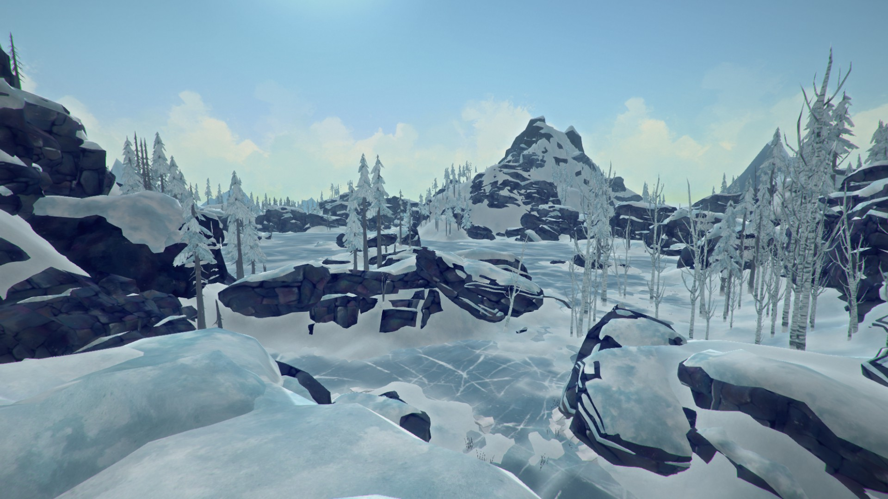

# Rocky Refuge

**Categories:** Islands, Locations, Locations in Mountain Town, Outdoor locations, Sheltered locations · **Source:** [Fandom](https://thelongdark.fandom.com/wiki/Rocky_Refuge)

**Rocky Refuge**

\[\[File:

250px\]\]

**Location**

Region

[Mountain Town](./Mountain%20Town.md)|-

Location

Description

A small area protected on two sides by rocks

**General**

Type

Outdoors|-

<!-- #Overview -->
​

<!-- #overview -->
## Overview

It is reached by climbing up the back side of the island hill until small cave is reached. A [Campfire](./Campfire.md) is always found inside - along with a [Backpack](./Backpack.md) and firewood - and sometimes a [Research Book](./Research%20Book.md). [Green Birch Saplings](./Green%20Birch%20Sapling.md) and [rose hip](./Rose%20Hip.md) bushes grow on the top of the hill.

A Birch forest is found to the north west, containing loads of [Birch Bark](./Birch%20Bark.md) and [Cat Tails](./Cat%20Tail.md). A [Moose](./Moose.md) often spawns in the forest.

<!-- #Gallery -->
​

<!-- #gallery -->
## Gallery

[ru:Скалистое убежище](https://ru.wikipedia.org/wiki/%D0%A1%D0%BA%D0%B0%D0%BB%D0%B8%D1%81%D1%82%D0%BE%D0%B5_%D1%83%D0%B1%D0%B5%D0%B6%D0%B8%D1%89%D0%B5)
