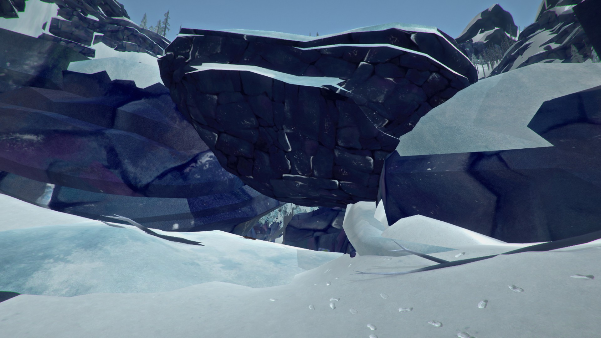

# Rocky Refuge

**Rocky Refuge**

| Property | Details |
| --- | --- |
| \[\[File: / \|  / *Exterior* \|  / *Interior* \| / \| --- \| --- \| | 250px\]\] |
|  / *Exterior* |  / *Interior* |
| **Location** |  |
|  / *Rocky\_Refuge\_Location.png* |  |
| Region | [Mountain Town](./Mountain%20Town.md)\|- / Location |
| Description | A small area protected on two sides by rocks |
| **General** |  |
| Type | Outdoors\|- |
