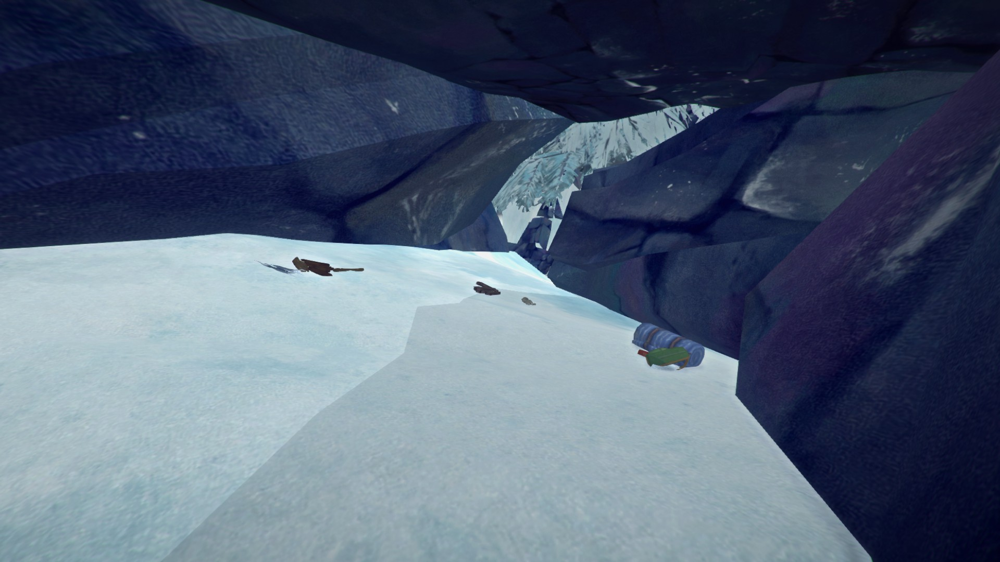
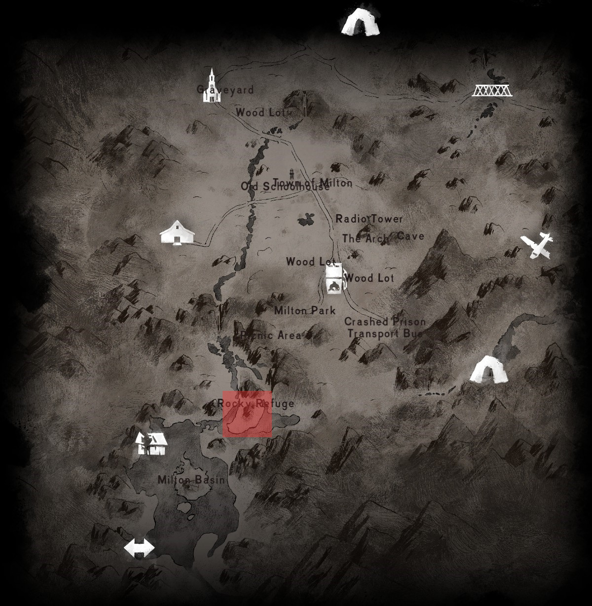

# Rocky Refuge

**Categories:** Islands, Locations, Locations in Mountain Town, Outdoor locations, Sheltered locations · **Source:** [Fandom](https://thelongdark.fandom.com/wiki/Rocky_Refuge)

**Rocky Refuge**

\[\[File: /  / _Exterior_ /  / _Interior_

250px\]\]

**Location**

_Rocky\_Refuge\_Location.png_

Region

[Mountain Town](./Mountain%20Town.md)

Location

**Description:** A small area protected on two sides by rocks

**General**

**Type:** Outdoors
