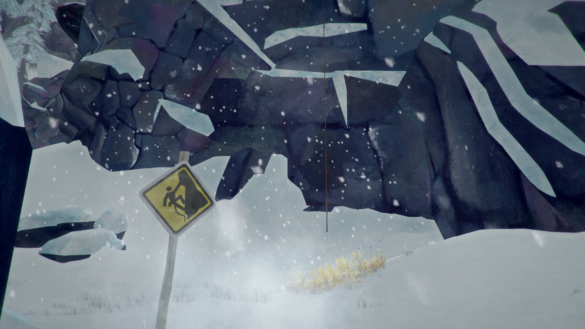
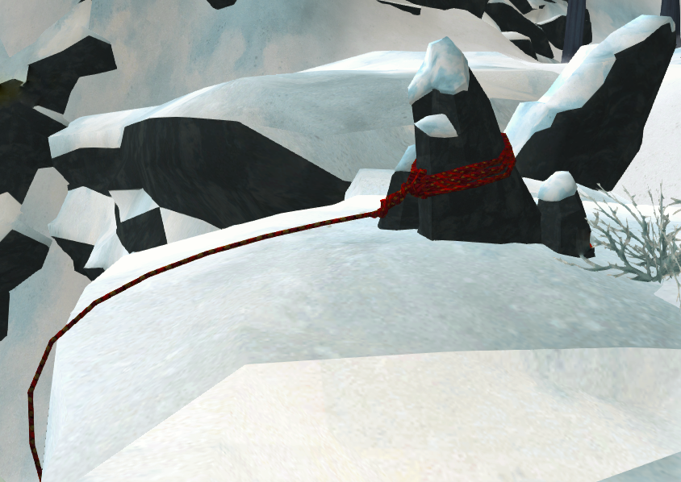

# Rope Climbing

**Categories:** Gameplay, Interactable Objects · **Source:** [Fandom](https://thelongdark.fandom.com/wiki/Rope_Climbing)

**Contents**

- [Overview](#overview)
- [Climbing](#climbing)
- [Action](#action)
- [Ledges](#ledges)
- [Slipping/Falls](#slipping-falls)
- [Descending](#descending)
- [Deploying ropes](#deploying-ropes)
- [Tips](#tips)
- [Game history](#game-history)
- [References](#references)

**Rope Climbing** is a gameplay feature in _[The Long Dark](./The%20Long%20Dark.md)_. _Rope over cliff. old version_

## Overview

Rope climbing allows players to navigate up or down steep cliffs by utilizing a rope anchored on a specific rock at the top of a traverse. While most [Mountaineering Rope](./Mountaineering%20Rope.md) will spawn pre-attached to a climbing spot, there are certain climbing spots that will never have ropes set up. A non-deployed Mountaineering Rope can often be found somewhere nearby, which can be attached to the climbing rock, and then used as normal. Deployed Mountaineering Ropes can be removed and then deployed at other climbing points.

## Climbing

_A climbing spot and sign in lower Milton Park near Milton._ Climbing is the most strenuous activity in-game, draining [Fatigue](./Fatigue.md) and [Stamina](./Stamina.md) rapidly. When stamina reaches zero, the climbing rate slows significantly and there is a chance to slip and fall from the rope.

How fast one climbs is significantly impacted by current Fatigue level, carried weight, and Stamina. The cost of climbing a rope increases exponentially as Fatigue drops, since climbing speed is directly tied to Fatigue level and stamina. Having the Fatigue need satiated, full Stamina, and low weight will make for an easy, quick climb; the player will burn less calories and lose less Fatigue. Low fatigue, reduced stamina, and high weight will slow the rate of climbing. Since the rate of calorie and Fatigue burn is the same anytime a rope is climbed, the player will burn more Calories and Fatigue. It is very possible, especially on longer climbs, to run out of Stamina or Fatigue mid-climb if starting with a partially-empty Fatigue or Stamina meter.

Once Stamina and/or Fatigue reach zero, the player will become so slow that it may be impossible to complete a climb. In addition, reaching zero for both of these meters will result in a high chance of slipping, and the potential to fall. If climbing up, slipping will set the player back several meters, so it is wise to descend to an earlier ledge or the ground immediately when Fatigue or Stamina reaches zero unless you are within the final few meters of the climb.

Climbing is not possible if the player is encumbered, or has any [Sprained Wrists](./Sprained%20Wrist.md), [Sprained Ankles](./Sprained%20Ankle.md), or [Broken Ribs](./Broken%20Ribs.md). This means it is possible to become stranded at locations which require climbing to access (such as the bottom of [Hushed River Valley](./Hushed%20River%20Valley.md) or the summit of [Timberwolf Mountain](./Timberwolf%20Mountain.md)). Bandages can be life-saving to treat sprains in these circumstances, but Broken Ribs require [Painkillers](./Painkillers.md) or [Rose Hip Tea](./Rose%20Hip%20Tea.md) along with several days of rest.

If all options are exhausted, an [Emergency Stim](./Emergency%20Stim.md) can be used to ignore these injuries for a very short period, and provide the opportunity to climb to safety. However, not only are stims incredibly rare, they will also completely exhaust the player once their duration expires. Stims will _not allow climbing while encumbered_, and any extra weight should be dumped before using a stim.

### Action

Select the deployed rope to begin climbing, then move forward to climb up, or backwards to climb down. Looking around while climbing is possible by stopping mid-climb, but Stamina, Fatigue, and Calories will continue to drain rapidly. It is possible to reverse climbing direction mid-climb, or stop and rest on a Ledge.

## Ledges

Some cliffs feature ledges midway along their rope course, and are suggested when the white selection dot appears. To enter a ledge, stop climbing and look at the ledge until it highlights, then select it. Resting at a ledge is recommended when climbing up a rope, as stamina can be recovered to increase climbing speed and thus reduce fatigue drain.

- There is always room for a fire and a sleeping bag. There will often be a few pieces of firewood also.
- Almost all ledges are very cold and exposed, especially if strong winds or blizzards are present.
- It is not possible to exit or enter a rope mid-climb except at designated ledges.

## Slipping/Falls

When the character runs out of Stamina mid-climb, there is an increasing chance they will slip on the rope. The longer one continues to climb with no Stamina, the greater the chance of slipping.

- After slipping, they will slide down the rope until randomly catching themselves. How far one slips may depend on how much fatigue one has.
- When one starts slipping, it is not advisable to try to resume the climb. Descend quickly or enter a ledge and rest before trying again.
- If one slips as far as the ground, it is equivalent to falling from the original height and bruising injuries, sprain [afflictions](./Afflictions.md), and [condition](./Condition.md) loss will be received accordingly, along with severely tearing clothes.
  - In some cases, Death is even possible.

## Descending

Descending takes far less stamina and is less impacted by fatigue. However, slipping and falling is still possible. Select the rope between where it is tied off but before it turns over the cliff. Move backward to go down. It's possible to stop mid-climb and look around, if desired. If there is no rope available, or the player is encumbered, it is sometimes possible to "mountain goat" down a cliff. The trick here is to select a location with the fewest number of overhangs possible, and crouch-walk. As long as the slope of the cliff is anything less than vertical, the player will not fall. This technique must be used carefully, however; sprains and minor condition loss are likely, and one miscalculation could result in a lethal fall.

## Deploying ropes

_Rope tied off. old version_ Mountaineering ropes can only be attached to or detached from a specific rock formation at the top of a sheer cliff (see image for example of formation; looks like a sharp tooth about 3 meters high). To deploy a rope from inventory, simply select the middle of the rock when close. To detach and take a rope, select the rope where it wraps around the rock. Rope will automatically be placed in inventory. Attaching/detaching a rope takes about 10 minutes.

## Tips

Note: Stamina for climbing is not affected by the Sprint Penalty statistic of worn clothing, but is derived from the same Stamina meter used for sprinting. It is not wise to Sprint prior to a climb without allowing Stamina to recover.

- It is recommended to always stop and recover stamina on a ledge if it is safe to do so (described below); often a requirement for long climbs.
- [Cup of Coffee](./Cup%20of%20Coffee.md) and [Cup of Acorn Coffee](./Cup%20of%20Acorn%20Coffee.md) does NOT affect the fatigue drain rate of rope climbing, but can help with rest recovery before the climb. However, wearing [Crampons](./Crampons.md) and [Improvised Crampons](./Improvised%20Crampons.md) reduces Stamina drain when climbing, thus speeding up the process and preserving Fatigue (for long ropes only. If Stamina is more than 25% there is no difference)
- Drinking a [Go! Energy Drink](./Go!%20Energy%20Drink.md) before starting will immediately restore 60% of the player's fatigue and completely fill their stamina. However, the [Headache](./Headache.md) and 50% loss of fatigue after the drink wears off can harm the player.
- Using an [Emergency Stim](./Emergency%20Stim.md) for temporary infinite Stamina allows one to climb with ease, but the emptied fatigue meter afterwards can be crippling.
- Sleeping with a [Bedroll](./Bedroll.md), [Improvised Down Bedroll](./Improvised%20Down%20Bedroll.md), or [Bear Skin Bedroll](./Bear%20Skin%20Bedroll.md) prior to a climb, or on a Ledge mid-climb, can be useful to restore Fatigue. Be aware that sleeping outdoors on Ledges can result in death via freezing to death if a blizzard rolls through, so sleep before attempting a climb.
- In many areas, it is usually possible to avoid climbing down ropes by carefully dropping down nearby slopes and small ledges, a technique often referred to as "[Mountain Goating](./Mountain%20Goating.md)", or "scrambling". The trade-off is that this method usually carries a high risk of sprains and falls.
  - Note that one major exception exists: dropping into the [Ravine Basin](./Ravine%20Basin.md) will result in automatic death due to a kill-box. This is left over from earlier versions of the game, since the basin could only be accessed via rope climb prior to the addition of [Bleak Inlet](./Bleak%20Inlet.md). Scrambling down would strand the player had they not deployed a rope prior.
- In a few rare cases, it may even be possible to avoid a rope climb by navigating up sloped terrain (for example, one can reach the [Lake Overlook](./Lake%20Overlook.md) by marching up the hill in front of the [Camp Office](./Camp%20Office.md)). Even more so than dropping down, climbing steep terrain comes with a high risk of sprains.
- For players with [Tales from the Far Territory](./Tales%20from%20the%20Far%20Territory.md) installed, eating [Rose Hip Pie](./Rose%20Hip%20Pie.md) or [Peach Pie](./Peach%20Pie.md) before climbing or at a ledge can be helpful to restore Fatigue (15% worth). It may also be useful to eat a [Ptarmigan Pie](./Ptarmigan%20Pie.md), [Rabbit Pie](./Rabbit%20Pie.md), or [Venison Pie](./Venison%20Pie.md), as those will increase carrying capacity by 3 kg.

## Game history

Rope Climbing was introduced on 16 December 2015 in [version 0.298](./The%20Long%20Dark%20%E2%80%94%20Early%20Access%20Changelog.md#0-298-timberwolf-mountain-update) also known as the Timberwolf Mountain update.

## References
