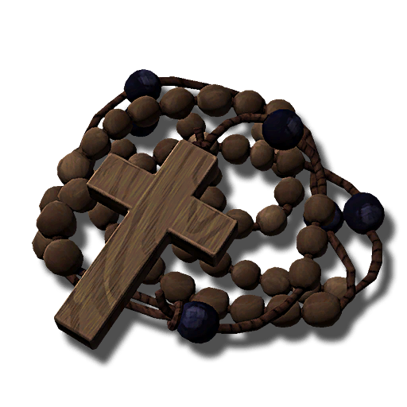

# Rosary

**Rosary**

| Property | Details |
| --- | --- |
|  |  / *Rosary\_icon.png* |
| Wintermute | [Episode 3](./Episode%203%20-%20Crossroads%20Elegy.md) - [Fallen Star](./Fallen%20Star.md) |
| **Properties** |  |
| Item type | [Collectibles](./Collectibles.md)\|- |
| Stackable | No |
| Examine | A string of prayer beads from Father Thomas |
| **Values** |  |
| Weight | 0.00 kg (0 lbs) |
| **Actions** |  |
| Backpack | Examine |
| On ground | Take It, Read Text, Leave It |

> “**At least until I can minster to those souls myself, having you carry this rosary while you investigate the crash site...it would bring an old priest some comfort. It will be the closest thing to my being able to pray for them.**”
>
> — [Father Thomas](./Father%20Thomas.md) to [Astrid Greenwood](./Astrid%20Greenwood.md)

**Rosary** is a [Collectible](./Collectibles.md) item found in [Episode 3](./Episode%203%20-%20Crossroads%20Elegy.md) of the [Wintermute](./Wintermute.md) story mode. It is a wooden cross attached to prayer beads given to [Astrid Greenwood](./Astrid%20Greenwood.md) by [Father Thomas](./Father%20Thomas.md) during the mission [Fallen Star](./Fallen%20Star.md) before she visits the crash site to find [Insulin](./Insulin.md) for Dimitri and to find ID cards for the [Crash Survivors](./Crash%20Survivor.md). Astrid later tries to return the cross after rescuing the survivors, but Father Thomas insists she keep it for her travels.

## Update history

- UPDATE **22 October 2019 ([Update](./The%20Long%20Dark%20%E2%80%94%20Changelog.md#1.60)):**
  - Added to game.

**Lua execution error in Module:Navbox function navbox**
