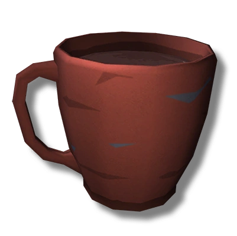

# Rose Hip Tea

**Contents**

- [Overview](#Overview)
- [Recipe](#Recipe)
- [Tips](#Tips)
- [Gallery](#Gallery)
- [History](#History)

<table class="infobox">
<caption>Rose Hip Tea</caption>
<colgroup>
<col style="width: 50%" />
<col style="width: 50%" />
</colgroup>
<tbody>
<tr>
<td colspan="2"><figure>

<figcaption>Rose_Hip_Tea_icon.png</figcaption>
</figure></td>
</tr>
<tr>
<td>
Renewable
</td>
<td>
No
</td>
</tr>
<tr>
<td colspan="2" class="section">
<strong>Properties</strong>
</td>
</tr>
<tr>
<td>
Item type
</td>
<td>
<a href="./First%20Aid.md" class="wikilink" title="First Aid">First Aid</a>|-
</td>
</tr>
<tr>
<td colspan="2" class="section">
<strong>Values</strong>
</td>
</tr>
<tr>
<td>
Calories
</td>
<td>
100 kcal
</td>
</tr>
<tr>
<td>
Hydration
</td>
<td>
30%
</td>
</tr>
<tr>
<td>
<a href="./Scurvy.md" class="wikilink" title="Vitamin C">Vitamin C</a>
</td>
<td>
Minor (13%)
</td>
</tr>
<tr>
<td>
Weight
</td>
<td>
0.10 kg (0.22 lbs)
</td>
</tr>
</tbody>
</table>

**Rose Hip Tea** is a natural medical and food item used to treat <a href="./Afflictions.md" class="wikilink" title="Afflictions">Afflictions</a> in *The Long Dark*.

## Overview

Rose Hip Tea functions similar to <a href="./Painkillers.md" class="wikilink" title="Painkillers">Painkillers</a> for treating Afflictions, and is cooked from one <a href="./Prepared%20Rose%20Hips.md" class="wikilink" title="Prepared Rose Hips">Prepared Rose Hips</a> (24 <a href="./Rose%20Hip.md" class="wikilink" title="Rose Hips">Rose Hips</a>) and 0.25 liters of <a href="./Water%20%28Potable%29.md" class="wikilink" title="Water (Potable)">Water (Potable)</a> at a lit <a href="./Fire.md" class="wikilink" title="Fire">Fire</a>. Consuming prepared Rose Hip Tea (even without treating an Affliction) restores 100 Calories, 30% Hydration and potentially grants the benefit "<a href="./Warming%20Up.md" class="wikilink" title="Warming Up">Warming Up</a>." Cooking Rose Hip Tea increases <a href="./Cooking.md" class="wikilink" title="Cooking Skill">Cooking Skill</a>.

Prepared Rose Hips are crafted from 24 Rose Hips and takes 15 minutes (in-game) to prepare. Rose Hips can can be found in the wilderness growing on Rose Bushes, typically in clusters of 1-4 units, a single Rose Bush yields 8 Rose Hips when Harvested. Rose Hips can be found rarely inside of containers. They cannot be directly consumed and must first be crafted into Prepared Rose Hips and then cooked into Rose Hip Tea.

Rose Hip Tea and Painkillers are used to treat the following Afflictions:

- <a href="./Pain.md" class="wikilink" title="Pain">Pain</a> (1 dose, or 4 hours if untreated)
- <a href="./Burns.md" class="wikilink" title="Burns">Burns</a> (1 dose, or 30 hours if untreated)
- <a href="./Broken%20Ribs.md" class="wikilink" title="Broken Ribs">Broken Ribs</a> (2 doses and 2 <a href="./Bandage.md" class="wikilink" title="Bandages">Bandages</a>, and 120 hours of <a href="./Sleep.md" class="wikilink" title="Sleep">Sleep</a>)

The effect of Rose Hip Tea is not generalized throughout the body, and each dose will only treat one injury, and should be applied to the injuring requiring them as treatment (e.g. "Broken Ribs" and "Burns" will display as separate Afflictions, with each requiring separate doses to treat).

As a source of Vitamin C, Rose Hip Tea can also be used to treat <a href="./Scurvy.md" class="wikilink" title="Scurvy">Scurvy</a> and <a href="./Scurvy%20Risk.md" class="wikilink" title="Scurvy Risk">Scurvy Risk</a>. This is especially useful in regions where <a href="./Ice%20Fishing.md" class="wikilink" title="Ice Fishing">Ice Fishing</a> isn't possible or practical, as Rose Hips are relatively common throughout the world. However, this is generally not a long-term strategy as the tea only contains 13% Vitamin C, and will only stave off the affliction for a day or two.

Prepared Rose Hips have half the weight of their raw form, and no form of Rose Hips <a href="./Decay.md" class="wikilink" title="Decay">Decay</a>.

## Recipe

<table class="infobox">
<caption>Rose Hip Tea</caption>
<tbody>
<tr>
<td colspan="2">
<strong>Template:pic link plain</strong><a href="./Cooking.md" class="wikilink" title="Cooking">Cooking</a>
</td>
</tr>
<tr>
<td colspan="2">
-
</td>
</tr>
<tr>
<td colspan="2">
12.5 minutes
</td>
</tr>
<tr>
<td colspan="2" class="section">
<strong>Requirements</strong>
</td>
</tr>
<tr>
<td>
Facility
</td>
<td>
<strong>Template:iconlink</strong>
</td>
</tr>
<tr>
<td colspan="2" class="section">
<strong>Materials</strong>
</td>
</tr>
<tr>
<td colspan="2" class="section">
<strong>Template:iconlink plain</strong>
</td>
</tr>
<tr>
<td>
Item
</td>
<td>
<a href="./Prepared%20Rose%20Hips.md" class="wikilink" title="Prepared Rose Hips">Prepared Rose Hips</a>
</td>
</tr>
<tr>
<td>
Quantity
</td>
<td>
1
</td>
</tr>
<tr>
<td colspan="2" class="section">
<strong>Template:iconlink plain</strong>
</td>
</tr>
<tr>
<td colspan="2">
<a href="./Water%20%28Potable%29.md" class="wikilink" title="Water (Potable)">Water (Potable)</a>
</td>
</tr>
<tr>
<td colspan="2">
0.25 L
</td>
</tr>
</tbody>
</table>

## Tips

- Teas may be heated/reheated to grant the Warming Up Benefit by placing them on a fire's cooking spot, or nearby a lit fire.
- Teas are more weight efficient than Water for the Hydration they grant. (0.1kg of a tea grants 30% Hydration, equivalent to 0.25kg of water).
- Teas never decay once cooked.
- The condition of Painkillers decays slowly over time (based on <a href="./Survival%20Mode.md" class="wikilink" title="Survival Mode">Survival Mode</a>). Upon reaching 0% Condition, they become unusable and will disappear if inside of a container, but all forms of Rose Hips do not decay.

## Gallery

<table class="gallery">
<colgroup>
<col style="width: 50%" />
<col style="width: 50%" />
</colgroup>
<tbody>
<tr>
<td><figure>
[Missing image: Rose_hip_tea.png]
<figcaption>Old model.</figcaption>
</figure></td>
<td><figure>

<figcaption>Old icon</figcaption>
</figure></td>
</tr>
</tbody>
</table>

## History

- Rose Hips and other harvestable plants and remedies were introduced on 7 February 2015 in <a href="./The%20Long%20Dark%20%E2%80%94%20Changelog.md#0.192" class="wikilink" title="update 0.192">update 0.192</a>.
- As of the 1.0 <a href="./Wintermute.md" class="wikilink" title="Wintermute">Wintermute</a> update (August 1, 2017) Rose Hips must be prepared before cooking them.

**Lua execution error in Module:Navbox function navbox** **Lua execution error in Module:Navbox function navbox** <a href="ru:%D0%A7%D0%B0%D0%B9_%D0%B8%D0%B7_%D0%A8%D0%B8%D0%BF%D0%BE%D0%B2%D0%BD%D0%B8%D0%BA%D0%B0" class="wikilink" title="ru:Чай из Шиповника">ru:Чай из Шиповника</a>

