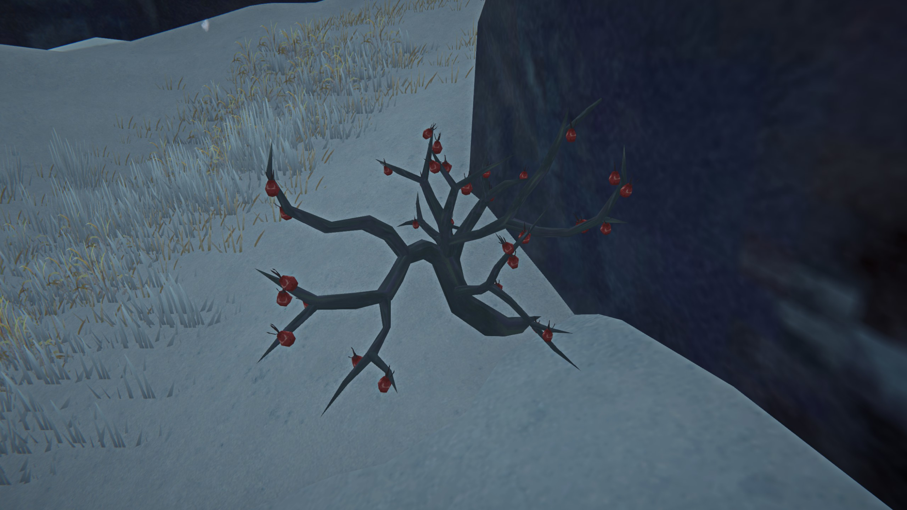
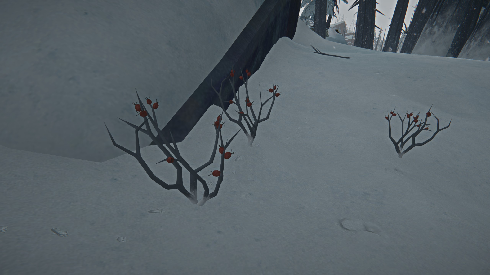
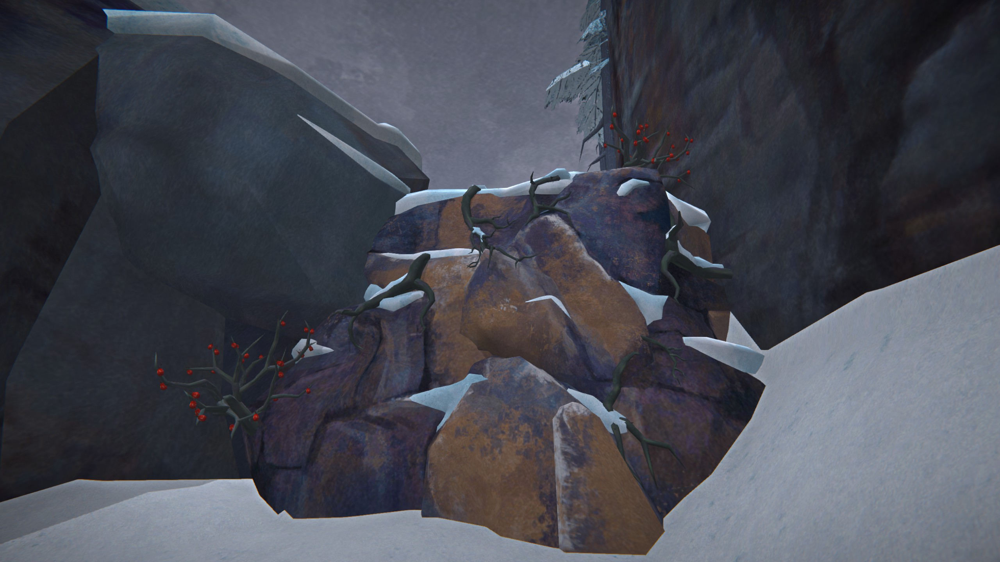
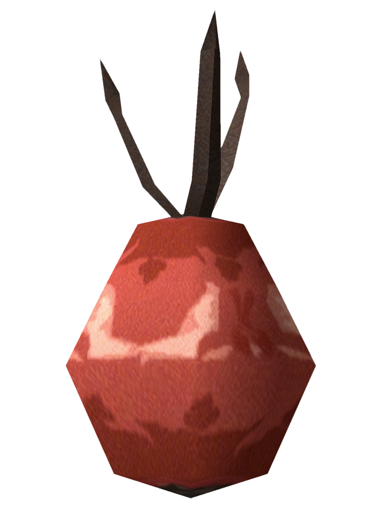
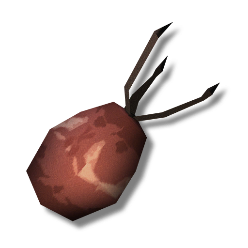

# Rose Hip

**Categories:** Food And Drink, Materials, Plants, Story items · **Source:** [Fandom](https://thelongdark.fandom.com/wiki/Rose_Hip)

**Contents**

- [Overview](#overview)
- [Tips](#tips)
- [Products](#products)
- [History](#history)
- [Trivia](#trivia)
- [Gallery](#gallery)

**Rose Hip**

| Property | Details |
| --- | --- |
| | [Rose Hip icon](../assets/Rose_Hip_icon.png) |
| **General** | |
| Item Type | Material |
| Wintermute | Yes |
| Renewable | No |
| **Statistics** | |
| Weight | [Weight icon](../assets/Weight_icon.png)0.01 kg(0.02 lbs) |

> “**A fruit of a wild rose bush.**”
>
> — In-game description

**Rose Hips** are a natural medical and food item used to treat [Afflictions](./Afflictions.md) in _The Long Dark_.

## Overview

Rose Hips can can be found in the wilderness growing on 2 types of Rose Bushes. Grey ones typically grow in clusters of 1-4 units, while green ones grow on or near [Rock Climbs](./Rock%20Climb.md). A single Rose Bush yields 8 Rose Hips when Harvested. Rose Hips can be found rarely inside of containers. They cannot be directly consumed and must be used in the cooking recipes such as [Camber Flight Porridge](./Camber%20Flight%20Porridge.md) and [Rose Hip Pie](./Rose%20Hip%20Pie.md), or crafted into [Prepared Rose Hips](./Prepared%20Rose%20Hips.md) and then cooked into [Rose Hip Tea](./Rose%20Hip%20Tea.md).

Prepared Rose Hips weigh 0.05 kg, or around 1/5 of what 24 Rose Hips (their crafting materials) weigh, and no form of Rose Hips [Decay](./Decay.md).

## Tips

- Harvesting 3 Rose Bushes (at 8 Rose Hips each) is required to craft 1 unit of Prepared Rose Hips/Rose Hip Tea.
- Rose Hips are found sporadically in all regions growing on Rose Bushes, particular in mountainous areas near ledges or cliffs. They frequently are near entrances to [Caves](./Cave%20%28disambiguation%29.md), Rose Climbs, deployment points for [Mountaineering Ropes](./Mountaineering%20Rope.md), and secret locations.
- Teas may be heated/reheated to grant the Warming Up Benefit by placing them on a fire's cooking spot, or nearby a lit fire.
- Broken Ribs are permanent if left untreated, though Pain and Burns will dissipate naturally with time (4-30 hours).
- Pain has minimal effect on gameplay (aside from blurry vision) with it's only limitation being an inability to read [Research Books](./Research%20Book.md) while afflicted, and subsides automatically with time. This generally makes treating Pain a wasteful decision, to carry Painkillers consume them instead of reserving their use to treat Broken Ribs or Burns.
- Painkillers cannot be crafted and Rose Hips do not regrow; however Painkillers are renewable via [Beachcombing](./Beachcombing.md).
- Crafting Rose Hips into Prepared Rose Hips will make them easier to transport.
- Teas are more weight efficient than Water for the Hydration they grant. (0.1kg of a tea grants 30% Hydration, equivalent to 0.25kg of water).
- Teas never [Decay](./Decay.md) once cooked.
- The condition of Painkillers decays slowly over time (based on [Survival Mode](./Survival%20Mode.md)). Upon reaching 0% Condition, they become unusable and will disappear if inside of a container, but all forms of Rose Hips do not decay.

## Products

| Item | Skills | Materials |
| --- | --- | --- |
| [Camber Flight Porridge](./Camber%20Flight%20Porridge.md) | None | - 0.05 kg × [Maple Syrup](./Maple%20Syrup.md); - 4 × [Rose Hip](./Rose%20Hip.md); - 0.50 kg × [Pinnacle Peaches](./Pinnacle%20Peaches.md); - 0.20 L × [Water (Potable)](./Water%20%28Potable%29.md); - 0.10 kg × [Running River Oats](./Running%20River%20Oats.md) |
| [Pemmican Bar](./Pemmican%20Bar.md) | None | - 0.50 kg × [Cured Meat](./Cured%20Meat.md); - 15 × [Rose Hip](./Rose%20Hip.md); - 0.50 kg × [Animal Fat](./Animal%20Fat.md); - 0.05 kg × [Salt](./Salt.md) |
| [Pemmican Bar](./Pemmican%20Bar.md) | None | - 0.50 kg × [Cured Meat](./Cured%20Meat.md); - 15 × [Rose Hip](./Rose%20Hip.md); - 0.50 kg × [Animal Fat](./Animal%20Fat.md); - 0.05 kg × [Salt](./Salt.md) |
| [Prepared Rose Hips](./Prepared%20Rose%20Hips.md) | None | - 24 × [Rose Hip](./Rose%20Hip.md) |
| [Rose Hip Pie](./Rose%20Hip%20Pie.md) | None | - 8 × [Rose Hip](./Rose%20Hip.md); - 0.10 L × [Water (Potable)](./Water%20%28Potable%29.md); - 0.05 L × [Cooking Oil](./Cooking%20Oil.md); - 0.20 kg × [Old Mill Flour](./Old%20Mill%20Flour.md) |

## History

- Rose Hips and other harvestable plants and remedies were introduced on 7 February 2015 in [update 0.192](./The%20Long%20Dark%20%E2%80%94%20Early%20Access%20Changelog.md#0-192).
- As of the 1.0 [Wintermute](./Wintermute.md) update (August 1, 2017) Rose Hips must be prepared before cooking them.

## Trivia

- Rose Hips (also known as Rosehip, Rosehep or Rosehaw) are a [real world plant](https://en.wikipedia.org/wiki/Rose_hip) and accessory fruit to Rose Bushes, similar to their in-game representation including their use as a painkiller.
- Real-World Rose Hips have a history as a [poverty food](https://en.wikipedia.org/wiki/Famine_food), particularly with Native American peoples during survival situations or times of hardship, as well as for ornamental purposes.
- In The Long Dark, Painkillers and Tea must be applied directly to treat a specific injury (similar to a Bandage), unlike real-world orally-taken drugs which become generally distributed through the body.

## Gallery

