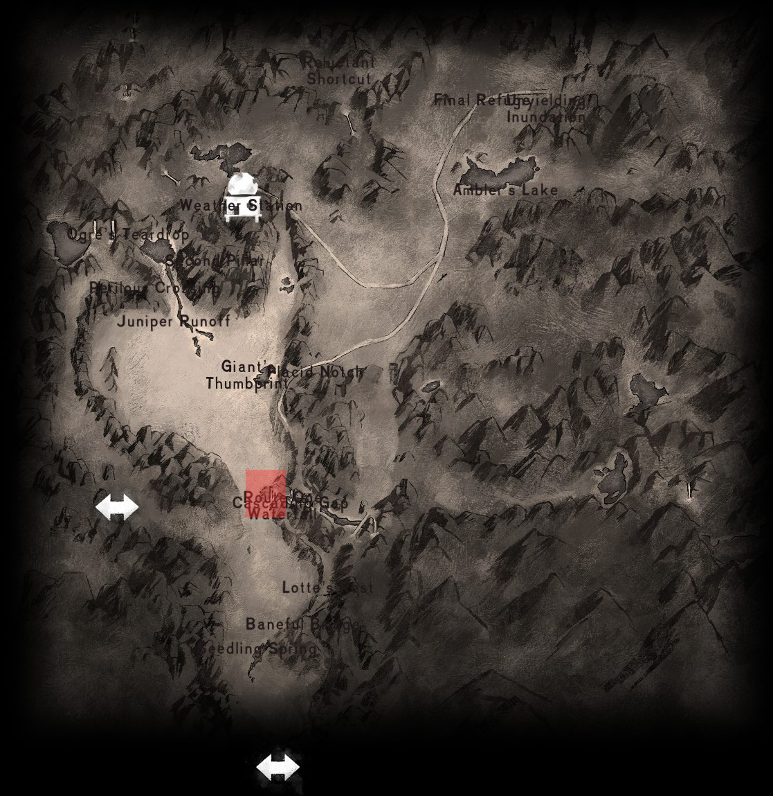

# Route One Waterfall

**Route One Waterfall**

| Property | Details |
| --- | --- |
|  |  / *Route\_One\_Waterfall.jpg* |
| **Location** |  |
|  |  / *Route\_One\_Waterfall\_Location.png* |
| Region | [Sundered Pass](./Sundered%20Pass.md)\|- |
| **General** |  |
|  | Has no shelter\|} **Route One Waterfall** is a location in [Sundered Pass](./Sundered%20Pass.md). / ## Overview / It is a frozen waterfall found in the valley below the [Cascading Gap](./Cascading%20Gap.md) bridge. The waterfall itself makes for a great landmark when exploring the valley, as the bright blue frozen ice can be seen from far away. There is no notable loot nearby, but [Last Lonely House](./Last%20Lonely%20House.md) is a short walk to the south west. [Deer](./Deer.md) may roam the area. Due north is a cave entrance to the four entrance Cave system between this one, [Prayerful Window](./Prayerful%20Window.md), [Idle Hideout](./Idle%20Hideout.md) and [Cascading Gap](./Cascading%20Gap.md). / The waterfall is a possible starting region spawn area.**Lua execution error in Module:Navbox function navbox** [ru:Водопад 1-го маршрута](ru:%D0%92%D0%BE%D0%B4%D0%BE%D0%BF%D0%B0%D0%B4_1-%D0%B3%D0%BE_%D0%BC%D0%B0%D1%80%D1%88%D1%80%D1%83%D1%82%D0%B0) |
