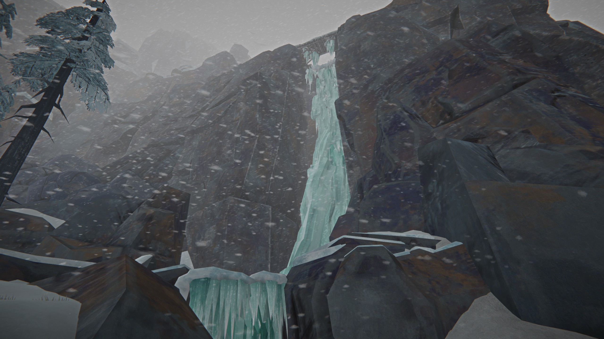

# Route One Waterfall

**Categories:** Locations, Locations in Sundered Pass, Outdoor locations · **Source:** [Fandom](https://thelongdark.fandom.com/wiki/Route_One_Waterfall)

**Route One Waterfall**

_Route\_One\_Waterfall.jpg_

**Location**

_Route\_One\_Waterfall\_Location.png_

**Region:** [Sundered Pass](./Sundered%20Pass.md)

**General**

Has no shelter **Route One Waterfall** is a location in [Sundered Pass](./Sundered%20Pass.md).

## Overview

It is a frozen waterfall found in the valley below the [Cascading Gap](./Cascading%20Gap.md) bridge. The waterfall itself makes for a great landmark when exploring the valley, as the bright blue frozen ice can be seen from far away. There is no notable loot nearby, but [Last Lonely House](./Last%20Lonely%20House.md) is a short walk to the south west. [Deer](./Deer.md) may roam the area. Due north is a cave entrance to the four entrance Cave system between this one, [Prayerful Window](./Prayerful%20Window.md), [Idle Hideout](./Idle%20Hideout.md) and [Cascading Gap](./Cascading%20Gap.md).
