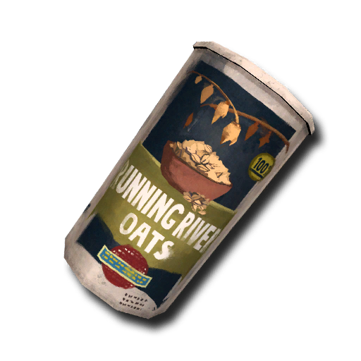

# Running River Oats

**Categories:** DLC Content, Food And Drink, Pages with update history · **Source:** [Fandom](https://thelongdark.fandom.com/wiki/Running_River_Oats)

**Contents**

- [Overview](#overview)
- [Tips](#tips)
- [Products](#products)
- [Trivia](#trivia)
- [Update history](#update-history)

**Running River Oats**

_Running\_River\_Oats\_icon.png_

**Release:** [19 June 2023](./The%20Long%20Dark%20%E2%80%94%20Changelog.md#2.17)

**Wintermute:** No

**Renewable:** Yes ([Trader](./Trader.md) only)

**Properties**

**Item type:** [Food And Drink](./Food%20And%20Drink.md)

**Values**

**Weight:** 0.80 kg (1.76 lbs)

**Decay Rate**

**Inside:** 0.200% per day

**Outside:** 0.200% per day

**Advanced data**

**Item key:** GAMEPLAY\_OatsTin

_Ptarmigan\_icon.png_

**DLC-Exclusive content.** / This content requires the [Tales from the Far Territory](./Tales%20from%20the%20Far%20Territory.md) addon to be installed before it can be seen or used in regular gameplay.

Item

Skills

Materials

&lt;a href="Camber Flight Porridge"&gt;Camber Flight Porridge&lt;/a&gt;

None

- 0.05 kg × &lt;a href="Maple Syrup"&gt;Maple Syrup&lt;/a&gt; / - 4 × &lt;a href="Rose Hip"&gt;Rose Hip&lt;/a&gt; / - 0.50 kg × &lt;a href="Pinnacle Peaches"&gt;Pinnacle Peaches&lt;/a&gt; / - 0.20 L × &lt;a href="Water (Potable)"&gt;Water (Potable)&lt;/a&gt; / - 0.10 kg × &lt;a href="Running River Oats"&gt;Running River Oats&lt;/a&gt;

&lt;a href="Porridge"&gt;Porridge&lt;/a&gt;

None

- 0.25 L × &lt;a href="Water (Potable)"&gt;Water (Potable)&lt;/a&gt; / - 0.10 kg × &lt;a href="Running River Oats"&gt;Running River Oats&lt;/a&gt;
